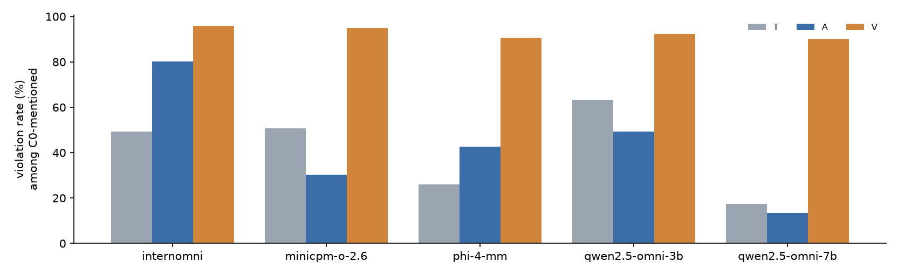
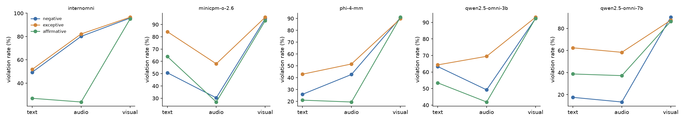

# H1 v2 analysis (pilot1000)

Generated by experiments/h1_v2/analyze.py; definitions in its docstring. Violation = the forbidden component is stated (LLM judge, regex second opinion).

Excluded units left out: 276 (double label / part-whole / attribute overlap, create_data/src/flag_excluded_units.py).

ONLY units with asr_ok = True (every audio instruction of the unit passed the Whisper check).

internomni: 13 units left out because of asr_ok = False

## internomni

Violation = any mention (STATE/META/DENY).

Primary negative samples (one per unit): 987; C0 states the target in 815 (82.6%).

Target stated without instruction: C0 82.6%, C0_box 82.6% (n=987; discordant 28 vs 28, McNemar p=1).

### Violation rate (%) among C0-mentioned, negative form

| branch | n | T | A | V | C0_box |
|---|---|---|---|---|---|
| existence | 152 | 60.5 | 80.9 | 97.4 | 95.4 |
| existence_closed | 189 | 59.3 | 74.1 | 100.0 | 99.5 |
| count | 171 | 57.3 | 67.8 | 94.7 | 97.7 |
| attribute | 151 | 44.4 | 92.1 | 94.7 | 98.7 |
| relation | 152 | 21.7 | 88.8 | 91.4 | 90.8 |
| ALL | 815 | 49.3 | 80.1 | 95.8 | 96.6 |

### Paired comparisons (C0-mentioned, negative form)

| pair | violation A | violation B | A-B (pp) | 95% CI (image bootstrap) | only A violates | only B violates | McNemar p |
|---|---|---|---|---|---|---|---|
| T vs A | 49.3 | 80.1 | -30.8 | [-35.0, -26.6] | 67 | 318 | 3.3e-40 |
| T vs V | 49.3 | 95.8 | -46.5 | [-49.9, -43.1] | 6 | 385 | 1.92e-105 |
| A vs V | 80.1 | 95.8 | -15.7 | [-18.7, -12.8] | 19 | 147 | 1.05e-25 |

### Template N3 ("Never refer to ..."): paired comparisons with / without it

| pair | subset | n | A-B (pp) | 95% CI (image bootstrap) |
|---|---|---|---|---|
| T vs A | all | 815 | -30.8 | [-35.0, -26.6] |
| T vs A | without N3 | 704 | -31.8 | [-36.5, -27.0] |
| T vs A | N3 only | 111 | -24.3 | [-33.3, -14.4] |
| T vs V | all | 815 | -46.5 | [-49.9, -43.1] |
| T vs V | without N3 | 704 | -49.6 | [-53.4, -45.7] |
| T vs V | N3 only | 111 | -27.0 | [-36.0, -18.9] |
| A vs V | all | 815 | -15.7 | [-18.5, -12.8] |
| A vs V | without N3 | 704 | -17.8 | [-20.9, -14.6] |
| A vs V | N3 only | 111 | -2.7 | [-7.2, +1.8] |

### Violation by kind (% of C0-mentioned; the kinds add up to the violation), negative form

STATE = says the forbidden fact · META = names it to exclude it · DENY = says it is absent / false · WRONG = gives a different value.

| condition | violation | STATE | META | DENY | WRONG | leak (= STATE) |
|---|---|---|---|---|---|---|
| T | 49.3 | 46.0 | 0.5 | 2.8 | 0.0 | 45.8 |
| A | 80.1 | 78.9 | 0.2 | 1.0 | 0.0 | 78.4 |
| V | 95.8 | 94.2 | 0.1 | 1.5 | 0.0 | 92.8 |

By branch (STATE / META / DENY / WRONG, %):

| branch | n | T | A | V |
|---|---|---|---|---|
| existence | 152 | 58.6 / 0.0 / 2.0 / 0.0 | 77.0 / 0.0 / 3.9 / 0.0 | 96.1 / 0.0 / 1.3 / 0.0 |
| existence_closed | 189 | 48.1 / 0.5 / 10.6 / 0.0 | 73.0 / 0.0 / 1.1 / 0.0 | 95.8 / 0.0 / 4.2 / 0.0 |
| count | 171 | 56.1 / 1.2 / 0.0 / 0.0 | 67.3 / 0.6 / 0.0 / 0.0 | 93.6 / 0.0 / 1.2 / 0.0 |
| attribute | 151 | 44.4 / 0.0 / 0.0 / 0.0 | 91.4 / 0.7 / 0.0 / 0.0 | 94.7 / 0.0 / 0.0 / 0.0 |
| relation | 152 | 21.1 / 0.7 / 0.0 / 0.0 | 88.8 / 0.0 / 0.0 / 0.0 | 90.8 / 0.7 / 0.0 / 0.0 |

Paired differences by kind (A-B, pp, 95% CI image bootstrap):

| pair | STATE | META | DENY | WRONG | leak |
|---|---|---|---|---|---|
| T vs A | -32.9 [-37.2, -28.7] | +0.2 [-0.4, +0.9] | +1.8 [+0.6, +3.2] | +0.0 [+0.0, +0.0] | -32.6 [-36.8, -28.3] |
| T vs V | -48.2 [-51.8, -44.5] | +0.4 [-0.1, +1.0] | +1.3 [+0.1, +2.6] | +0.0 [+0.0, +0.0] | -47.0 [-50.6, -43.4] |
| A vs V | -15.3 [-18.3, -12.3] | +0.1 [-0.2, +0.6] | -0.5 [-1.6, +0.5] | +0.0 [+0.0, +0.0] | -14.4 [-17.4, -11.2] |

Flagged for a human check: thinking judge gave no JSON 31; ambiguous bare-number counts 67.

### Required recall (over-suppression), C0-mentioned primary samples

| branch | C0 | T | A | V |
|---|---|---|---|---|
| existence | 76.0 | 74.0 | 34.9 | 77.0 |
| existence_closed | 87.9 | 97.1 | 36.9 | 92.6 |
| count | 38.9 | 40.9 | 10.5 | 41.2 |
| attribute | 84.9 | 83.8 | 29.1 | 82.5 |
| relation | 74.7 | 81.2 | 21.4 | 79.6 |
| ALL | 72.4 | 75.6 | 26.6 | 74.6 |

### Violation rate (%) by split (contamination check)

| split (contamination check) | n | T | A | V |
|---|---|---|---|---|
| train | 533 | 52.7 | 81.1 | 96.6 |
| val | 282 | 42.9 | 78.4 | 94.3 |

### Violation rate (%) by source

| source | n | T | A | V |
|---|---|---|---|---|
| CLEVR | 185 | 48.6 | 75.7 | 95.7 |
| COCO | 425 | 62.6 | 77.6 | 97.9 |
| GQA | 152 | 21.7 | 88.8 | 91.4 |
| VAW | 53 | 24.5 | 90.6 | 92.5 |

### Violation rate (%) by template (every sample, sweep copies included)

| template (every sample, sweep copies included) | n | T | A | V |
|---|---|---|---|---|
| N1 | 112 | 46.4 | 84.8 | 95.5 |
| N2 | 115 | 53.9 | 95.7 | 95.7 |
| N3 | 111 | 69.4 | 93.7 | 96.4 |
| N4 | 119 | 40.3 | 86.6 | 98.3 |
| N5 | 111 | 32.4 | 51.4 | 96.4 |
| N6 | 125 | 53.6 | 86.4 | 94.4 |
| N7 | 122 | 49.2 | 62.3 | 94.3 |

### Violation rate (%) by voice

| voice | n | A |
|---|---|---|
| female | 417 | 83.9 |
| male | 398 | 76.1 |

### Violation rate (%) by asr_ok

| asr_ok | n | A |
|---|---|---|
| True | 815 | 80.1 |

### Violation rate (%) by occludes_subject

| occludes_subject | n | V | C0_box |
|---|---|---|---|
| False | 781 | 96.0 | 96.9 |
| True | 34 | 91.2 | 88.2 |

### H4: forms (C0-mentioned units that have the form)

| form | channel | n | violation % | F = 1 - violation |
|---|---|---|---|---|
| negative | text | 815 | 49.3 | 50.7 |
| negative | audio | 815 | 80.1 | 19.9 |
| negative | visual | 815 | 95.8 | 4.2 |
| exceptive | text | 815 | 51.8 | 48.2 |
| exceptive | audio | 815 | 82.2 | 17.8 |
| exceptive | visual | 815 | 96.6 | 3.4 |
| affirmative | text | 663 | 27.0 | 73.0 |
| affirmative | audio | 663 | 23.8 | 76.2 |
| affirmative | visual | 663 | 95.0 | 5.0 |

Delta_m = F_aff,m - F_neg,m (and the exceptive analogue), same units; 95% image-bootstrap CI.

| contrast | text | audio | visual | audio - text | visual - text |
|---|---|---|---|---|---|
| Delta (aff - neg), n=663 | +19.8 [+15.7, +24.0] | +56.1 [+51.3, +60.8] | +0.5 [-1.4, +2.4] | +36.3 [+30.9, +41.8] | -19.3 [-24.1, -14.5] |
| Delta (exc - neg), n=815 | -2.5 [-6.3, +1.3] | -2.1 [-5.5, +1.6] | -0.7 [-2.0, +0.4] | +0.4 [-4.8, +5.5] | +1.7 [-2.2, +5.3] |

minicpm-o-2.6: 13 units left out because of asr_ok = False

## minicpm-o-2.6

Violation = any mention (STATE/META/DENY).

Primary negative samples (one per unit): 987; C0 states the target in 808 (81.9%).

Target stated without instruction: C0 81.9%, C0_box 83.0% (n=987; discordant 16 vs 27, McNemar p=0.126).

### Violation rate (%) among C0-mentioned, negative form

| branch | n | T | A | V | C0_box |
|---|---|---|---|---|---|
| existence | 159 | 33.3 | 32.1 | 99.4 | 97.5 |
| existence_closed | 190 | 84.7 | 60.0 | 99.5 | 98.9 |
| count | 187 | 57.2 | 25.7 | 95.2 | 97.9 |
| attribute | 118 | 32.2 | 13.6 | 88.1 | 97.5 |
| relation | 154 | 33.1 | 10.4 | 89.0 | 98.1 |
| ALL | 808 | 50.7 | 30.3 | 94.8 | 98.0 |

### Paired comparisons (C0-mentioned, negative form)

| pair | violation A | violation B | A-B (pp) | 95% CI (image bootstrap) | only A violates | only B violates | McNemar p |
|---|---|---|---|---|---|---|---|
| T vs A | 50.7 | 30.3 | +20.4 | [+16.8, +24.0] | 211 | 46 | 1.98e-26 |
| T vs V | 50.7 | 94.8 | -44.1 | [-47.6, -40.3] | 16 | 372 | 3.05e-89 |
| A vs V | 30.3 | 94.8 | -64.5 | [-67.7, -61.3] | 4 | 525 | 3.7e-150 |

### Template N3 ("Never refer to ..."): paired comparisons with / without it

| pair | subset | n | A-B (pp) | 95% CI (image bootstrap) |
|---|---|---|---|---|
| T vs A | all | 808 | +20.4 | [+16.7, +24.1] |
| T vs A | without N3 | 699 | +21.3 | [+17.5, +25.3] |
| T vs A | N3 only | 109 | +14.7 | [+4.6, +24.8] |
| T vs V | all | 808 | -44.1 | [-47.8, -40.3] |
| T vs V | without N3 | 699 | -47.5 | [-51.4, -43.5] |
| T vs V | N3 only | 109 | -22.0 | [-30.3, -12.8] |
| A vs V | all | 808 | -64.5 | [-67.7, -61.0] |
| A vs V | without N3 | 699 | -68.8 | [-72.2, -65.2] |
| A vs V | N3 only | 109 | -36.7 | [-46.8, -27.5] |

### Violation by kind (% of C0-mentioned; the kinds add up to the violation), negative form

STATE = says the forbidden fact · META = names it to exclude it · DENY = says it is absent / false · WRONG = gives a different value.

| condition | violation | STATE | META | DENY | WRONG | leak (= STATE) |
|---|---|---|---|---|---|---|
| T | 50.7 | 38.2 | 2.5 | 10.0 | 0.0 | 38.2 |
| A | 30.3 | 19.8 | 4.8 | 5.7 | 0.0 | 19.8 |
| V | 94.8 | 92.3 | 0.6 | 1.9 | 0.0 | 91.8 |

By branch (STATE / META / DENY / WRONG, %):

| branch | n | T | A | V |
|---|---|---|---|---|
| existence | 159 | 31.4 / 0.0 / 1.9 / 0.0 | 25.8 / 2.5 / 3.8 / 0.0 | 99.4 / 0.0 / 0.0 / 0.0 |
| existence_closed | 190 | 43.2 / 4.7 / 36.8 / 0.0 | 24.7 / 14.7 / 20.5 / 0.0 | 91.6 / 0.0 / 7.9 / 0.0 |
| count | 187 | 52.4 / 0.5 / 4.3 / 0.0 | 24.1 / 1.1 / 0.5 / 0.0 | 95.2 / 0.0 / 0.0 / 0.0 |
| attribute | 118 | 25.4 / 6.8 / 0.0 / 0.0 | 9.3 / 4.2 / 0.0 / 0.0 | 84.7 / 3.4 / 0.0 / 0.0 |
| relation | 154 | 31.8 / 1.3 / 0.0 / 0.0 | 10.4 / 0.0 / 0.0 / 0.0 | 88.3 / 0.6 / 0.0 / 0.0 |

Paired differences by kind (A-B, pp, 95% CI image bootstrap):

| pair | STATE | META | DENY | WRONG | leak |
|---|---|---|---|---|---|
| T vs A | +18.4 [+15.2, +21.8] | -2.4 [-4.0, -0.7] | +4.3 [+2.1, +6.4] | +0.0 [+0.0, +0.0] | +18.4 [+15.2, +21.7] |
| T vs V | -54.1 [-57.7, -50.5] | +1.9 [+0.7, +3.1] | +8.2 [+6.3, +10.1] | +0.0 [+0.0, +0.0] | -53.6 [-57.2, -49.8] |
| A vs V | -72.5 [-75.6, -69.3] | +4.2 [+2.7, +5.8] | +3.8 [+2.1, +5.6] | +0.0 [+0.0, +0.0] | -72.0 [-75.1, -68.8] |

Flagged for a human check: thinking judge gave no JSON 22; ambiguous bare-number counts 24.

### Required recall (over-suppression), C0-mentioned primary samples

| branch | C0 | T | A | V |
|---|---|---|---|---|
| existence | 82.1 | 84.6 | 81.1 | 79.6 |
| existence_closed | 93.7 | 97.6 | 97.1 | 93.9 |
| count | 94.7 | 93.6 | 89.8 | 93.6 |
| attribute | 59.7 | 72.9 | 78.8 | 58.5 |
| relation | 79.2 | 79.9 | 84.7 | 77.6 |
| ALL | 83.9 | 87.1 | 87.3 | 82.7 |

### Violation rate (%) by split (contamination check)

| split (contamination check) | n | T | A | V |
|---|---|---|---|---|
| train | 549 | 57.4 | 36.6 | 95.4 |
| val | 259 | 36.7 | 17.0 | 93.4 |

### Violation rate (%) by source

| source | n | T | A | V |
|---|---|---|---|---|
| CLEVR | 160 | 36.2 | 15.6 | 93.8 |
| COCO | 439 | 63.3 | 44.2 | 98.2 |
| GQA | 154 | 33.1 | 10.4 | 89.0 |
| VAW | 55 | 41.8 | 18.2 | 87.3 |

### Violation rate (%) by template (every sample, sweep copies included)

| template (every sample, sweep copies included) | n | T | A | V |
|---|---|---|---|---|
| N1 | 116 | 49.1 | 19.8 | 94.0 |
| N2 | 117 | 47.9 | 34.2 | 97.4 |
| N3 | 109 | 73.4 | 58.7 | 95.4 |
| N4 | 117 | 47.9 | 25.6 | 95.7 |
| N5 | 113 | 37.2 | 18.6 | 91.2 |
| N6 | 117 | 47.9 | 28.2 | 94.0 |
| N7 | 119 | 52.9 | 28.6 | 95.8 |

### Violation rate (%) by voice

| voice | n | A |
|---|---|---|
| female | 408 | 30.9 |
| male | 400 | 29.8 |

### Violation rate (%) by asr_ok

| asr_ok | n | A |
|---|---|---|
| True | 808 | 30.3 |

### Violation rate (%) by occludes_subject

| occludes_subject | n | V | C0_box |
|---|---|---|---|
| False | 775 | 95.0 | 98.2 |
| True | 33 | 90.9 | 93.9 |

### H4: forms (C0-mentioned units that have the form)

| form | channel | n | violation % | F = 1 - violation |
|---|---|---|---|---|
| negative | text | 808 | 50.7 | 49.3 |
| negative | audio | 808 | 30.3 | 69.7 |
| negative | visual | 808 | 94.8 | 5.2 |
| exceptive | text | 808 | 84.2 | 15.8 |
| exceptive | audio | 808 | 58.0 | 42.0 |
| exceptive | visual | 808 | 95.9 | 4.1 |
| affirmative | text | 649 | 63.9 | 36.1 |
| affirmative | audio | 649 | 27.0 | 73.0 |
| affirmative | visual | 649 | 93.1 | 6.9 |

Delta_m = F_aff,m - F_neg,m (and the exceptive analogue), same units; 95% image-bootstrap CI.

| contrast | text | audio | visual | audio - text | visual - text |
|---|---|---|---|---|---|
| Delta (aff - neg), n=649 | -8.9 [-13.4, -4.3] | +2.9 [-1.2, +7.4] | +0.6 [-1.5, +2.8] | +11.9 [+6.6, +17.6] | +9.6 [+4.8, +14.6] |
| Delta (exc - neg), n=808 | -33.4 [-37.4, -29.5] | -27.7 [-31.2, -24.0] | -1.1 [-2.6, +0.4] | +5.7 [+0.6, +10.9] | +32.3 [+28.0, +36.8] |

phi-4-mm: 13 units left out because of asr_ok = False

## phi-4-mm

Violation = any mention (STATE/META/DENY).

Primary negative samples (one per unit): 987; C0 states the target in 801 (81.2%).

Target stated without instruction: C0 81.2%, C0_box 80.2% (n=987; discordant 32 vs 23, McNemar p=0.281).

### Violation rate (%) among C0-mentioned, negative form

| branch | n | T | A | V | C0_box |
|---|---|---|---|---|---|
| existence | 154 | 7.8 | 51.3 | 96.8 | 94.8 |
| existence_closed | 191 | 13.6 | 61.3 | 100.0 | 100.0 |
| count | 150 | 41.3 | 44.7 | 89.3 | 95.3 |
| attribute | 152 | 39.5 | 19.1 | 82.9 | 95.4 |
| relation | 154 | 31.2 | 32.5 | 81.8 | 93.5 |
| ALL | 801 | 26.0 | 42.7 | 90.6 | 96.0 |

### Paired comparisons (C0-mentioned, negative form)

| pair | violation A | violation B | A-B (pp) | 95% CI (image bootstrap) | only A violates | only B violates | McNemar p |
|---|---|---|---|---|---|---|---|
| T vs A | 26.0 | 42.7 | -16.7 | [-20.7, -12.6] | 85 | 219 | 8.71e-15 |
| T vs V | 26.0 | 90.6 | -64.7 | [-68.3, -60.8] | 18 | 536 | 1e-133 |
| A vs V | 42.7 | 90.6 | -47.9 | [-51.6, -44.3] | 19 | 403 | 8.03e-95 |

### Template N3 ("Never refer to ..."): paired comparisons with / without it

| pair | subset | n | A-B (pp) | 95% CI (image bootstrap) |
|---|---|---|---|---|
| T vs A | all | 801 | -16.7 | [-21.0, -12.7] |
| T vs A | without N3 | 689 | -14.9 | [-19.3, -10.6] |
| T vs A | N3 only | 112 | -27.7 | [-39.3, -16.1] |
| T vs V | all | 801 | -64.7 | [-68.3, -60.9] |
| T vs V | without N3 | 689 | -65.5 | [-69.1, -61.5] |
| T vs V | N3 only | 112 | -59.8 | [-69.6, -50.0] |
| A vs V | all | 801 | -47.9 | [-51.9, -44.3] |
| A vs V | without N3 | 689 | -50.5 | [-54.6, -46.6] |
| A vs V | N3 only | 112 | -32.1 | [-42.0, -22.3] |

### Violation by kind (% of C0-mentioned; the kinds add up to the violation), negative form

STATE = says the forbidden fact · META = names it to exclude it · DENY = says it is absent / false · WRONG = gives a different value.

| condition | violation | STATE | META | DENY | WRONG | leak (= STATE) |
|---|---|---|---|---|---|---|
| T | 26.0 | 25.7 | 0.2 | 0.0 | 0.0 | 25.7 |
| A | 42.7 | 40.7 | 0.0 | 2.0 | 0.0 | 39.8 |
| V | 90.6 | 88.9 | 0.9 | 0.9 | 0.0 | 86.1 |

By branch (STATE / META / DENY / WRONG, %):

| branch | n | T | A | V |
|---|---|---|---|---|
| existence | 154 | 7.8 / 0.0 / 0.0 / 0.0 | 48.1 / 0.0 / 3.2 / 0.0 | 96.1 / 0.0 / 0.6 / 0.0 |
| existence_closed | 191 | 13.1 / 0.5 / 0.0 / 0.0 | 56.0 / 0.0 / 5.2 / 0.0 | 96.9 / 0.0 / 3.1 / 0.0 |
| count | 150 | 41.3 / 0.0 / 0.0 / 0.0 | 44.0 / 0.0 / 0.7 / 0.0 | 87.3 / 2.0 / 0.0 / 0.0 |
| attribute | 152 | 39.5 / 0.0 / 0.0 / 0.0 | 19.1 / 0.0 / 0.0 / 0.0 | 80.9 / 2.0 / 0.0 / 0.0 |
| relation | 154 | 30.5 / 0.6 / 0.0 / 0.0 | 32.5 / 0.0 / 0.0 / 0.0 | 81.2 / 0.6 / 0.0 / 0.0 |

Paired differences by kind (A-B, pp, 95% CI image bootstrap):

| pair | STATE | META | DENY | WRONG | leak |
|---|---|---|---|---|---|
| T vs A | -15.0 [-19.1, -11.1] | +0.2 [+0.0, +0.6] | -2.0 [-3.0, -1.1] | +0.0 [+0.0, +0.0] | -14.1 [-18.1, -9.9] |
| T vs V | -63.2 [-66.9, -59.6] | -0.6 [-1.2, +0.0] | -0.9 [-1.6, -0.4] | +0.0 [+0.0, +0.0] | -60.4 [-64.4, -56.3] |
| A vs V | -48.2 [-52.1, -44.4] | -0.9 [-1.5, -0.2] | +1.1 [+0.1, +2.2] | +0.0 [+0.0, +0.0] | -46.3 [-50.3, -42.4] |

Flagged for a human check: thinking judge gave no JSON 24; ambiguous bare-number counts 156.

### Required recall (over-suppression), C0-mentioned primary samples

| branch | C0 | T | A | V |
|---|---|---|---|---|
| existence | 80.2 | 68.8 | 79.5 | 79.9 |
| existence_closed | 99.3 | 94.2 | 88.7 | 97.7 |
| count | 78.3 | 4.0 | 21.3 | 70.0 |
| attribute | 76.3 | 78.5 | 78.0 | 77.3 |
| relation | 74.0 | 74.0 | 77.3 | 68.8 |
| ALL | 82.5 | 65.6 | 70.1 | 79.7 |

### Violation rate (%) by split (contamination check)

| split (contamination check) | n | T | A | V |
|---|---|---|---|---|
| train | 540 | 23.5 | 51.7 | 92.8 |
| val | 261 | 31.0 | 24.1 | 86.2 |

### Violation rate (%) by source

| source | n | T | A | V |
|---|---|---|---|---|
| CLEVR | 167 | 35.9 | 16.8 | 86.8 |
| COCO | 420 | 18.8 | 58.6 | 96.2 |
| GQA | 154 | 31.2 | 32.5 | 81.8 |
| VAW | 60 | 35.0 | 30.0 | 85.0 |

### Violation rate (%) by template (every sample, sweep copies included)

| template (every sample, sweep copies included) | n | T | A | V |
|---|---|---|---|---|
| N1 | 113 | 24.8 | 40.7 | 91.2 |
| N2 | 113 | 22.1 | 46.9 | 92.9 |
| N3 | 112 | 25.9 | 53.6 | 85.7 |
| N4 | 114 | 17.5 | 45.6 | 90.4 |
| N5 | 110 | 26.4 | 30.0 | 82.7 |
| N6 | 120 | 43.3 | 58.3 | 97.5 |
| N7 | 119 | 21.0 | 23.5 | 93.3 |

### Violation rate (%) by voice

| voice | n | A |
|---|---|---|
| female | 405 | 42.5 |
| male | 396 | 42.9 |

### Violation rate (%) by asr_ok

| asr_ok | n | A |
|---|---|---|
| True | 801 | 42.7 |

### Violation rate (%) by occludes_subject

| occludes_subject | n | V | C0_box |
|---|---|---|---|
| False | 768 | 90.8 | 96.4 |
| True | 33 | 87.9 | 87.9 |

### H4: forms (C0-mentioned units that have the form)

| form | channel | n | violation % | F = 1 - violation |
|---|---|---|---|---|
| negative | text | 801 | 26.0 | 74.0 |
| negative | audio | 801 | 42.7 | 57.3 |
| negative | visual | 801 | 90.6 | 9.4 |
| exceptive | text | 801 | 42.9 | 57.1 |
| exceptive | audio | 801 | 51.6 | 48.4 |
| exceptive | visual | 801 | 89.8 | 10.2 |
| affirmative | text | 647 | 21.0 | 79.0 |
| affirmative | audio | 647 | 19.5 | 80.5 |
| affirmative | visual | 647 | 91.0 | 9.0 |

Delta_m = F_aff,m - F_neg,m (and the exceptive analogue), same units; 95% image-bootstrap CI.

| contrast | text | audio | visual | audio - text | visual - text |
|---|---|---|---|---|---|
| Delta (aff - neg), n=647 | +9.3 [+5.3, +13.1] | +21.2 [+17.0, +25.5] | -1.9 [-4.6, +0.9] | +11.9 [+7.0, +17.0] | -11.1 [-15.9, -6.3] |
| Delta (exc - neg), n=801 | -17.0 [-20.8, -13.2] | -8.9 [-13.2, -4.6] | +0.9 [-1.2, +3.0] | +8.1 [+3.2, +13.1] | +17.9 [+13.6, +22.2] |

qwen2.5-omni-3b: 13 units left out because of asr_ok = False

## qwen2.5-omni-3b

Violation = any mention (STATE/META/DENY).

Primary negative samples (one per unit): 987; C0 states the target in 829 (84.0%).

Target stated without instruction: C0 84.0%, C0_box 81.7% (n=987; discordant 45 vs 22, McNemar p=0.00674).

### Violation rate (%) among C0-mentioned, negative form

| branch | n | T | A | V | C0_box |
|---|---|---|---|---|---|
| existence | 165 | 26.1 | 18.8 | 96.4 | 93.3 |
| existence_closed | 190 | 48.9 | 46.8 | 98.4 | 99.5 |
| count | 171 | 90.6 | 71.3 | 91.2 | 95.3 |
| attribute | 146 | 62.3 | 42.5 | 87.0 | 94.5 |
| relation | 157 | 91.1 | 66.2 | 87.3 | 89.2 |
| ALL | 829 | 63.3 | 49.2 | 92.4 | 94.6 |

### Paired comparisons (C0-mentioned, negative form)

| pair | violation A | violation B | A-B (pp) | 95% CI (image bootstrap) | only A violates | only B violates | McNemar p |
|---|---|---|---|---|---|---|---|
| T vs A | 63.3 | 49.2 | +14.1 | [+10.6, +17.4] | 165 | 48 | 3.19e-16 |
| T vs V | 63.3 | 92.4 | -29.1 | [-32.8, -25.7] | 35 | 276 | 1.28e-47 |
| A vs V | 49.2 | 92.4 | -43.2 | [-46.8, -39.6] | 25 | 383 | 1.82e-83 |

### Template N3 ("Never refer to ..."): paired comparisons with / without it

| pair | subset | n | A-B (pp) | 95% CI (image bootstrap) |
|---|---|---|---|---|
| T vs A | all | 829 | +14.1 | [+10.7, +17.5] |
| T vs A | without N3 | 713 | +15.0 | [+11.5, +18.7] |
| T vs A | N3 only | 116 | +8.6 | [-0.9, +18.1] |
| T vs V | all | 829 | -29.1 | [-32.7, -25.6] |
| T vs V | without N3 | 713 | -30.7 | [-34.5, -26.6] |
| T vs V | N3 only | 116 | -19.0 | [-28.4, -9.5] |
| A vs V | all | 829 | -43.2 | [-46.7, -39.4] |
| A vs V | without N3 | 713 | -45.7 | [-50.1, -41.8] |
| A vs V | N3 only | 116 | -27.6 | [-37.9, -18.1] |

### Violation by kind (% of C0-mentioned; the kinds add up to the violation), negative form

STATE = says the forbidden fact · META = names it to exclude it · DENY = says it is absent / false · WRONG = gives a different value.

| condition | violation | STATE | META | DENY | WRONG | leak (= STATE) |
|---|---|---|---|---|---|---|
| T | 63.3 | 55.1 | 2.1 | 6.2 | 0.0 | 54.4 |
| A | 49.2 | 40.9 | 1.6 | 6.8 | 0.0 | 40.4 |
| V | 92.4 | 86.9 | 3.1 | 2.4 | 0.0 | 85.6 |

By branch (STATE / META / DENY / WRONG, %):

| branch | n | T | A | V |
|---|---|---|---|---|
| existence | 165 | 22.4 / 3.0 / 0.6 / 0.0 | 17.0 / 1.8 / 0.0 / 0.0 | 94.5 / 1.8 / 0.0 / 0.0 |
| existence_closed | 190 | 23.7 / 1.1 / 24.2 / 0.0 | 17.9 / 0.5 / 28.4 / 0.0 | 87.9 / 0.0 / 10.5 / 0.0 |
| count | 171 | 88.3 / 0.0 / 2.3 / 0.0 | 70.8 / 0.0 / 0.6 / 0.0 | 90.6 / 0.6 / 0.0 / 0.0 |
| attribute | 146 | 56.2 / 6.2 / 0.0 / 0.0 | 39.0 / 3.4 / 0.0 / 0.0 | 74.0 / 13.0 / 0.0 / 0.0 |
| relation | 157 | 90.4 / 0.6 / 0.0 / 0.0 | 63.1 / 2.5 / 0.6 / 0.0 | 85.4 / 1.9 / 0.0 / 0.0 |

Paired differences by kind (A-B, pp, 95% CI image bootstrap):

| pair | STATE | META | DENY | WRONG | leak |
|---|---|---|---|---|---|
| T vs A | +14.2 [+10.9, +17.4] | +0.5 [-0.5, +1.4] | -0.6 [-2.4, +1.2] | +0.0 [+0.0, +0.0] | +14.0 [+10.9, +17.0] |
| T vs V | -31.7 [-35.5, -28.0] | -1.1 [-2.7, +0.4] | +3.7 [+1.9, +5.5] | +0.0 [+0.0, +0.0] | -31.2 [-35.2, -27.4] |
| A vs V | -46.0 [-49.8, -42.1] | -1.6 [-3.0, -0.1] | +4.3 [+2.5, +6.2] | +0.0 [+0.0, +0.0] | -45.2 [-49.2, -41.5] |

Flagged for a human check: thinking judge gave no JSON 50; ambiguous bare-number counts 0.

### Required recall (over-suppression), C0-mentioned primary samples

| branch | C0 | T | A | V |
|---|---|---|---|---|
| existence | 84.5 | 83.6 | 81.2 | 74.2 |
| existence_closed | 92.6 | 96.1 | 96.1 | 90.3 |
| count | 83.0 | 83.3 | 86.3 | 82.7 |
| attribute | 73.1 | 71.7 | 71.1 | 73.8 |
| relation | 81.2 | 79.3 | 81.2 | 72.9 |
| ALL | 83.4 | 83.5 | 83.9 | 79.3 |

### Violation rate (%) by split (contamination check)

| split (contamination check) | n | T | A | V |
|---|---|---|---|---|
| train | 542 | 57.6 | 45.8 | 93.9 |
| val | 287 | 74.2 | 55.7 | 89.5 |

### Violation rate (%) by source

| source | n | T | A | V |
|---|---|---|---|---|
| CLEVR | 183 | 78.7 | 59.6 | 90.2 |
| COCO | 433 | 46.7 | 37.6 | 96.5 |
| GQA | 157 | 91.1 | 66.2 | 87.3 |
| VAW | 56 | 64.3 | 57.1 | 82.1 |

### Violation rate (%) by template (every sample, sweep copies included)

| template (every sample, sweep copies included) | n | T | A | V |
|---|---|---|---|---|
| N1 | 116 | 63.8 | 40.5 | 94.8 |
| N2 | 119 | 69.7 | 53.8 | 94.1 |
| N3 | 116 | 72.4 | 63.8 | 91.4 |
| N4 | 119 | 59.7 | 42.0 | 92.4 |
| N5 | 113 | 58.4 | 52.2 | 89.4 |
| N6 | 125 | 68.0 | 56.8 | 93.6 |
| N7 | 121 | 51.2 | 35.5 | 90.9 |

### Violation rate (%) by voice

| voice | n | A |
|---|---|---|
| female | 416 | 45.4 |
| male | 413 | 53.0 |

### Violation rate (%) by asr_ok

| asr_ok | n | A |
|---|---|---|
| True | 829 | 49.2 |

### Violation rate (%) by occludes_subject

| occludes_subject | n | V | C0_box |
|---|---|---|---|
| False | 799 | 92.1 | 94.5 |
| True | 30 | 100.0 | 96.7 |

### H4: forms (C0-mentioned units that have the form)

| form | channel | n | violation % | F = 1 - violation |
|---|---|---|---|---|
| negative | text | 829 | 63.3 | 36.7 |
| negative | audio | 829 | 49.2 | 50.8 |
| negative | visual | 829 | 92.4 | 7.6 |
| exceptive | text | 829 | 64.3 | 35.7 |
| exceptive | audio | 829 | 69.5 | 30.5 |
| exceptive | visual | 829 | 93.1 | 6.9 |
| affirmative | text | 664 | 53.5 | 46.5 |
| affirmative | audio | 664 | 41.9 | 58.1 |
| affirmative | visual | 664 | 92.5 | 7.5 |

Delta_m = F_aff,m - F_neg,m (and the exceptive analogue), same units; 95% image-bootstrap CI.

| contrast | text | audio | visual | audio - text | visual - text |
|---|---|---|---|---|---|
| Delta (aff - neg), n=664 | +19.1 [+14.3, +24.4] | +14.9 [+9.8, +20.3] | -1.1 [-3.2, +1.1] | -4.2 [-9.0, +0.6] | -20.2 [-25.6, -14.5] |
| Delta (exc - neg), n=829 | -1.0 [-4.5, +2.5] | -20.3 [-24.0, -16.2] | -0.7 [-2.5, +1.0] | -19.3 [-24.1, -14.7] | +0.2 [-3.6, +4.2] |

qwen2.5-omni-7b: 13 units left out because of asr_ok = False

## qwen2.5-omni-7b

Violation = any mention (STATE/META/DENY).

Primary negative samples (one per unit): 987; C0 states the target in 833 (84.4%).

Target stated without instruction: C0 84.4%, C0_box 83.9% (n=987; discordant 32 vs 27, McNemar p=0.603).

### Violation rate (%) among C0-mentioned, negative form

| branch | n | T | A | V | C0_box |
|---|---|---|---|---|---|
| existence | 164 | 11.0 | 10.4 | 87.8 | 93.9 |
| existence_closed | 186 | 34.4 | 29.0 | 94.1 | 98.4 |
| count | 194 | 16.5 | 7.7 | 93.3 | 99.0 |
| attribute | 128 | 12.5 | 10.9 | 83.6 | 93.8 |
| relation | 161 | 9.9 | 6.8 | 89.4 | 94.4 |
| ALL | 833 | 17.5 | 13.3 | 90.2 | 96.2 |

### Paired comparisons (C0-mentioned, negative form)

| pair | violation A | violation B | A-B (pp) | 95% CI (image bootstrap) | only A violates | only B violates | McNemar p |
|---|---|---|---|---|---|---|---|
| T vs A | 17.5 | 13.3 | +4.2 | [+1.7, +6.7] | 76 | 41 | 0.00156 |
| T vs V | 17.5 | 90.2 | -72.6 | [-75.8, -69.5] | 4 | 609 | 3.45e-175 |
| A vs V | 13.3 | 90.2 | -76.8 | [-79.7, -73.8] | 3 | 643 | 3.08e-187 |

### Template N3 ("Never refer to ..."): paired comparisons with / without it

| pair | subset | n | A-B (pp) | 95% CI (image bootstrap) |
|---|---|---|---|---|
| T vs A | all | 833 | +4.2 | [+1.7, +6.8] |
| T vs A | without N3 | 713 | +4.6 | [+2.0, +7.2] |
| T vs A | N3 only | 120 | +1.7 | [-6.7, +10.0] |
| T vs V | all | 833 | -72.6 | [-75.6, -69.4] |
| T vs V | without N3 | 713 | -73.6 | [-76.7, -70.3] |
| T vs V | N3 only | 120 | -66.7 | [-75.0, -58.3] |
| A vs V | all | 833 | -76.8 | [-79.7, -73.8] |
| A vs V | without N3 | 713 | -78.3 | [-81.3, -75.3] |
| A vs V | N3 only | 120 | -68.3 | [-76.7, -60.0] |

### Violation by kind (% of C0-mentioned; the kinds add up to the violation), negative form

STATE = says the forbidden fact · META = names it to exclude it · DENY = says it is absent / false · WRONG = gives a different value.

| condition | violation | STATE | META | DENY | WRONG | leak (= STATE) |
|---|---|---|---|---|---|---|
| T | 17.5 | 9.6 | 2.4 | 5.5 | 0.0 | 9.5 |
| A | 13.3 | 6.5 | 2.8 | 4.1 | 0.0 | 6.4 |
| V | 90.2 | 82.8 | 4.0 | 3.4 | 0.0 | 80.9 |

By branch (STATE / META / DENY / WRONG, %):

| branch | n | T | A | V |
|---|---|---|---|---|
| existence | 164 | 7.9 / 2.4 / 0.6 / 0.0 | 4.3 / 5.5 / 0.6 / 0.0 | 86.6 / 0.6 / 0.6 / 0.0 |
| existence_closed | 186 | 9.7 / 1.6 / 23.1 / 0.0 | 8.1 / 3.2 / 17.7 / 0.0 | 81.7 / 0.5 / 11.8 / 0.0 |
| count | 194 | 13.4 / 2.6 / 0.5 / 0.0 | 6.7 / 1.0 / 0.0 / 0.0 | 84.0 / 6.7 / 2.6 / 0.0 |
| attribute | 128 | 10.2 / 2.3 / 0.0 / 0.0 | 8.6 / 2.3 / 0.0 / 0.0 | 74.2 / 9.4 / 0.0 / 0.0 |
| relation | 161 | 6.2 / 3.1 / 0.6 / 0.0 | 5.0 / 1.9 / 0.0 / 0.0 | 85.7 / 3.7 / 0.0 / 0.0 |

Paired differences by kind (A-B, pp, 95% CI image bootstrap):

| pair | STATE | META | DENY | WRONG | leak |
|---|---|---|---|---|---|
| T vs A | +3.1 [+1.1, +5.0] | -0.4 [-1.7, +1.0] | +1.4 [+0.0, +3.0] | +0.0 [+0.0, +0.0] | +3.1 [+1.1, +5.2] |
| T vs V | -73.2 [-76.5, -70.2] | -1.6 [-3.4, +0.1] | +2.2 [+0.4, +4.0] | +0.0 [+0.0, +0.0] | -71.4 [-74.5, -68.3] |
| A vs V | -76.4 [-79.2, -73.3] | -1.2 [-2.9, +0.6] | +0.7 [-1.0, +2.5] | +0.0 [+0.0, +0.0] | -74.5 [-77.6, -71.4] |

Flagged for a human check: thinking judge gave no JSON 58; ambiguous bare-number counts 75.

### Required recall (over-suppression), C0-mentioned primary samples

| branch | C0 | T | A | V |
|---|---|---|---|---|
| existence | 85.4 | 82.6 | 82.9 | 81.9 |
| existence_closed | 88.2 | 98.9 | 100.0 | 92.7 |
| count | 94.1 | 92.0 | 92.3 | 89.2 |
| attribute | 58.8 | 70.9 | 68.9 | 61.9 |
| relation | 81.4 | 82.9 | 83.2 | 81.4 |
| ALL | 83.2 | 86.7 | 86.8 | 82.8 |

### Violation rate (%) by split (contamination check)

| split (contamination check) | n | T | A | V |
|---|---|---|---|---|
| train | 558 | 19.9 | 16.3 | 91.2 |
| val | 275 | 12.7 | 7.3 | 88.0 |

### Violation rate (%) by source

| source | n | T | A | V |
|---|---|---|---|---|
| CLEVR | 169 | 13.0 | 5.3 | 88.8 |
| COCO | 444 | 20.9 | 17.3 | 91.4 |
| GQA | 161 | 9.9 | 6.8 | 89.4 |
| VAW | 59 | 25.4 | 23.7 | 86.4 |

### Violation rate (%) by template (every sample, sweep copies included)

| template (every sample, sweep copies included) | n | T | A | V |
|---|---|---|---|---|
| N1 | 118 | 15.3 | 14.4 | 94.1 |
| N2 | 117 | 18.8 | 12.8 | 93.2 |
| N3 | 120 | 28.3 | 26.7 | 95.0 |
| N4 | 125 | 13.6 | 11.2 | 92.0 |
| N5 | 113 | 11.5 | 4.4 | 74.3 |
| N6 | 118 | 19.5 | 13.6 | 89.8 |
| N7 | 122 | 15.6 | 9.8 | 91.8 |

### Violation rate (%) by voice

| voice | n | A |
|---|---|---|
| female | 423 | 9.9 |
| male | 410 | 16.8 |

### Violation rate (%) by asr_ok

| asr_ok | n | A |
|---|---|---|
| True | 833 | 13.3 |

### Violation rate (%) by occludes_subject

| occludes_subject | n | V | C0_box |
|---|---|---|---|
| False | 799 | 90.0 | 96.4 |
| True | 34 | 94.1 | 91.2 |

### H4: forms (C0-mentioned units that have the form)

| form | channel | n | violation % | F = 1 - violation |
|---|---|---|---|---|
| negative | text | 833 | 17.5 | 82.5 |
| negative | audio | 833 | 13.3 | 86.7 |
| negative | visual | 833 | 90.2 | 9.8 |
| exceptive | text | 833 | 62.4 | 37.6 |
| exceptive | audio | 833 | 58.3 | 41.7 |
| exceptive | visual | 833 | 87.4 | 12.6 |
| affirmative | text | 669 | 38.7 | 61.3 |
| affirmative | audio | 669 | 37.2 | 62.8 |
| affirmative | visual | 669 | 86.4 | 13.6 |

Delta_m = F_aff,m - F_neg,m (and the exceptive analogue), same units; 95% image-bootstrap CI.

| contrast | text | audio | visual | audio - text | visual - text |
|---|---|---|---|---|---|
| Delta (aff - neg), n=669 | -19.6 [-23.9, -15.1] | -23.2 [-27.5, -19.3] | +4.3 [+1.3, +7.3] | -3.6 [-8.2, +0.9] | +23.9 [+19.0, +29.3] |
| Delta (exc - neg), n=833 | -44.9 [-48.7, -41.2] | -45.0 [-48.9, -41.4] | +2.8 [+0.2, +5.3] | -0.1 [-4.1, +4.2] | +47.7 [+43.1, +52.3] |

