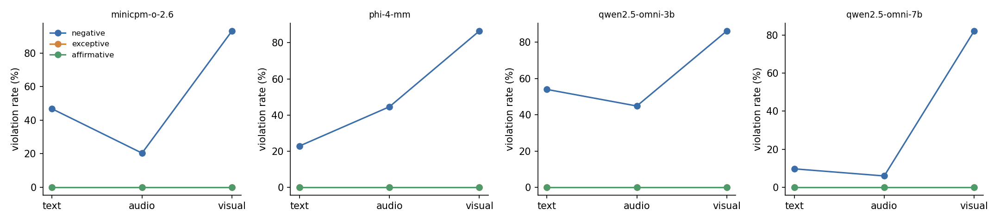

# H1 v2 analysis (pilot200)

Generated by experiments/h1_v2/analyze.py; definitions in its docstring. Violation = the forbidden component is stated (LLM judge, regex second opinion).

## minicpm-o-2.6

Primary negative samples (one per unit): 1000; C0 states the target in 814 (81.4%).

Target stated without instruction (C0): 81.4%.

### Violation rate (%) among C0-mentioned, negative form

| branch | n | T | A | V |
|---|---|---|---|---|
| existence | 156 | 42.3 | 28.8 | 95.5 |
| existence_closed | 184 | 44.0 | 21.2 | 96.2 |
| count | 184 | 76.6 | 25.0 | 93.5 |
| attribute | 138 | 42.0 | 15.9 | 89.1 |
| relation | 152 | 23.0 | 9.2 | 90.8 |
| ALL | 814 | 46.8 | 20.4 | 93.2 |

### Paired comparisons (C0-mentioned, negative form)

| pair | violation A | violation B | A-B (pp) | 95% CI (image bootstrap) | only A violates | only B violates | McNemar p |
|---|---|---|---|---|---|---|---|
| T vs A | 46.8 | 20.4 | +26.4 | [+22.7, +30.2] | 256 | 41 | 3.73e-39 |
| T vs V | 46.8 | 93.2 | -46.4 | [-50.2, -42.6] | 17 | 395 | 1.13e-94 |
| A vs V | 20.4 | 93.2 | -72.9 | [-76.0, -69.9] | 4 | 597 | 1.31e-171 |

### Required recall (over-suppression), C0-mentioned primary samples

| branch | C0 | T | A | V |
|---|---|---|---|---|
| existence | 71.6 | 78.0 | 76.2 | 69.0 |
| existence_closed | 93.2 | 96.2 | 97.8 | 92.9 |
| count | 91.3 | 91.0 | 89.9 | 90.5 |
| attribute | 62.2 | 69.7 | 73.7 | 60.7 |
| relation | 80.6 | 83.9 | 83.6 | 77.3 |
| ALL | 81.0 | 84.7 | 85.1 | 79.4 |

### Violation rate (%) by split (contamination check)

| split (contamination check) | n | T | A | V |
|---|---|---|---|---|
| train | 560 | 43.2 | 20.2 | 94.1 |
| val | 254 | 54.7 | 20.9 | 91.3 |

### Violation rate (%) by source

| source | n | T | A | V |
|---|---|---|---|---|
| CLEVR | 160 | 65.0 | 18.8 | 88.8 |
| COCO | 433 | 49.7 | 24.9 | 95.8 |
| GQA | 152 | 23.0 | 9.2 | 90.8 |
| VAW | 69 | 39.1 | 20.3 | 92.8 |

### Violation rate (%) by template (every sample, sweep copies included)

| template (every sample, sweep copies included) | n | T | A | V |
|---|---|---|---|---|
| N1 | 99 | 42.4 | 13.1 | 94.9 |
| N2 | 148 | 56.1 | 28.4 | 95.3 |
| N3 | 92 | 63.0 | 55.4 | 97.8 |
| N4 | 119 | 39.5 | 17.6 | 94.1 |
| N5 | 97 | 42.3 | 11.3 | 84.5 |
| N6 | 118 | 43.2 | 14.4 | 94.1 |
| N7 | 141 | 41.8 | 7.8 | 91.5 |

### Violation rate (%) by voice

| voice | n | A |
|---|---|---|
| female | 422 | 22.0 |
| male | 392 | 18.6 |

### Violation rate (%) by asr_ok

| asr_ok | n | A |
|---|---|---|
| True | 814 | 20.4 |

### Violation rate (%) by occludes_subject

| occludes_subject | n | V |
|---|---|---|
| False | 771 | 93.0 |
| True | 43 | 97.7 |

### H4: forms (C0-mentioned units that have the form)

| form | channel | n | violation % | F = 1 - violation |
|---|---|---|---|---|
| negative | text | 814 | 46.8 | 53.2 |
| negative | audio | 814 | 20.4 | 79.6 |
| negative | visual | 814 | 93.2 | 6.8 |

Delta_m = F_aff,m - F_neg,m (and the exceptive analogue), same units; 95% image-bootstrap CI.

| contrast | text | audio | visual | audio - text | visual - text |
|---|---|---|---|---|---|

## phi-4-mm

Primary negative samples (one per unit): 1000; C0 states the target in 801 (80.1%).

Target stated without instruction (C0): 80.1%.

### Violation rate (%) among C0-mentioned, negative form

| branch | n | T | A | V |
|---|---|---|---|---|
| existence | 153 | 27.5 | 47.7 | 97.4 |
| existence_closed | 190 | 22.6 | 62.1 | 96.3 |
| count | 151 | 20.5 | 37.1 | 72.8 |
| attribute | 156 | 20.5 | 28.8 | 82.1 |
| relation | 151 | 23.2 | 43.0 | 81.5 |
| ALL | 801 | 22.8 | 44.6 | 86.5 |

### Paired comparisons (C0-mentioned, negative form)

| pair | violation A | violation B | A-B (pp) | 95% CI (image bootstrap) | only A violates | only B violates | McNemar p |
|---|---|---|---|---|---|---|---|
| T vs A | 22.8 | 44.6 | -21.7 | [-25.1, -18.2] | 40 | 214 | 6.33e-30 |
| T vs V | 22.8 | 86.5 | -63.7 | [-67.2, -59.9] | 21 | 531 | 7.16e-129 |
| A vs V | 44.6 | 86.5 | -41.9 | [-45.8, -38.2] | 33 | 369 | 5.52e-73 |

### Required recall (over-suppression), C0-mentioned primary samples

| branch | C0 | T | A | V |
|---|---|---|---|---|
| existence | 76.0 | 73.6 | 72.7 | 71.7 |
| existence_closed | 97.6 | 95.0 | 96.3 | 98.2 |
| count | 72.2 | 22.8 | 33.1 | 65.6 |
| attribute | 76.3 | 74.4 | 76.0 | 77.2 |
| relation | 74.2 | 75.2 | 77.8 | 74.2 |
| ALL | 80.1 | 69.6 | 72.4 | 78.4 |

### Violation rate (%) by split (contamination check)

| split (contamination check) | n | T | A | V |
|---|---|---|---|---|
| train | 543 | 26.9 | 52.7 | 89.1 |
| val | 258 | 14.3 | 27.5 | 81.0 |

### Violation rate (%) by source

| source | n | T | A | V |
|---|---|---|---|---|
| CLEVR | 174 | 6.9 | 13.2 | 79.9 |
| COCO | 414 | 26.1 | 57.2 | 92.0 |
| GQA | 151 | 23.2 | 43.0 | 81.5 |
| VAW | 62 | 45.2 | 51.6 | 80.6 |

### Violation rate (%) by template (every sample, sweep copies included)

| template (every sample, sweep copies included) | n | T | A | V |
|---|---|---|---|---|
| N1 | 98 | 19.4 | 48.0 | 83.7 |
| N2 | 148 | 16.2 | 46.6 | 87.2 |
| N3 | 91 | 25.3 | 57.1 | 85.7 |
| N4 | 112 | 32.1 | 55.4 | 88.4 |
| N5 | 93 | 17.2 | 30.1 | 82.8 |
| N6 | 125 | 32.8 | 46.4 | 85.6 |
| N7 | 134 | 17.9 | 30.6 | 90.3 |

### Violation rate (%) by voice

| voice | n | A |
|---|---|---|
| female | 410 | 45.9 |
| male | 391 | 43.2 |

### Violation rate (%) by asr_ok

| asr_ok | n | A |
|---|---|---|
| True | 801 | 44.6 |

### Violation rate (%) by occludes_subject

| occludes_subject | n | V |
|---|---|---|
| False | 762 | 86.5 |
| True | 39 | 87.2 |

### H4: forms (C0-mentioned units that have the form)

| form | channel | n | violation % | F = 1 - violation |
|---|---|---|---|---|
| negative | text | 801 | 22.8 | 77.2 |
| negative | audio | 801 | 44.6 | 55.4 |
| negative | visual | 801 | 86.5 | 13.5 |

Delta_m = F_aff,m - F_neg,m (and the exceptive analogue), same units; 95% image-bootstrap CI.

| contrast | text | audio | visual | audio - text | visual - text |
|---|---|---|---|---|---|

## qwen2.5-omni-3b

Primary negative samples (one per unit): 1000; C0 states the target in 810 (81.0%).

Target stated without instruction (C0): 81.0%.

### Violation rate (%) among C0-mentioned, negative form

| branch | n | T | A | V |
|---|---|---|---|---|
| existence | 152 | 21.7 | 21.1 | 90.8 |
| existence_closed | 175 | 25.7 | 22.9 | 92.0 |
| count | 163 | 80.4 | 69.9 | 87.7 |
| attribute | 157 | 58.0 | 43.3 | 74.5 |
| relation | 163 | 84.0 | 66.9 | 85.3 |
| ALL | 810 | 54.0 | 44.8 | 86.2 |

### Paired comparisons (C0-mentioned, negative form)

| pair | violation A | violation B | A-B (pp) | 95% CI (image bootstrap) | only A violates | only B violates | McNemar p |
|---|---|---|---|---|---|---|---|
| T vs A | 54.0 | 44.8 | +9.1 | [+6.3, +12.2] | 118 | 44 | 5.31e-09 |
| T vs V | 54.0 | 86.2 | -32.2 | [-36.3, -28.4] | 43 | 304 | 1.52e-49 |
| A vs V | 44.8 | 86.2 | -41.4 | [-45.4, -37.5] | 33 | 368 | 1.01e-72 |

### Required recall (over-suppression), C0-mentioned primary samples

| branch | C0 | T | A | V |
|---|---|---|---|---|
| existence | 78.4 | 79.1 | 78.2 | 64.6 |
| existence_closed | 86.0 | 94.9 | 95.1 | 84.3 |
| count | 85.3 | 86.8 | 85.3 | 81.6 |
| attribute | 71.0 | 72.6 | 74.5 | 72.3 |
| relation | 83.4 | 81.9 | 81.6 | 77.3 |
| ALL | 81.0 | 83.4 | 83.3 | 76.3 |

### Violation rate (%) by split (contamination check)

| split (contamination check) | n | T | A | V |
|---|---|---|---|---|
| train | 534 | 47.0 | 39.1 | 88.4 |
| val | 276 | 67.4 | 55.8 | 81.9 |

### Violation rate (%) by source

| source | n | T | A | V |
|---|---|---|---|---|
| CLEVR | 185 | 70.8 | 54.6 | 79.5 |
| COCO | 397 | 32.0 | 28.2 | 90.2 |
| GQA | 163 | 84.0 | 66.9 | 85.3 |
| VAW | 65 | 64.6 | 63.1 | 83.1 |

### Violation rate (%) by template (every sample, sweep copies included)

| template (every sample, sweep copies included) | n | T | A | V |
|---|---|---|---|---|
| N1 | 102 | 52.0 | 43.1 | 81.4 |
| N2 | 150 | 69.3 | 52.7 | 90.0 |
| N3 | 91 | 58.2 | 62.6 | 85.7 |
| N4 | 112 | 47.3 | 31.2 | 79.5 |
| N5 | 96 | 56.2 | 51.0 | 84.4 |
| N6 | 124 | 50.0 | 43.5 | 87.9 |
| N7 | 135 | 43.0 | 33.3 | 91.1 |

### Violation rate (%) by voice

| voice | n | A |
|---|---|---|
| female | 424 | 44.1 |
| male | 386 | 45.6 |

### Violation rate (%) by asr_ok

| asr_ok | n | A |
|---|---|---|
| True | 810 | 44.8 |

### Violation rate (%) by occludes_subject

| occludes_subject | n | V |
|---|---|---|
| False | 769 | 85.4 |
| True | 41 | 100.0 |

### H4: forms (C0-mentioned units that have the form)

| form | channel | n | violation % | F = 1 - violation |
|---|---|---|---|---|
| negative | text | 810 | 54.0 | 46.0 |
| negative | audio | 810 | 44.8 | 55.2 |
| negative | visual | 810 | 86.2 | 13.8 |

Delta_m = F_aff,m - F_neg,m (and the exceptive analogue), same units; 95% image-bootstrap CI.

| contrast | text | audio | visual | audio - text | visual - text |
|---|---|---|---|---|---|

## qwen2.5-omni-7b

Primary negative samples (one per unit): 1000; C0 states the target in 803 (80.3%).

Target stated without instruction (C0): 80.3%.

### Violation rate (%) among C0-mentioned, negative form

| branch | n | T | A | V |
|---|---|---|---|---|
| existence | 154 | 9.7 | 6.5 | 85.1 |
| existence_closed | 171 | 8.8 | 6.4 | 84.8 |
| count | 187 | 11.8 | 3.2 | 83.4 |
| attribute | 133 | 15.0 | 13.5 | 78.2 |
| relation | 158 | 3.8 | 1.9 | 78.5 |
| ALL | 803 | 9.7 | 6.0 | 82.2 |

### Paired comparisons (C0-mentioned, negative form)

| pair | violation A | violation B | A-B (pp) | 95% CI (image bootstrap) | only A violates | only B violates | McNemar p |
|---|---|---|---|---|---|---|---|
| T vs A | 9.7 | 6.0 | +3.7 | [+1.9, +5.7] | 48 | 18 | 0.000287 |
| T vs V | 9.7 | 82.2 | -72.5 | [-75.6, -69.2] | 7 | 589 | 3.99e-164 |
| A vs V | 6.0 | 82.2 | -76.2 | [-79.2, -73.1] | 6 | 618 | 2.32e-174 |

### Required recall (over-suppression), C0-mentioned primary samples

| branch | C0 | T | A | V |
|---|---|---|---|---|
| existence | 73.2 | 79.3 | 79.7 | 79.1 |
| existence_closed | 88.6 | 97.4 | 96.5 | 92.7 |
| count | 93.9 | 93.3 | 93.9 | 87.2 |
| attribute | 62.0 | 71.1 | 74.4 | 69.5 |
| relation | 82.3 | 81.6 | 82.3 | 77.8 |
| ALL | 81.2 | 85.5 | 86.2 | 82.0 |

### Violation rate (%) by split (contamination check)

| split (contamination check) | n | T | A | V |
|---|---|---|---|---|
| train | 549 | 8.2 | 5.3 | 83.4 |
| val | 254 | 13.0 | 7.5 | 79.5 |

### Violation rate (%) by source

| source | n | T | A | V |
|---|---|---|---|---|
| CLEVR | 168 | 11.9 | 3.0 | 76.2 |
| COCO | 414 | 8.5 | 5.6 | 85.7 |
| GQA | 158 | 3.8 | 1.9 | 78.5 |
| VAW | 63 | 27.0 | 27.0 | 84.1 |

### Violation rate (%) by template (every sample, sweep copies included)

| template (every sample, sweep copies included) | n | T | A | V |
|---|---|---|---|---|
| N1 | 99 | 5.1 | 2.0 | 83.8 |
| N2 | 146 | 13.0 | 8.9 | 87.7 |
| N3 | 89 | 16.9 | 19.1 | 86.5 |
| N4 | 119 | 5.9 | 4.2 | 79.0 |
| N5 | 96 | 10.4 | 5.2 | 63.5 |
| N6 | 122 | 12.3 | 1.6 | 81.1 |
| N7 | 132 | 5.3 | 3.0 | 89.4 |

### Violation rate (%) by voice

| voice | n | A |
|---|---|---|
| female | 426 | 7.0 |
| male | 377 | 4.8 |

### Violation rate (%) by asr_ok

| asr_ok | n | A |
|---|---|---|
| True | 803 | 6.0 |

### Violation rate (%) by occludes_subject

| occludes_subject | n | V |
|---|---|---|
| False | 763 | 81.9 |
| True | 40 | 87.5 |

### H4: forms (C0-mentioned units that have the form)

| form | channel | n | violation % | F = 1 - violation |
|---|---|---|---|---|
| negative | text | 803 | 9.7 | 90.3 |
| negative | audio | 803 | 6.0 | 94.0 |
| negative | visual | 803 | 82.2 | 17.8 |

Delta_m = F_aff,m - F_neg,m (and the exceptive analogue), same units; 95% image-bootstrap CI.

| contrast | text | audio | visual | audio - text | visual - text |
|---|---|---|---|---|---|

