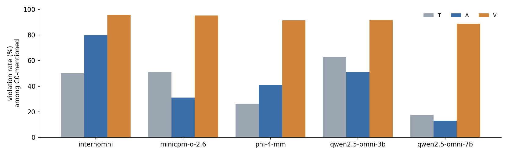

# H1 v2 analysis (pilot200)

Generated by experiments/h1_v2/analyze.py; definitions in its docstring. Violation = the forbidden component is stated (LLM judge, regex second opinion).

Excluded units left out: 79 (double label / part-whole / attribute overlap, create_data/src/flag_excluded_units.py).

## internomni

Violation = any mention (STATE/META/DENY).

Primary negative samples (one per unit): 932; C0 states the target in 779 (83.6%).

Target stated without instruction (C0): 83.6%.

### Violation rate (%) among C0-mentioned, negative form

| branch | n | T | A | V |
|---|---|---|---|---|
| existence | 135 | 61.5 | 83.7 | 97.0 |
| existence_closed | 172 | 62.8 | 72.1 | 100.0 |
| count | 161 | 60.2 | 67.1 | 93.2 |
| attribute | 158 | 42.4 | 89.2 | 96.2 |
| relation | 153 | 22.9 | 88.9 | 92.2 |
| ALL | 779 | 50.1 | 79.8 | 95.8 |

### Paired comparisons (C0-mentioned, negative form)

| pair | violation A | violation B | A-B (pp) | 95% CI (image bootstrap) | only A violates | only B violates | McNemar p |
|---|---|---|---|---|---|---|---|
| T vs A | 50.1 | 79.8 | -29.8 | [-34.0, -25.3] | 66 | 298 | 2.53e-36 |
| T vs V | 50.1 | 95.8 | -45.7 | [-49.4, -42.1] | 13 | 369 | 1.01e-91 |
| A vs V | 79.8 | 95.8 | -15.9 | [-19.0, -12.8] | 22 | 146 | 1.2e-23 |

### Template N3 ("Never refer to ..."): paired comparisons with / without it

| pair | subset | n | A-B (pp) | 95% CI (image bootstrap) |
|---|---|---|---|---|
| T vs A | all | 779 | -29.8 | [-34.0, -25.4] |
| T vs A | without N3 | 691 | -30.7 | [-35.3, -25.8] |
| T vs A | N3 only | 88 | -22.7 | [-34.1, -11.4] |
| T vs V | all | 779 | -45.7 | [-49.6, -41.8] |
| T vs V | without N3 | 691 | -47.8 | [-51.5, -43.8] |
| T vs V | N3 only | 88 | -29.5 | [-40.9, -19.3] |
| A vs V | all | 779 | -15.9 | [-19.3, -12.8] |
| A vs V | without N3 | 691 | -17.1 | [-20.4, -13.7] |
| A vs V | N3 only | 88 | -6.8 | [-13.6, +0.0] |

### Violation by kind (% of C0-mentioned; the kinds add up to the violation), negative form

STATE = says the forbidden fact · META = names it to exclude it · DENY = says it is absent / false · WRONG = gives a different value.

| condition | violation | STATE | META | DENY | WRONG | leak (= STATE) |
|---|---|---|---|---|---|---|
| T | 50.1 | 46.2 | 0.1 | 3.7 | 0.0 | 46.0 |
| A | 79.8 | 78.3 | 0.1 | 1.4 | 0.0 | 77.9 |
| V | 95.8 | 94.0 | 0.6 | 1.2 | 0.0 | 92.6 |

By branch (STATE / META / DENY / WRONG, %):

| branch | n | T | A | V |
|---|---|---|---|---|
| existence | 135 | 57.8 / 0.0 / 3.7 / 0.0 | 79.3 / 0.0 / 4.4 / 0.0 | 95.6 / 0.0 / 1.5 / 0.0 |
| existence_closed | 172 | 48.8 / 0.0 / 14.0 / 0.0 | 69.8 / 0.0 / 2.3 / 0.0 | 95.3 / 1.2 / 3.5 / 0.0 |
| count | 161 | 60.2 / 0.0 / 0.0 / 0.0 | 65.8 / 0.6 / 0.6 / 0.0 | 90.7 / 1.9 / 0.6 / 0.0 |
| attribute | 158 | 42.4 / 0.0 / 0.0 / 0.0 | 89.2 / 0.0 / 0.0 / 0.0 | 96.2 / 0.0 / 0.0 / 0.0 |
| relation | 153 | 22.2 / 0.7 / 0.0 / 0.0 | 88.9 / 0.0 / 0.0 / 0.0 | 92.2 / 0.0 / 0.0 / 0.0 |

Paired differences by kind (A-B, pp, 95% CI image bootstrap):

| pair | STATE | META | DENY | WRONG | leak |
|---|---|---|---|---|---|
| T vs A | -32.1 [-36.3, -27.3] | +0.0 [-0.4, +0.4] | +2.3 [+1.0, +3.6] | +0.0 [+0.0, +0.0] | -32.0 [-36.1, -27.6] |
| T vs V | -47.8 [-51.3, -43.9] | -0.5 [-1.2, +0.0] | +2.6 [+1.2, +4.0] | +0.0 [+0.0, +0.0] | -46.6 [-50.7, -42.6] |
| A vs V | -15.7 [-18.7, -12.3] | -0.5 [-1.0, -0.1] | +0.3 [-0.8, +1.3] | +0.0 [+0.0, +0.0] | -14.6 [-17.7, -11.4] |

Flagged for a human check: thinking judge gave no JSON 1; ambiguous bare-number counts 25.

### Required recall (over-suppression), C0-mentioned primary samples

| branch | C0 | T | A | V |
|---|---|---|---|---|
| existence | 67.4 | 73.3 | 32.6 | 73.0 |
| existence_closed | 87.5 | 97.7 | 38.1 | 90.4 |
| count | 40.1 | 41.6 | 11.2 | 45.7 |
| attribute | 79.7 | 80.4 | 32.3 | 78.8 |
| relation | 74.5 | 77.1 | 19.9 | 78.4 |
| ALL | 70.1 | 74.3 | 26.8 | 73.4 |

### Violation rate (%) by split (contamination check)

| split (contamination check) | n | T | A | V |
|---|---|---|---|---|
| train | 517 | 54.7 | 79.3 | 95.7 |
| val | 262 | 40.8 | 80.9 | 95.8 |

### Violation rate (%) by source

| source | n | T | A | V |
|---|---|---|---|---|
| CLEVR | 179 | 42.5 | 78.2 | 96.1 |
| COCO | 388 | 66.2 | 76.3 | 97.2 |
| GQA | 153 | 22.9 | 88.9 | 92.2 |
| VAW | 59 | 37.3 | 84.7 | 94.9 |

### Violation rate (%) by template (every sample, sweep copies included)

| template (every sample, sweep copies included) | n | T | A | V |
|---|---|---|---|---|
| N1 | 102 | 38.2 | 86.3 | 93.1 |
| N2 | 144 | 56.2 | 91.7 | 92.4 |
| N3 | 88 | 67.0 | 89.8 | 96.6 |
| N4 | 104 | 59.6 | 92.3 | 97.1 |
| N5 | 94 | 28.7 | 57.4 | 95.7 |
| N6 | 117 | 46.2 | 85.5 | 97.4 |
| N7 | 130 | 52.3 | 56.2 | 98.5 |

### Violation rate (%) by voice

| voice | n | A |
|---|---|---|
| female | 404 | 83.2 |
| male | 375 | 76.3 |

### Violation rate (%) by asr_ok

| asr_ok | n | A |
|---|---|---|
| True | 779 | 79.8 |

### Violation rate (%) by occludes_subject

| occludes_subject | n | V |
|---|---|---|
| False | 736 | 95.8 |
| True | 43 | 95.3 |

### H4: forms (C0-mentioned units that have the form)

| form | channel | n | violation % | F = 1 - violation |
|---|---|---|---|---|
| negative | text | 779 | 50.1 | 49.9 |
| negative | audio | 779 | 79.8 | 20.2 |
| negative | visual | 779 | 95.8 | 4.2 |

Delta_m = F_aff,m - F_neg,m (and the exceptive analogue), same units; 95% image-bootstrap CI.

| contrast | text | audio | visual | audio - text | visual - text |
|---|---|---|---|---|---|

## minicpm-o-2.6

Violation = any mention (STATE/META/DENY).

Primary negative samples (one per unit): 932; C0 states the target in 786 (84.3%).

Target stated without instruction (C0): 84.3%.

### Violation rate (%) among C0-mentioned, negative form

| branch | n | T | A | V |
|---|---|---|---|---|
| existence | 143 | 44.8 | 38.5 | 96.5 |
| existence_closed | 172 | 86.0 | 58.1 | 98.8 |
| count | 179 | 57.5 | 27.4 | 97.8 |
| attribute | 138 | 31.2 | 16.7 | 92.0 |
| relation | 154 | 28.6 | 11.7 | 89.6 |
| ALL | 786 | 51.1 | 31.2 | 95.2 |

### Paired comparisons (C0-mentioned, negative form)

| pair | violation A | violation B | A-B (pp) | 95% CI (image bootstrap) | only A violates | only B violates | McNemar p |
|---|---|---|---|---|---|---|---|
| T vs A | 51.1 | 31.2 | +20.0 | [+16.2, +23.8] | 213 | 56 | 9.8e-23 |
| T vs V | 51.1 | 95.2 | -44.0 | [-47.6, -40.5] | 5 | 351 | 6.4e-97 |
| A vs V | 31.2 | 95.2 | -64.0 | [-67.4, -60.3] | 8 | 511 | 1.46e-139 |

### Template N3 ("Never refer to ..."): paired comparisons with / without it

| pair | subset | n | A-B (pp) | 95% CI (image bootstrap) |
|---|---|---|---|---|
| T vs A | all | 786 | +20.0 | [+16.2, +23.8] |
| T vs A | without N3 | 696 | +20.8 | [+16.7, +25.1] |
| T vs A | N3 only | 90 | +13.3 | [+2.2, +25.6] |
| T vs V | all | 786 | -44.0 | [-47.6, -40.5] |
| T vs V | without N3 | 696 | -46.3 | [-50.3, -42.4] |
| T vs V | N3 only | 90 | -26.7 | [-36.7, -17.8] |
| A vs V | all | 786 | -64.0 | [-67.3, -60.6] |
| A vs V | without N3 | 696 | -67.1 | [-70.5, -63.1] |
| A vs V | N3 only | 90 | -40.0 | [-50.0, -30.0] |

### Violation by kind (% of C0-mentioned; the kinds add up to the violation), negative form

STATE = says the forbidden fact · META = names it to exclude it · DENY = says it is absent / false · WRONG = gives a different value.

| condition | violation | STATE | META | DENY | WRONG | leak (= STATE) |
|---|---|---|---|---|---|---|
| T | 51.1 | 39.6 | 2.4 | 9.0 | 0.1 | 39.3 |
| A | 31.2 | 19.5 | 3.9 | 7.8 | 0.0 | 19.2 |
| V | 95.2 | 92.9 | 0.6 | 1.4 | 0.3 | 92.1 |

By branch (STATE / META / DENY / WRONG, %):

| branch | n | T | A | V |
|---|---|---|---|---|
| existence | 143 | 38.5 / 0.7 / 5.6 / 0.0 | 26.6 / 5.6 / 6.3 / 0.0 | 95.1 / 0.0 / 1.4 / 0.0 |
| existence_closed | 172 | 45.3 / 5.2 / 35.5 / 0.0 | 17.4 / 11.6 / 29.1 / 0.0 | 93.6 / 0.0 / 5.2 / 0.0 |
| count | 179 | 54.7 / 1.1 / 1.1 / 0.6 | 25.7 / 1.1 / 0.6 / 0.0 | 96.6 / 0.0 / 0.0 / 1.1 |
| attribute | 138 | 26.8 / 4.3 / 0.0 / 0.0 | 16.7 / 0.0 / 0.0 / 0.0 | 88.4 / 3.6 / 0.0 / 0.0 |
| relation | 154 | 27.9 / 0.6 / 0.0 / 0.0 | 10.4 / 0.6 / 0.6 / 0.0 | 89.6 / 0.0 / 0.0 / 0.0 |

Paired differences by kind (A-B, pp, 95% CI image bootstrap):

| pair | STATE | META | DENY | WRONG | leak |
|---|---|---|---|---|---|
| T vs A | +20.1 [+16.3, +23.7] | -1.5 [-3.1, +0.0] | +1.3 [-0.6, +3.3] | +0.1 [+0.0, +0.4] | +20.1 [+16.3, +23.9] |
| T vs V | -53.3 [-56.9, -49.9] | +1.8 [+0.5, +3.1] | +7.6 [+5.9, +9.7] | -0.1 [-0.4, +0.0] | -52.8 [-56.4, -49.2] |
| A vs V | -73.4 [-76.5, -70.1] | +3.3 [+1.9, +4.7] | +6.4 [+4.6, +8.4] | -0.3 [-0.6, +0.0] | -72.9 [-75.8, -69.7] |

Flagged for a human check: thinking judge gave no JSON 7; ambiguous bare-number counts 0.

### Required recall (over-suppression), C0-mentioned primary samples

| branch | C0 | T | A | V |
|---|---|---|---|---|
| existence | 72.5 | 80.9 | 77.5 | 70.0 |
| existence_closed | 97.1 | 97.7 | 98.3 | 95.3 |
| count | 93.3 | 92.5 | 89.1 | 92.2 |
| attribute | 59.1 | 68.8 | 73.9 | 58.0 |
| relation | 79.9 | 83.1 | 85.7 | 76.6 |
| ALL | 81.7 | 85.5 | 85.7 | 79.8 |

### Violation rate (%) by split (contamination check)

| split (contamination check) | n | T | A | V |
|---|---|---|---|---|
| train | 527 | 55.2 | 34.5 | 95.3 |
| val | 259 | 42.9 | 24.3 | 95.0 |

### Violation rate (%) by source

| source | n | T | A | V |
|---|---|---|---|---|
| CLEVR | 166 | 39.8 | 19.9 | 95.2 |
| COCO | 396 | 67.4 | 44.9 | 97.7 |
| GQA | 154 | 28.6 | 11.7 | 89.6 |
| VAW | 70 | 35.7 | 22.9 | 92.9 |

### Violation rate (%) by template (every sample, sweep copies included)

| template (every sample, sweep copies included) | n | T | A | V |
|---|---|---|---|---|
| N1 | 98 | 50.0 | 27.6 | 99.0 |
| N2 | 140 | 51.4 | 35.7 | 95.7 |
| N3 | 90 | 71.1 | 57.8 | 97.8 |
| N4 | 112 | 47.3 | 30.4 | 94.6 |
| N5 | 94 | 31.9 | 14.9 | 91.5 |
| N6 | 118 | 50.0 | 31.4 | 94.9 |
| N7 | 134 | 56.0 | 23.1 | 93.3 |

### Violation rate (%) by voice

| voice | n | A |
|---|---|---|
| female | 410 | 32.7 |
| male | 376 | 29.5 |

### Violation rate (%) by asr_ok

| asr_ok | n | A |
|---|---|---|
| True | 786 | 31.2 |

### Violation rate (%) by occludes_subject

| occludes_subject | n | V |
|---|---|---|
| False | 743 | 95.0 |
| True | 43 | 97.7 |

### H4: forms (C0-mentioned units that have the form)

| form | channel | n | violation % | F = 1 - violation |
|---|---|---|---|---|
| negative | text | 786 | 51.1 | 48.9 |
| negative | audio | 786 | 31.2 | 68.8 |
| negative | visual | 786 | 95.2 | 4.8 |

Delta_m = F_aff,m - F_neg,m (and the exceptive analogue), same units; 95% image-bootstrap CI.

| contrast | text | audio | visual | audio - text | visual - text |
|---|---|---|---|---|---|

## phi-4-mm

Violation = any mention (STATE/META/DENY).

Primary negative samples (one per unit): 932; C0 states the target in 772 (82.8%).

Target stated without instruction (C0): 82.8%.

### Violation rate (%) among C0-mentioned, negative form

| branch | n | T | A | V |
|---|---|---|---|---|
| existence | 142 | 9.9 | 48.6 | 97.2 |
| existence_closed | 172 | 10.5 | 58.7 | 99.4 |
| count | 151 | 42.4 | 40.4 | 90.7 |
| attribute | 157 | 35.0 | 21.7 | 84.1 |
| relation | 150 | 33.3 | 34.0 | 84.7 |
| ALL | 772 | 26.0 | 40.9 | 91.3 |

### Paired comparisons (C0-mentioned, negative form)

| pair | violation A | violation B | A-B (pp) | 95% CI (image bootstrap) | only A violates | only B violates | McNemar p |
|---|---|---|---|---|---|---|---|
| T vs A | 26.0 | 40.9 | -14.9 | [-18.8, -10.9] | 85 | 200 | 7.57e-12 |
| T vs V | 26.0 | 91.3 | -65.3 | [-69.0, -61.4] | 24 | 528 | 8.83e-125 |
| A vs V | 40.9 | 91.3 | -50.4 | [-54.4, -46.6] | 19 | 408 | 3.15e-96 |

### Template N3 ("Never refer to ..."): paired comparisons with / without it

| pair | subset | n | A-B (pp) | 95% CI (image bootstrap) |
|---|---|---|---|---|
| T vs A | all | 772 | -14.9 | [-19.0, -11.0] |
| T vs A | without N3 | 681 | -12.9 | [-17.5, -8.7] |
| T vs A | N3 only | 91 | -29.7 | [-41.8, -16.5] |
| T vs V | all | 772 | -65.3 | [-68.9, -61.4] |
| T vs V | without N3 | 681 | -65.1 | [-69.0, -60.8] |
| T vs V | N3 only | 91 | -67.0 | [-76.9, -57.1] |
| A vs V | all | 772 | -50.4 | [-54.1, -46.5] |
| A vs V | without N3 | 681 | -52.1 | [-56.2, -48.0] |
| A vs V | N3 only | 91 | -37.4 | [-48.4, -26.4] |

### Violation by kind (% of C0-mentioned; the kinds add up to the violation), negative form

STATE = says the forbidden fact · META = names it to exclude it · DENY = says it is absent / false · WRONG = gives a different value.

| condition | violation | STATE | META | DENY | WRONG | leak (= STATE) |
|---|---|---|---|---|---|---|
| T | 26.0 | 25.5 | 0.4 | 0.1 | 0.0 | 25.5 |
| A | 40.9 | 39.0 | 0.1 | 1.8 | 0.0 | 38.6 |
| V | 91.3 | 88.7 | 1.3 | 1.3 | 0.0 | 86.4 |

By branch (STATE / META / DENY / WRONG, %):

| branch | n | T | A | V |
|---|---|---|---|---|
| existence | 142 | 9.2 / 0.0 / 0.7 / 0.0 | 45.1 / 0.0 / 3.5 / 0.0 | 96.5 / 0.0 / 0.7 / 0.0 |
| existence_closed | 172 | 9.9 / 0.6 / 0.0 / 0.0 | 53.5 / 0.0 / 5.2 / 0.0 | 94.2 / 0.0 / 5.2 / 0.0 |
| count | 151 | 42.4 / 0.0 / 0.0 / 0.0 | 40.4 / 0.0 / 0.0 / 0.0 | 87.4 / 3.3 / 0.0 / 0.0 |
| attribute | 157 | 35.0 / 0.0 / 0.0 / 0.0 | 21.7 / 0.0 / 0.0 / 0.0 | 82.8 / 1.3 / 0.0 / 0.0 |
| relation | 150 | 32.0 / 1.3 / 0.0 / 0.0 | 33.3 / 0.7 / 0.0 / 0.0 | 82.7 / 2.0 / 0.0 / 0.0 |

Paired differences by kind (A-B, pp, 95% CI image bootstrap):

| pair | STATE | META | DENY | WRONG | leak |
|---|---|---|---|---|---|
| T vs A | -13.5 [-17.4, -9.3] | +0.3 [+0.0, +0.6] | -1.7 [-2.7, -0.8] | +0.0 [+0.0, +0.0] | -13.1 [-17.1, -8.9] |
| T vs V | -63.2 [-67.1, -59.2] | -0.9 [-1.7, -0.3] | -1.2 [-2.1, -0.4] | +0.0 [+0.0, +0.0] | -60.9 [-64.6, -56.6] |
| A vs V | -49.7 [-53.8, -45.7] | -1.2 [-1.9, -0.5] | +0.5 [-0.5, +1.6] | +0.0 [+0.0, +0.0] | -47.8 [-51.8, -43.9] |

Flagged for a human check: thinking judge gave no JSON 1; ambiguous bare-number counts 55.

### Required recall (over-suppression), C0-mentioned primary samples

| branch | C0 | T | A | V |
|---|---|---|---|---|
| existence | 76.3 | 64.9 | 72.7 | 71.2 |
| existence_closed | 98.3 | 93.9 | 89.0 | 98.8 |
| count | 74.2 | 7.3 | 16.9 | 67.5 |
| attribute | 74.8 | 73.6 | 74.5 | 75.2 |
| relation | 74.3 | 74.0 | 77.3 | 76.3 |
| ALL | 80.1 | 63.6 | 66.7 | 78.5 |

### Violation rate (%) by split (contamination check)

| split (contamination check) | n | T | A | V |
|---|---|---|---|---|
| train | 518 | 22.4 | 48.8 | 93.1 |
| val | 254 | 33.5 | 24.8 | 87.8 |

### Violation rate (%) by source

| source | n | T | A | V |
|---|---|---|---|---|
| CLEVR | 173 | 34.1 | 15.0 | 89.0 |
| COCO | 386 | 17.6 | 55.7 | 96.1 |
| GQA | 150 | 33.3 | 34.0 | 84.7 |
| VAW | 63 | 38.1 | 38.1 | 84.1 |

### Violation rate (%) by template (every sample, sweep copies included)

| template (every sample, sweep copies included) | n | T | A | V |
|---|---|---|---|---|
| N1 | 98 | 28.6 | 38.8 | 91.8 |
| N2 | 138 | 19.6 | 46.4 | 92.0 |
| N3 | 91 | 27.5 | 57.1 | 94.5 |
| N4 | 105 | 15.2 | 51.4 | 90.5 |
| N5 | 91 | 34.1 | 28.6 | 85.7 |
| N6 | 120 | 35.8 | 38.3 | 89.2 |
| N7 | 129 | 24.0 | 27.9 | 94.6 |

### Violation rate (%) by voice

| voice | n | A |
|---|---|---|
| female | 395 | 41.8 |
| male | 377 | 40.1 |

### Violation rate (%) by asr_ok

| asr_ok | n | A |
|---|---|---|
| True | 772 | 40.9 |

### Violation rate (%) by occludes_subject

| occludes_subject | n | V |
|---|---|---|
| False | 733 | 91.4 |
| True | 39 | 89.7 |

### H4: forms (C0-mentioned units that have the form)

| form | channel | n | violation % | F = 1 - violation |
|---|---|---|---|---|
| negative | text | 772 | 26.0 | 74.0 |
| negative | audio | 772 | 40.9 | 59.1 |
| negative | visual | 772 | 91.3 | 8.7 |

Delta_m = F_aff,m - F_neg,m (and the exceptive analogue), same units; 95% image-bootstrap CI.

| contrast | text | audio | visual | audio - text | visual - text |
|---|---|---|---|---|---|

## qwen2.5-omni-3b

Violation = any mention (STATE/META/DENY).

Primary negative samples (one per unit): 932; C0 states the target in 799 (85.7%).

Target stated without instruction: C0 85.7%, C0_box 84.0% (n=932; discordant 34 vs 18, McNemar p=0.0365).

### Violation rate (%) among C0-mentioned, negative form

| branch | n | T | A | V | C0_box |
|---|---|---|---|---|---|
| existence | 139 | 20.1 | 26.6 | 97.8 | 95.0 |
| existence_closed | 172 | 47.1 | 47.7 | 98.8 | 100.0 |
| count | 163 | 87.7 | 71.2 | 89.6 | 95.1 |
| attribute | 160 | 66.9 | 47.5 | 85.0 | 97.5 |
| relation | 165 | 87.3 | 58.8 | 87.9 | 90.9 |
| ALL | 799 | 63.0 | 51.1 | 91.7 | 95.7 |

### Paired comparisons (C0-mentioned, negative form)

| pair | violation A | violation B | A-B (pp) | 95% CI (image bootstrap) | only A violates | only B violates | McNemar p |
|---|---|---|---|---|---|---|---|
| T vs A | 63.0 | 51.1 | +11.9 | [+8.4, +15.4] | 153 | 58 | 4.58e-11 |
| T vs V | 63.0 | 91.7 | -28.8 | [-32.5, -25.0] | 43 | 273 | 4.51e-42 |
| A vs V | 51.1 | 91.7 | -40.7 | [-44.3, -37.2] | 23 | 348 | 1.07e-75 |

### Template N3 ("Never refer to ..."): paired comparisons with / without it

| pair | subset | n | A-B (pp) | 95% CI (image bootstrap) |
|---|---|---|---|---|
| T vs A | all | 799 | +11.9 | [+8.3, +15.3] |
| T vs A | without N3 | 710 | +13.1 | [+9.7, +16.8] |
| T vs A | N3 only | 89 | +2.2 | [-10.1, +13.5] |
| T vs V | all | 799 | -28.8 | [-32.9, -24.9] |
| T vs V | without N3 | 710 | -29.4 | [-33.7, -25.5] |
| T vs V | N3 only | 89 | -23.6 | [-36.0, -12.4] |
| A vs V | all | 799 | -40.7 | [-44.4, -37.0] |
| A vs V | without N3 | 710 | -42.5 | [-46.5, -38.5] |
| A vs V | N3 only | 89 | -25.8 | [-36.0, -15.7] |

### Violation by kind (% of C0-mentioned; the kinds add up to the violation), negative form

STATE = says the forbidden fact · META = names it to exclude it · DENY = says it is absent / false · WRONG = gives a different value.

| condition | violation | STATE | META | DENY | WRONG | leak (= STATE) |
|---|---|---|---|---|---|---|
| T | 63.0 | 54.6 | 2.8 | 5.6 | 0.0 | 53.8 |
| A | 51.1 | 43.9 | 1.8 | 5.4 | 0.0 | 43.6 |
| V | 91.7 | 84.7 | 4.0 | 3.0 | 0.0 | 83.5 |

By branch (STATE / META / DENY / WRONG, %):

| branch | n | T | A | V |
|---|---|---|---|---|
| existence | 139 | 18.0 / 2.2 / 0.0 / 0.0 | 25.2 / 1.4 / 0.0 / 0.0 | 95.0 / 2.2 / 0.7 / 0.0 |
| existence_closed | 172 | 23.3 / 1.7 / 22.1 / 0.0 | 22.1 / 1.2 / 24.4 / 0.0 | 85.5 / 0.0 / 13.4 / 0.0 |
| count | 163 | 81.6 / 1.8 / 4.3 / 0.0 | 70.6 / 0.0 / 0.6 / 0.0 | 88.3 / 1.2 / 0.0 / 0.0 |
| attribute | 160 | 60.6 / 6.2 / 0.0 / 0.0 | 42.5 / 5.0 / 0.0 / 0.0 | 71.2 / 13.8 / 0.0 / 0.0 |
| relation | 165 | 85.5 / 1.8 / 0.0 / 0.0 | 57.6 / 1.2 / 0.0 / 0.0 | 84.8 / 3.0 / 0.0 / 0.0 |

Paired differences by kind (A-B, pp, 95% CI image bootstrap):

| pair | STATE | META | DENY | WRONG | leak |
|---|---|---|---|---|---|
| T vs A | +10.6 [+7.5, +13.8] | +1.0 [-0.3, +2.4] | +0.3 [-1.4, +1.9] | +0.0 [+0.0, +0.0] | +10.3 [+7.1, +13.4] |
| T vs V | -30.2 [-34.0, -26.4] | -1.3 [-3.0, +0.5] | +2.6 [+0.9, +4.4] | +0.0 [+0.0, +0.0] | -29.7 [-33.5, -25.4] |
| A vs V | -40.8 [-44.9, -36.8] | -2.3 [-3.9, -0.8] | +2.4 [+0.8, +4.0] | +0.0 [+0.0, +0.0] | -39.9 [-43.9, -36.0] |

Flagged for a human check: thinking judge gave no JSON 22; ambiguous bare-number counts 0.

### Required recall (over-suppression), C0-mentioned primary samples

| branch | C0 | T | A | V |
|---|---|---|---|---|
| existence | 80.3 | 81.4 | 78.7 | 68.1 |
| existence_closed | 91.9 | 98.0 | 96.8 | 89.2 |
| count | 86.2 | 86.5 | 85.0 | 83.4 |
| attribute | 67.5 | 66.6 | 66.6 | 69.4 |
| relation | 83.0 | 82.7 | 79.4 | 76.1 |
| ALL | 82.0 | 83.3 | 81.6 | 77.7 |

### Violation rate (%) by split (contamination check)

| split (contamination check) | n | T | A | V |
|---|---|---|---|---|
| train | 518 | 56.8 | 46.5 | 93.4 |
| val | 281 | 74.4 | 59.4 | 88.6 |

### Violation rate (%) by source

| source | n | T | A | V |
|---|---|---|---|---|
| CLEVR | 188 | 79.3 | 56.4 | 88.3 |
| COCO | 380 | 43.7 | 42.1 | 96.3 |
| GQA | 165 | 87.3 | 58.8 | 87.9 |
| VAW | 66 | 66.7 | 68.2 | 84.8 |

### Violation rate (%) by template (every sample, sweep copies included)

| template (every sample, sweep copies included) | n | T | A | V |
|---|---|---|---|---|
| N1 | 104 | 61.5 | 50.0 | 89.4 |
| N2 | 144 | 75.0 | 59.7 | 94.4 |
| N3 | 89 | 68.5 | 66.3 | 92.1 |
| N4 | 108 | 61.1 | 42.6 | 89.8 |
| N5 | 95 | 60.0 | 52.6 | 88.4 |
| N6 | 122 | 63.1 | 54.9 | 91.0 |
| N7 | 137 | 51.1 | 35.0 | 94.9 |

### Violation rate (%) by voice

| voice | n | A |
|---|---|---|
| female | 414 | 49.3 |
| male | 385 | 53.0 |

### Violation rate (%) by asr_ok

| asr_ok | n | A |
|---|---|---|
| True | 799 | 51.1 |

### Violation rate (%) by occludes_subject

| occludes_subject | n | V | C0_box |
|---|---|---|---|
| False | 757 | 91.5 | 95.5 |
| True | 42 | 95.2 | 100.0 |

### H4: forms (C0-mentioned units that have the form)

| form | channel | n | violation % | F = 1 - violation |
|---|---|---|---|---|
| negative | text | 799 | 63.0 | 37.0 |
| negative | audio | 799 | 51.1 | 48.9 |
| negative | visual | 799 | 91.7 | 8.3 |

Delta_m = F_aff,m - F_neg,m (and the exceptive analogue), same units; 95% image-bootstrap CI.

| contrast | text | audio | visual | audio - text | visual - text |
|---|---|---|---|---|---|

## qwen2.5-omni-7b

Violation = any mention (STATE/META/DENY).

Primary negative samples (one per unit): 932; C0 states the target in 790 (84.8%).

Target stated without instruction: C0 84.8%, C0_box 84.5% (n=932; discordant 35 vs 33, McNemar p=0.904).

### Violation rate (%) among C0-mentioned, negative form

| branch | n | T | A | V | C0_box |
|---|---|---|---|---|---|
| existence | 145 | 14.5 | 13.1 | 89.0 | 96.6 |
| existence_closed | 163 | 36.8 | 28.8 | 95.7 | 96.9 |
| count | 181 | 13.3 | 6.6 | 95.0 | 99.4 |
| attribute | 134 | 17.2 | 11.9 | 82.8 | 94.8 |
| relation | 167 | 4.8 | 5.4 | 80.2 | 89.8 |
| ALL | 790 | 17.2 | 13.0 | 88.9 | 95.6 |

### Paired comparisons (C0-mentioned, negative form)

| pair | violation A | violation B | A-B (pp) | 95% CI (image bootstrap) | only A violates | only B violates | McNemar p |
|---|---|---|---|---|---|---|---|
| T vs A | 17.2 | 13.0 | +4.2 | [+1.6, +6.7] | 69 | 36 | 0.00166 |
| T vs V | 17.2 | 88.9 | -71.6 | [-74.8, -68.5] | 8 | 574 | 3.99e-158 |
| A vs V | 13.0 | 88.9 | -75.8 | [-79.0, -72.7] | 6 | 605 | 1.68e-170 |

### Template N3 ("Never refer to ..."): paired comparisons with / without it

| pair | subset | n | A-B (pp) | 95% CI (image bootstrap) |
|---|---|---|---|---|
| T vs A | all | 790 | +4.2 | [+1.6, +6.7] |
| T vs A | without N3 | 703 | +4.8 | [+2.3, +7.5] |
| T vs A | N3 only | 87 | -1.1 | [-10.3, +8.0] |
| T vs V | all | 790 | -71.6 | [-74.9, -68.4] |
| T vs V | without N3 | 703 | -72.3 | [-75.5, -68.7] |
| T vs V | N3 only | 87 | -66.7 | [-77.0, -56.3] |
| A vs V | all | 790 | -75.8 | [-78.9, -72.8] |
| A vs V | without N3 | 703 | -77.1 | [-80.2, -73.8] |
| A vs V | N3 only | 87 | -65.5 | [-75.9, -55.2] |

### Violation by kind (% of C0-mentioned; the kinds add up to the violation), negative form

STATE = says the forbidden fact · META = names it to exclude it · DENY = says it is absent / false · WRONG = gives a different value.

| condition | violation | STATE | META | DENY | WRONG | leak (= STATE) |
|---|---|---|---|---|---|---|
| T | 17.2 | 10.8 | 2.0 | 4.4 | 0.0 | 10.6 |
| A | 13.0 | 7.2 | 2.8 | 3.0 | 0.0 | 7.1 |
| V | 88.9 | 81.9 | 3.9 | 3.0 | 0.0 | 81.0 |

By branch (STATE / META / DENY / WRONG, %):

| branch | n | T | A | V |
|---|---|---|---|---|
| existence | 145 | 12.4 / 2.1 / 0.0 / 0.0 | 9.0 / 3.4 / 0.7 / 0.0 | 86.9 / 1.4 / 0.7 / 0.0 |
| existence_closed | 163 | 11.0 / 4.3 / 21.5 / 0.0 | 9.8 / 4.9 / 14.1 / 0.0 | 83.4 / 0.0 / 12.3 / 0.0 |
| count | 181 | 11.6 / 1.7 / 0.0 / 0.0 | 3.3 / 3.3 / 0.0 / 0.0 | 86.2 / 7.2 / 1.7 / 0.0 |
| attribute | 134 | 15.7 / 1.5 / 0.0 / 0.0 | 10.4 / 1.5 / 0.0 / 0.0 | 73.1 / 9.7 / 0.0 / 0.0 |
| relation | 167 | 4.2 / 0.6 / 0.0 / 0.0 | 4.8 / 0.6 / 0.0 / 0.0 | 78.4 / 1.8 / 0.0 / 0.0 |

Paired differences by kind (A-B, pp, 95% CI image bootstrap):

| pair | STATE | META | DENY | WRONG | leak |
|---|---|---|---|---|---|
| T vs A | +3.5 [+1.4, +5.7] | -0.8 [-1.9, +0.4] | +1.4 [+0.1, +2.8] | +0.0 [+0.0, +0.0] | +3.5 [+1.3, +5.8] |
| T vs V | -71.1 [-74.3, -68.0] | -1.9 [-3.5, -0.3] | +1.4 [-0.3, +3.2] | +0.0 [+0.0, +0.0] | -70.4 [-73.7, -67.1] |
| A vs V | -74.7 [-78.0, -71.5] | -1.1 [-2.9, +0.5] | +0.0 [-1.5, +1.5] | +0.0 [+0.0, +0.0] | -73.9 [-77.2, -70.6] |

Flagged for a human check: thinking judge gave no JSON 45; ambiguous bare-number counts 55.

### Required recall (over-suppression), C0-mentioned primary samples

| branch | C0 | T | A | V |
|---|---|---|---|---|
| existence | 74.6 | 79.4 | 81.1 | 79.5 |
| existence_closed | 93.6 | 98.8 | 98.2 | 96.0 |
| count | 95.0 | 93.4 | 94.8 | 87.6 |
| attribute | 57.1 | 65.3 | 66.0 | 60.8 |
| relation | 83.5 | 79.6 | 79.6 | 77.2 |
| ALL | 82.1 | 84.3 | 84.9 | 81.1 |

### Violation rate (%) by split (contamination check)

| split (contamination check) | n | T | A | V |
|---|---|---|---|---|
| train | 537 | 17.3 | 14.2 | 87.9 |
| val | 253 | 17.0 | 10.7 | 90.9 |

### Violation rate (%) by source

| source | n | T | A | V |
|---|---|---|---|---|
| CLEVR | 165 | 13.3 | 5.5 | 91.5 |
| COCO | 391 | 22.0 | 18.2 | 92.1 |
| GQA | 167 | 4.8 | 5.4 | 80.2 |
| VAW | 67 | 29.9 | 20.9 | 85.1 |

### Violation rate (%) by template (every sample, sweep copies included)

| template (every sample, sweep copies included) | n | T | A | V |
|---|---|---|---|---|
| N1 | 102 | 9.8 | 6.9 | 89.2 |
| N2 | 140 | 21.4 | 17.1 | 89.3 |
| N3 | 87 | 24.1 | 25.3 | 90.8 |
| N4 | 115 | 18.3 | 13.0 | 89.6 |
| N5 | 94 | 12.8 | 9.6 | 80.9 |
| N6 | 122 | 18.0 | 6.6 | 86.9 |
| N7 | 130 | 15.4 | 13.8 | 93.8 |

### Violation rate (%) by voice

| voice | n | A |
|---|---|---|
| female | 409 | 13.4 |
| male | 381 | 12.6 |

### Violation rate (%) by asr_ok

| asr_ok | n | A |
|---|---|---|
| True | 790 | 13.0 |

### Violation rate (%) by occludes_subject

| occludes_subject | n | V | C0_box |
|---|---|---|---|
| False | 748 | 88.9 | 95.5 |
| True | 42 | 88.1 | 97.6 |

### H4: forms (C0-mentioned units that have the form)

| form | channel | n | violation % | F = 1 - violation |
|---|---|---|---|---|
| negative | text | 790 | 17.2 | 82.8 |
| negative | audio | 790 | 13.0 | 87.0 |
| negative | visual | 790 | 88.9 | 11.1 |
| exceptive | text | 722 | 64.0 | 36.0 |
| exceptive | audio | 722 | 54.4 | 45.6 |
| exceptive | visual | 722 | 85.7 | 14.3 |
| affirmative | text | 591 | 38.2 | 61.8 |
| affirmative | audio | 591 | 33.5 | 66.5 |
| affirmative | visual | 591 | 87.8 | 12.2 |

Delta_m = F_aff,m - F_neg,m (and the exceptive analogue), same units; 95% image-bootstrap CI.

| contrast | text | audio | visual | audio - text | visual - text |
|---|---|---|---|---|---|
| Delta (aff - neg), n=591 | -20.8 [-25.4, -16.2] | -21.2 [-25.4, -17.1] | +0.8 [-2.4, +4.1] | -0.3 [-5.2, +4.6] | +21.7 [+16.6, +27.1] |
| Delta (exc - neg), n=722 | -47.0 [-51.0, -43.2] | -41.7 [-45.7, -37.4] | +2.8 [+0.0, +5.5] | +5.3 [+0.7, +9.8] | +49.7 [+44.9, +54.7] |

