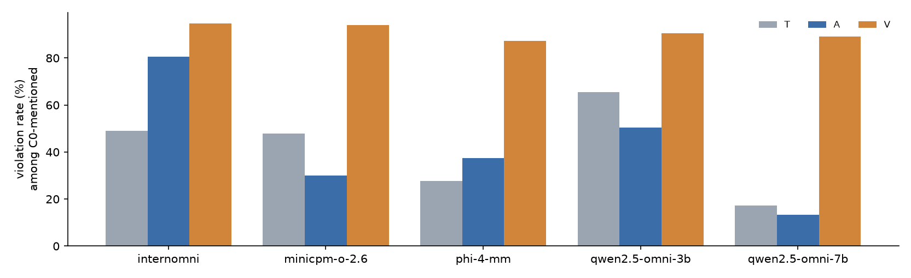
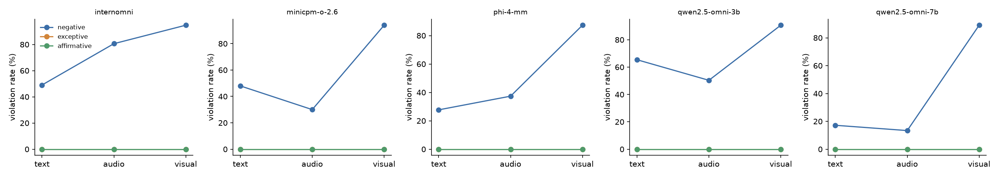

# H1 v2 analysis (all)

Generated by experiments/h1_v2/analyze.py; definitions in its docstring. Violation = the forbidden component is stated (LLM judge, regex second opinion).

Excluded units left out: 276 (double label / part-whole / attribute overlap, create_data/src/flag_excluded_units.py).

## internomni

Violation = any mention (STATE/META/DENY).

Primary negative samples (one per unit): 4390; C0 states the target in 3527 (80.3%).

Target stated without instruction (C0): 80.3%.

### Violation rate (%) among C0-mentioned, negative form

| branch | n | T | A | V |
|---|---|---|---|---|
| existence | 526 | 62.0 | 81.2 | 96.6 |
| existence_closed | 616 | 57.8 | 72.1 | 99.8 |
| count | 744 | 58.5 | 67.5 | 91.5 |
| attribute | 1146 | 43.5 | 89.8 | 94.2 |
| relation | 495 | 22.8 | 89.1 | 92.5 |
| ALL | 3527 | 49.0 | 80.6 | 94.7 |

### Paired comparisons (C0-mentioned, negative form)

| pair | violation A | violation B | A-B (pp) | 95% CI (image bootstrap) | only A violates | only B violates | McNemar p |
|---|---|---|---|---|---|---|---|
| T vs A | 49.0 | 80.6 | -31.6 | [-33.5, -29.6] | 256 | 1370 | 6.53e-184 |
| T vs V | 49.0 | 94.7 | -45.7 | [-47.5, -44.0] | 69 | 1681 | 0 |
| A vs V | 80.6 | 94.7 | -14.1 | [-15.6, -12.7] | 124 | 622 | 1.46e-80 |

### Template N3 ("Never refer to ..."): paired comparisons with / without it

| pair | subset | n | A-B (pp) | 95% CI (image bootstrap) |
|---|---|---|---|---|
| T vs A | all | 3527 | -31.6 | [-33.7, -29.6] |
| T vs A | without N3 | 3027 | -32.8 | [-35.0, -30.6] |
| T vs A | N3 only | 500 | -24.2 | [-28.3, -20.0] |
| T vs V | all | 3527 | -45.7 | [-47.5, -44.0] |
| T vs V | without N3 | 3027 | -48.8 | [-50.7, -46.8] |
| T vs V | N3 only | 500 | -27.2 | [-31.7, -23.0] |
| A vs V | all | 3527 | -14.1 | [-15.5, -12.7] |
| A vs V | without N3 | 3027 | -16.0 | [-17.5, -14.4] |
| A vs V | N3 only | 500 | -3.0 | [-5.6, -0.4] |

### Violation by kind (% of C0-mentioned; the kinds add up to the violation), negative form

STATE = says the forbidden fact · META = names it to exclude it · DENY = says it is absent / false · WRONG = gives a different value.

| condition | violation | STATE | META | DENY | WRONG | leak (= STATE) |
|---|---|---|---|---|---|---|
| T | 49.0 | 46.4 | 0.2 | 2.4 | 0.0 | 46.3 |
| A | 80.6 | 79.3 | 0.4 | 0.9 | 0.0 | 79.0 |
| V | 94.7 | 93.3 | 0.4 | 1.0 | 0.0 | 92.1 |

By branch (STATE / META / DENY / WRONG, %):

| branch | n | T | A | V |
|---|---|---|---|---|
| existence | 526 | 58.9 / 0.0 / 3.0 / 0.0 | 77.0 / 0.0 / 4.2 / 0.0 | 94.9 / 0.0 / 1.7 / 0.0 |
| existence_closed | 616 | 46.6 / 0.3 / 10.9 / 0.0 | 70.5 / 0.2 / 1.5 / 0.0 | 95.8 / 0.0 / 4.1 / 0.0 |
| count | 744 | 57.8 / 0.4 / 0.3 / 0.0 | 66.9 / 0.4 / 0.1 / 0.0 | 90.7 / 0.4 / 0.4 / 0.0 |
| attribute | 1146 | 43.5 / 0.1 / 0.0 / 0.0 | 89.0 / 0.8 / 0.0 / 0.0 | 93.3 / 0.9 / 0.0 / 0.0 |
| relation | 495 | 22.4 / 0.4 / 0.0 / 0.0 | 89.1 / 0.0 / 0.0 / 0.0 | 92.3 / 0.2 / 0.0 / 0.0 |

Paired differences by kind (A-B, pp, 95% CI image bootstrap):

| pair | STATE | META | DENY | WRONG | leak |
|---|---|---|---|---|---|
| T vs A | -32.9 [-34.9, -31.0] | -0.1 [-0.4, +0.1] | +1.5 [+1.0, +2.1] | +0.0 [+0.0, +0.0] | -32.7 [-34.8, -30.6] |
| T vs V | -46.9 [-48.6, -45.1] | -0.2 [-0.4, +0.1] | +1.4 [+0.8, +1.9] | +0.0 [+0.0, +0.0] | -45.8 [-47.6, -44.2] |
| A vs V | -13.9 [-15.4, -12.6] | -0.0 [-0.3, +0.3] | -0.1 [-0.6, +0.3] | +0.0 [+0.0, +0.0] | -13.2 [-14.5, -11.7] |

Flagged for a human check: thinking judge gave no JSON 14; ambiguous bare-number counts 168.

### Required recall (over-suppression), C0-mentioned primary samples

| branch | C0 | T | A | V |
|---|---|---|---|---|
| existence | 71.0 | 73.3 | 32.0 | 72.5 |
| existence_closed | 88.0 | 96.5 | 34.4 | 91.8 |
| count | 36.4 | 36.9 | 10.1 | 39.2 |
| attribute | 83.5 | 82.4 | 30.2 | 82.4 |
| relation | 75.3 | 79.2 | 20.1 | 78.5 |
| ALL | 71.3 | 73.5 | 25.5 | 72.9 |

### Violation rate (%) by split (contamination check)

| split (contamination check) | n | T | A | V |
|---|---|---|---|---|
| train | 1908 | 52.6 | 79.4 | 94.6 |
| val | 1619 | 44.8 | 82.0 | 94.9 |

### Violation rate (%) by source

| source | n | T | A | V |
|---|---|---|---|---|
| CLEVR | 1142 | 48.9 | 82.2 | 96.1 |
| COCO | 1474 | 63.8 | 76.5 | 95.7 |
| GQA | 495 | 22.8 | 89.1 | 92.5 |
| VAW | 416 | 28.1 | 80.5 | 89.9 |

### Violation rate (%) by template (every sample, sweep copies included)

| template (every sample, sweep copies included) | n | T | A | V |
|---|---|---|---|---|
| N1 | 462 | 36.4 | 78.8 | 94.4 |
| N2 | 529 | 58.8 | 95.3 | 94.7 |
| N3 | 500 | 68.0 | 92.2 | 95.2 |
| N4 | 517 | 40.4 | 89.4 | 94.8 |
| N5 | 496 | 35.9 | 59.9 | 94.0 |
| N6 | 505 | 51.1 | 85.3 | 95.6 |
| N7 | 518 | 51.2 | 62.5 | 94.4 |

### Violation rate (%) by voice

| voice | n | A |
|---|---|---|
| female | 1899 | 83.7 |
| male | 1628 | 77.0 |

### Violation rate (%) by asr_ok

| asr_ok | n | A |
|---|---|---|
| False | 44 | 61.4 |
| True | 3483 | 80.8 |

### Violation rate (%) by occludes_subject

| occludes_subject | n | V |
|---|---|---|
| False | 3393 | 94.8 |
| True | 134 | 92.5 |

### H4: forms (C0-mentioned units that have the form)

| form | channel | n | violation % | F = 1 - violation |
|---|---|---|---|---|
| negative | text | 3527 | 49.0 | 51.0 |
| negative | audio | 3527 | 80.6 | 19.4 |
| negative | visual | 3527 | 94.7 | 5.3 |

Delta_m = F_aff,m - F_neg,m (and the exceptive analogue), same units; 95% image-bootstrap CI.

| contrast | text | audio | visual | audio - text | visual - text |
|---|---|---|---|---|---|

## minicpm-o-2.6

Violation = any mention (STATE/META/DENY).

Primary negative samples (one per unit): 4390; C0 states the target in 3486 (79.4%).

Target stated without instruction (C0): 79.4%.

### Violation rate (%) among C0-mentioned, negative form

| branch | n | T | A | V |
|---|---|---|---|---|
| existence | 553 | 42.0 | 41.8 | 97.5 |
| existence_closed | 618 | 85.3 | 60.7 | 99.2 |
| count | 857 | 56.8 | 27.2 | 98.0 |
| attribute | 950 | 28.5 | 16.4 | 87.2 |
| relation | 508 | 30.5 | 10.0 | 89.8 |
| ALL | 3486 | 48.0 | 30.0 | 94.0 |

### Paired comparisons (C0-mentioned, negative form)

| pair | violation A | violation B | A-B (pp) | 95% CI (image bootstrap) | only A violates | only B violates | McNemar p |
|---|---|---|---|---|---|---|---|
| T vs A | 48.0 | 30.0 | +18.0 | [+16.2, +19.8] | 860 | 234 | 1.58e-84 |
| T vs V | 48.0 | 94.0 | -46.0 | [-47.9, -44.4] | 52 | 1656 | 0 |
| A vs V | 30.0 | 94.0 | -64.0 | [-65.7, -62.2] | 26 | 2256 | 0 |

### Template N3 ("Never refer to ..."): paired comparisons with / without it

| pair | subset | n | A-B (pp) | 95% CI (image bootstrap) |
|---|---|---|---|---|
| T vs A | all | 3486 | +18.0 | [+16.2, +19.6] |
| T vs A | without N3 | 3002 | +18.6 | [+16.6, +20.6] |
| T vs A | N3 only | 484 | +14.0 | [+9.7, +18.8] |
| T vs V | all | 3486 | -46.0 | [-47.8, -44.3] |
| T vs V | without N3 | 3002 | -49.5 | [-51.4, -47.6] |
| T vs V | N3 only | 484 | -24.6 | [-28.8, -20.3] |
| A vs V | all | 3486 | -64.0 | [-65.7, -62.2] |
| A vs V | without N3 | 3002 | -68.1 | [-69.8, -66.3] |
| A vs V | N3 only | 484 | -38.6 | [-43.0, -34.2] |

### Violation by kind (% of C0-mentioned; the kinds add up to the violation), negative form

STATE = says the forbidden fact · META = names it to exclude it · DENY = says it is absent / false · WRONG = gives a different value.

| condition | violation | STATE | META | DENY | WRONG | leak (= STATE) |
|---|---|---|---|---|---|---|
| T | 48.0 | 38.4 | 2.3 | 7.2 | 0.1 | 38.3 |
| A | 30.0 | 20.1 | 4.3 | 5.5 | 0.0 | 20.0 |
| V | 94.0 | 91.1 | 1.1 | 1.6 | 0.1 | 90.6 |

By branch (STATE / META / DENY / WRONG, %):

| branch | n | T | A | V |
|---|---|---|---|---|
| existence | 553 | 38.7 / 1.1 / 2.2 / 0.0 | 32.5 / 4.3 / 4.9 / 0.0 | 96.9 / 0.0 / 0.5 / 0.0 |
| existence_closed | 618 | 46.6 / 4.5 / 34.1 / 0.0 | 22.3 / 13.4 / 24.9 / 0.0 | 90.8 / 0.0 / 8.4 / 0.0 |
| count | 857 | 52.7 / 0.5 / 3.3 / 0.4 | 24.2 / 1.8 / 1.2 / 0.1 | 97.3 / 0.0 / 0.1 / 0.6 |
| attribute | 950 | 24.3 / 4.2 / 0.0 / 0.0 | 13.7 / 2.7 / 0.0 / 0.0 | 83.4 / 3.8 / 0.0 / 0.0 |
| relation | 508 | 30.1 / 0.4 / 0.0 / 0.0 | 9.3 / 0.6 / 0.2 / 0.0 | 89.4 / 0.4 / 0.0 / 0.0 |

Paired differences by kind (A-B, pp, 95% CI image bootstrap):

| pair | STATE | META | DENY | WRONG | leak |
|---|---|---|---|---|---|
| T vs A | +18.2 [+16.4, +19.9] | -2.0 [-2.8, -1.3] | +1.7 [+0.8, +2.6] | +0.1 [+0.0, +0.1] | +18.2 [+16.5, +19.8] |
| T vs V | -52.8 [-54.4, -51.0] | +1.2 [+0.7, +1.8] | +5.6 [+4.8, +6.5] | -0.1 [-0.2, +0.1] | -52.3 [-54.1, -50.6] |
| A vs V | -71.0 [-72.5, -69.4] | +3.2 [+2.5, +4.0] | +3.9 [+3.1, +4.7] | -0.1 [-0.2, -0.0] | -70.5 [-72.1, -68.9] |

Flagged for a human check: thinking judge gave no JSON 42; ambiguous bare-number counts 0.

### Required recall (over-suppression), C0-mentioned primary samples

| branch | C0 | T | A | V |
|---|---|---|---|---|
| existence | 78.8 | 82.6 | 81.2 | 75.7 |
| existence_closed | 94.3 | 97.8 | 95.0 | 93.6 |
| count | 94.5 | 92.5 | 90.6 | 93.2 |
| attribute | 60.4 | 71.6 | 74.0 | 60.4 |
| relation | 78.9 | 81.7 | 81.8 | 76.5 |
| ALL | 80.4 | 84.6 | 84.1 | 79.1 |

### Violation rate (%) by split (contamination check)

| split (contamination check) | n | T | A | V |
|---|---|---|---|---|
| train | 1988 | 55.3 | 36.8 | 95.5 |
| val | 1498 | 38.3 | 21.0 | 92.0 |

### Violation rate (%) by source

| source | n | T | A | V |
|---|---|---|---|---|
| CLEVR | 989 | 36.5 | 18.8 | 93.6 |
| COCO | 1524 | 66.4 | 46.9 | 98.1 |
| GQA | 508 | 30.5 | 10.0 | 89.8 |
| VAW | 465 | 31.0 | 20.4 | 85.8 |

### Violation rate (%) by template (every sample, sweep copies included)

| template (every sample, sweep copies included) | n | T | A | V |
|---|---|---|---|---|
| N1 | 457 | 45.3 | 23.6 | 93.2 |
| N2 | 530 | 46.0 | 31.5 | 96.8 |
| N3 | 484 | 70.2 | 56.2 | 94.8 |
| N4 | 504 | 43.1 | 28.8 | 96.0 |
| N5 | 486 | 33.7 | 14.6 | 90.9 |
| N6 | 498 | 45.6 | 27.9 | 93.2 |
| N7 | 527 | 51.8 | 27.3 | 92.6 |

### Violation rate (%) by voice

| voice | n | A |
|---|---|---|
| female | 1857 | 30.2 |
| male | 1629 | 29.8 |

### Violation rate (%) by asr_ok

| asr_ok | n | A |
|---|---|---|
| False | 45 | 20.0 |
| True | 3441 | 30.1 |

### Violation rate (%) by occludes_subject

| occludes_subject | n | V |
|---|---|---|
| False | 3350 | 94.0 |
| True | 136 | 92.6 |

### H4: forms (C0-mentioned units that have the form)

| form | channel | n | violation % | F = 1 - violation |
|---|---|---|---|---|
| negative | text | 3486 | 48.0 | 52.0 |
| negative | audio | 3486 | 30.0 | 70.0 |
| negative | visual | 3486 | 94.0 | 6.0 |

Delta_m = F_aff,m - F_neg,m (and the exceptive analogue), same units; 95% image-bootstrap CI.

| contrast | text | audio | visual | audio - text | visual - text |
|---|---|---|---|---|---|

## phi-4-mm

Violation = any mention (STATE/META/DENY).

Primary negative samples (one per unit): 4390; C0 states the target in 3519 (80.2%).

Target stated without instruction (C0): 80.2%.

### Violation rate (%) among C0-mentioned, negative form

| branch | n | T | A | V |
|---|---|---|---|---|
| existence | 550 | 7.8 | 53.8 | 96.9 |
| existence_closed | 618 | 11.0 | 54.9 | 99.8 |
| count | 705 | 42.3 | 39.6 | 86.5 |
| attribute | 1142 | 34.3 | 20.8 | 78.4 |
| relation | 504 | 34.5 | 32.1 | 82.9 |
| ALL | 3519 | 27.7 | 37.3 | 87.3 |

### Paired comparisons (C0-mentioned, negative form)

| pair | violation A | violation B | A-B (pp) | 95% CI (image bootstrap) | only A violates | only B violates | McNemar p |
|---|---|---|---|---|---|---|---|
| T vs A | 27.7 | 37.3 | -9.6 | [-11.8, -7.4] | 456 | 795 | 6.89e-22 |
| T vs V | 27.7 | 87.3 | -59.6 | [-61.5, -57.8] | 142 | 2240 | 0 |
| A vs V | 37.3 | 87.3 | -50.0 | [-51.8, -48.1] | 90 | 1849 | 0 |

### Template N3 ("Never refer to ..."): paired comparisons with / without it

| pair | subset | n | A-B (pp) | 95% CI (image bootstrap) |
|---|---|---|---|---|
| T vs A | all | 3519 | -9.6 | [-11.8, -7.5] |
| T vs A | without N3 | 3016 | -8.6 | [-10.7, -6.5] |
| T vs A | N3 only | 503 | -15.9 | [-21.7, -10.0] |
| T vs V | all | 3519 | -59.6 | [-61.5, -57.8] |
| T vs V | without N3 | 3016 | -59.7 | [-61.7, -57.5] |
| T vs V | N3 only | 503 | -59.2 | [-64.1, -54.3] |
| A vs V | all | 3519 | -50.0 | [-51.8, -48.0] |
| A vs V | without N3 | 3016 | -51.1 | [-53.1, -49.1] |
| A vs V | N3 only | 503 | -43.3 | [-48.4, -38.6] |

### Violation by kind (% of C0-mentioned; the kinds add up to the violation), negative form

STATE = says the forbidden fact · META = names it to exclude it · DENY = says it is absent / false · WRONG = gives a different value.

| condition | violation | STATE | META | DENY | WRONG | leak (= STATE) |
|---|---|---|---|---|---|---|
| T | 27.7 | 27.4 | 0.2 | 0.1 | 0.0 | 27.4 |
| A | 37.3 | 36.0 | 0.1 | 1.3 | 0.0 | 35.3 |
| V | 87.3 | 85.7 | 1.1 | 0.6 | 0.0 | 83.8 |

By branch (STATE / META / DENY / WRONG, %):

| branch | n | T | A | V |
|---|---|---|---|---|
| existence | 550 | 7.1 / 0.0 / 0.7 / 0.0 | 51.3 / 0.2 / 2.4 / 0.0 | 96.2 / 0.0 / 0.7 / 0.0 |
| existence_closed | 618 | 10.8 / 0.2 / 0.0 / 0.0 | 49.8 / 0.2 / 4.9 / 0.0 | 97.6 / 0.0 / 2.3 / 0.0 |
| count | 705 | 42.3 / 0.0 / 0.0 / 0.0 | 39.4 / 0.0 / 0.1 / 0.0 | 83.7 / 2.6 / 0.3 / 0.0 |
| attribute | 1142 | 34.2 / 0.1 / 0.0 / 0.0 | 20.8 / 0.1 / 0.0 / 0.0 | 77.1 / 1.2 / 0.0 / 0.0 |
| relation | 504 | 33.7 / 0.8 / 0.0 / 0.0 | 31.9 / 0.2 / 0.0 / 0.0 | 81.9 / 1.0 / 0.0 / 0.0 |

Paired differences by kind (A-B, pp, 95% CI image bootstrap):

| pair | STATE | META | DENY | WRONG | leak |
|---|---|---|---|---|---|
| T vs A | -8.6 [-10.6, -6.5] | +0.1 [-0.1, +0.2] | -1.1 [-1.5, -0.8] | +0.0 [+0.0, +0.0] | -7.9 [-9.9, -5.8] |
| T vs V | -58.3 [-60.0, -56.3] | -0.9 [-1.2, -0.5] | -0.5 [-0.7, -0.2] | +0.0 [+0.0, +0.0] | -56.4 [-58.3, -54.6] |
| A vs V | -49.7 [-51.6, -47.9] | -0.9 [-1.3, -0.6] | +0.7 [+0.3, +1.1] | +0.0 [+0.0, +0.0] | -48.5 [-50.4, -46.5] |

Flagged for a human check: thinking judge gave no JSON 33; ambiguous bare-number counts 264.

### Required recall (over-suppression), C0-mentioned primary samples

| branch | C0 | T | A | V |
|---|---|---|---|---|
| existence | 78.3 | 63.8 | 76.4 | 79.0 |
| existence_closed | 97.9 | 94.9 | 91.3 | 97.4 |
| count | 74.8 | 5.3 | 16.3 | 64.8 |
| attribute | 78.0 | 79.1 | 80.3 | 76.8 |
| relation | 75.3 | 73.3 | 75.4 | 74.6 |
| ALL | 80.5 | 63.9 | 68.1 | 78.1 |

### Violation rate (%) by split (contamination check)

| split (contamination check) | n | T | A | V |
|---|---|---|---|---|
| train | 1924 | 23.8 | 48.8 | 92.0 |
| val | 1595 | 32.4 | 23.5 | 81.7 |

### Violation rate (%) by source

| source | n | T | A | V |
|---|---|---|---|---|
| CLEVR | 1094 | 31.9 | 16.7 | 81.2 |
| COCO | 1463 | 19.5 | 55.8 | 95.4 |
| GQA | 504 | 34.5 | 32.1 | 82.9 |
| VAW | 458 | 36.2 | 33.2 | 81.0 |

### Violation rate (%) by template (every sample, sweep copies included)

| template (every sample, sweep copies included) | n | T | A | V |
|---|---|---|---|---|
| N1 | 462 | 26.6 | 35.9 | 83.1 |
| N2 | 523 | 19.9 | 41.7 | 91.4 |
| N3 | 503 | 31.8 | 47.7 | 91.1 |
| N4 | 507 | 17.0 | 39.6 | 89.9 |
| N5 | 489 | 35.0 | 24.5 | 74.8 |
| N6 | 509 | 40.1 | 43.6 | 88.4 |
| N7 | 526 | 24.1 | 27.9 | 91.4 |

### Violation rate (%) by voice

| voice | n | A |
|---|---|---|
| female | 1897 | 37.4 |
| male | 1622 | 37.2 |

### Violation rate (%) by asr_ok

| asr_ok | n | A |
|---|---|---|
| False | 41 | 31.7 |
| True | 3478 | 37.4 |

### Violation rate (%) by occludes_subject

| occludes_subject | n | V |
|---|---|---|
| False | 3381 | 87.3 |
| True | 138 | 89.1 |

### H4: forms (C0-mentioned units that have the form)

| form | channel | n | violation % | F = 1 - violation |
|---|---|---|---|---|
| negative | text | 3519 | 27.7 | 72.3 |
| negative | audio | 3519 | 37.3 | 62.7 |
| negative | visual | 3519 | 87.3 | 12.7 |

Delta_m = F_aff,m - F_neg,m (and the exceptive analogue), same units; 95% image-bootstrap CI.

| contrast | text | audio | visual | audio - text | visual - text |
|---|---|---|---|---|---|

## qwen2.5-omni-3b

Violation = any mention (STATE/META/DENY).

Primary negative samples (one per unit): 4390; C0 states the target in 3604 (82.1%).

Target stated without instruction (C0): 82.1%.

### Violation rate (%) among C0-mentioned, negative form

| branch | n | T | A | V |
|---|---|---|---|---|
| existence | 558 | 28.3 | 26.0 | 97.0 |
| existence_closed | 618 | 50.0 | 47.2 | 99.2 |
| count | 777 | 89.7 | 71.2 | 87.4 |
| attribute | 1128 | 64.5 | 42.3 | 86.2 |
| relation | 523 | 89.1 | 66.5 | 88.3 |
| ALL | 3604 | 65.4 | 50.4 | 90.6 |

### Paired comparisons (C0-mentioned, negative form)

| pair | violation A | violation B | A-B (pp) | 95% CI (image bootstrap) | only A violates | only B violates | McNemar p |
|---|---|---|---|---|---|---|---|
| T vs A | 65.4 | 50.4 | +15.0 | [+13.4, +16.7] | 745 | 203 | 2.5e-73 |
| T vs V | 65.4 | 90.6 | -25.2 | [-27.0, -23.5] | 194 | 1104 | 7.92e-155 |
| A vs V | 50.4 | 90.6 | -40.3 | [-42.1, -38.5] | 144 | 1596 | 6.33e-310 |

### Template N3 ("Never refer to ..."): paired comparisons with / without it

| pair | subset | n | A-B (pp) | 95% CI (image bootstrap) |
|---|---|---|---|---|
| T vs A | all | 3604 | +15.0 | [+13.4, +16.6] |
| T vs A | without N3 | 3095 | +16.7 | [+15.1, +18.4] |
| T vs A | N3 only | 509 | +4.9 | [+1.0, +8.7] |
| T vs V | all | 3604 | -25.2 | [-26.9, -23.4] |
| T vs V | without N3 | 3095 | -26.2 | [-28.1, -24.3] |
| T vs V | N3 only | 509 | -19.4 | [-24.1, -14.9] |
| A vs V | all | 3604 | -40.3 | [-42.0, -38.5] |
| A vs V | without N3 | 3095 | -42.9 | [-44.8, -41.1] |
| A vs V | N3 only | 509 | -24.4 | [-28.9, -19.8] |

### Violation by kind (% of C0-mentioned; the kinds add up to the violation), negative form

STATE = says the forbidden fact · META = names it to exclude it · DENY = says it is absent / false · WRONG = gives a different value.

| condition | violation | STATE | META | DENY | WRONG | leak (= STATE) |
|---|---|---|---|---|---|---|
| T | 65.4 | 57.9 | 2.7 | 4.8 | 0.0 | 57.5 |
| A | 50.4 | 43.1 | 2.2 | 5.0 | 0.0 | 42.7 |
| V | 90.6 | 82.5 | 6.0 | 2.1 | 0.0 | 81.4 |

By branch (STATE / META / DENY / WRONG, %):

| branch | n | T | A | V |
|---|---|---|---|---|
| existence | 558 | 25.3 / 2.2 / 0.9 / 0.0 | 24.9 / 0.9 / 0.2 / 0.0 | 92.8 / 3.6 / 0.5 / 0.0 |
| existence_closed | 618 | 25.6 / 1.5 / 23.0 / 0.0 | 17.5 / 1.8 / 28.0 / 0.0 | 87.1 / 0.3 / 11.8 / 0.0 |
| count | 777 | 85.6 / 0.6 / 3.5 / 0.0 | 70.0 / 0.3 / 0.9 / 0.0 | 86.7 / 0.6 / 0.0 / 0.0 |
| attribute | 1128 | 58.9 / 5.6 / 0.0 / 0.0 | 37.9 / 4.3 / 0.0 / 0.0 | 70.0 / 16.1 / 0.0 / 0.0 |
| relation | 523 | 87.8 / 1.3 / 0.0 / 0.0 | 64.2 / 2.1 / 0.2 / 0.0 | 86.8 / 1.5 / 0.0 / 0.0 |

Paired differences by kind (A-B, pp, 95% CI image bootstrap):

| pair | STATE | META | DENY | WRONG | leak |
|---|---|---|---|---|---|
| T vs A | +14.8 [+13.3, +16.2] | +0.5 [-0.1, +1.1] | -0.2 [-1.0, +0.5] | +0.0 [+0.0, +0.0] | +14.8 [+13.3, +16.2] |
| T vs V | -24.6 [-26.5, -22.6] | -3.4 [-4.2, -2.4] | +2.7 [+2.0, +3.5] | +0.0 [+0.0, +0.0] | -23.9 [-25.8, -21.8] |
| A vs V | -39.4 [-41.3, -37.4] | -3.9 [-4.7, -3.0] | +2.9 [+2.2, +3.7] | +0.0 [+0.0, +0.0] | -38.6 [-40.5, -36.7] |

Flagged for a human check: thinking judge gave no JSON 145; ambiguous bare-number counts 0.

### Required recall (over-suppression), C0-mentioned primary samples

| branch | C0 | T | A | V |
|---|---|---|---|---|
| existence | 83.1 | 80.9 | 80.9 | 73.6 |
| existence_closed | 90.0 | 97.0 | 97.2 | 87.9 |
| count | 85.3 | 86.6 | 88.7 | 85.6 |
| attribute | 72.9 | 71.4 | 72.5 | 72.1 |
| relation | 82.0 | 80.2 | 80.8 | 75.5 |
| ALL | 81.4 | 81.8 | 82.7 | 78.4 |

### Violation rate (%) by split (contamination check)

| split (contamination check) | n | T | A | V |
|---|---|---|---|---|
| train | 1958 | 58.6 | 47.7 | 92.8 |
| val | 1646 | 73.5 | 53.6 | 88.1 |

### Violation rate (%) by source

| source | n | T | A | V |
|---|---|---|---|---|
| CLEVR | 1132 | 76.6 | 54.2 | 89.1 |
| COCO | 1491 | 48.7 | 40.4 | 95.2 |
| GQA | 523 | 89.1 | 66.5 | 88.3 |
| VAW | 458 | 65.1 | 55.0 | 82.3 |

### Violation rate (%) by template (every sample, sweep copies included)

| template (every sample, sweep copies included) | n | T | A | V |
|---|---|---|---|---|
| N1 | 465 | 66.0 | 41.3 | 92.0 |
| N2 | 539 | 75.0 | 54.4 | 90.5 |
| N3 | 509 | 72.3 | 67.4 | 91.7 |
| N4 | 513 | 61.2 | 42.7 | 91.2 |
| N5 | 503 | 63.4 | 52.3 | 89.7 |
| N6 | 532 | 64.5 | 52.8 | 88.9 |
| N7 | 543 | 55.6 | 41.3 | 90.6 |

### Violation rate (%) by voice

| voice | n | A |
|---|---|---|
| female | 1939 | 48.3 |
| male | 1665 | 52.8 |

### Violation rate (%) by asr_ok

| asr_ok | n | A |
|---|---|---|
| False | 46 | 56.5 |
| True | 3558 | 50.3 |

### Violation rate (%) by occludes_subject

| occludes_subject | n | V |
|---|---|---|
| False | 3467 | 90.5 |
| True | 137 | 94.9 |

### H4: forms (C0-mentioned units that have the form)

| form | channel | n | violation % | F = 1 - violation |
|---|---|---|---|---|
| negative | text | 3604 | 65.4 | 34.6 |
| negative | audio | 3604 | 50.4 | 49.6 |
| negative | visual | 3604 | 90.6 | 9.4 |

Delta_m = F_aff,m - F_neg,m (and the exceptive analogue), same units; 95% image-bootstrap CI.

| contrast | text | audio | visual | audio - text | visual - text |
|---|---|---|---|---|---|

## qwen2.5-omni-7b

Violation = any mention (STATE/META/DENY).

Primary negative samples (one per unit): 4390; C0 states the target in 3581 (81.6%).

Target stated without instruction (C0): 81.6%.

### Violation rate (%) among C0-mentioned, negative form

| branch | n | T | A | V |
|---|---|---|---|---|
| existence | 567 | 13.9 | 11.6 | 88.7 |
| existence_closed | 596 | 35.1 | 30.2 | 95.5 |
| count | 882 | 16.1 | 8.7 | 93.8 |
| attribute | 1001 | 13.4 | 11.3 | 83.0 |
| relation | 535 | 9.5 | 8.0 | 85.8 |
| ALL | 3581 | 17.2 | 13.4 | 89.1 |

### Paired comparisons (C0-mentioned, negative form)

| pair | violation A | violation B | A-B (pp) | 95% CI (image bootstrap) | only A violates | only B violates | McNemar p |
|---|---|---|---|---|---|---|---|
| T vs A | 17.2 | 13.4 | +3.8 | [+2.6, +5.0] | 301 | 165 | 3.02e-10 |
| T vs V | 17.2 | 89.1 | -71.9 | [-73.4, -70.4] | 29 | 2603 | 0 |
| A vs V | 13.4 | 89.1 | -75.7 | [-77.2, -74.2] | 25 | 2735 | 0 |

### Template N3 ("Never refer to ..."): paired comparisons with / without it

| pair | subset | n | A-B (pp) | 95% CI (image bootstrap) |
|---|---|---|---|---|
| T vs A | all | 3581 | +3.8 | [+2.5, +5.0] |
| T vs A | without N3 | 3073 | +3.7 | [+2.4, +4.9] |
| T vs A | N3 only | 508 | +4.5 | [+0.8, +8.6] |
| T vs V | all | 3581 | -71.9 | [-73.4, -70.3] |
| T vs V | without N3 | 3073 | -73.3 | [-74.9, -71.8] |
| T vs V | N3 only | 508 | -63.0 | [-67.5, -58.8] |
| A vs V | all | 3581 | -75.7 | [-77.1, -74.2] |
| A vs V | without N3 | 3073 | -77.0 | [-78.5, -75.4] |
| A vs V | N3 only | 508 | -67.5 | [-71.7, -63.2] |

### Violation by kind (% of C0-mentioned; the kinds add up to the violation), negative form

STATE = says the forbidden fact · META = names it to exclude it · DENY = says it is absent / false · WRONG = gives a different value.

| condition | violation | STATE | META | DENY | WRONG | leak (= STATE) |
|---|---|---|---|---|---|---|
| T | 17.2 | 10.6 | 2.3 | 4.3 | 0.0 | 10.4 |
| A | 13.4 | 7.7 | 2.5 | 3.2 | 0.0 | 7.5 |
| V | 89.1 | 80.5 | 6.1 | 2.5 | 0.0 | 79.1 |

By branch (STATE / META / DENY / WRONG, %):

| branch | n | T | A | V |
|---|---|---|---|---|
| existence | 567 | 11.6 / 1.8 / 0.5 / 0.0 | 7.4 / 3.5 / 0.7 / 0.0 | 87.3 / 1.2 / 0.2 / 0.0 |
| existence_closed | 596 | 8.1 / 2.2 / 24.8 / 0.0 | 8.9 / 3.4 / 18.0 / 0.0 | 81.5 / 1.2 / 12.8 / 0.0 |
| count | 882 | 12.9 / 2.8 / 0.3 / 0.0 | 5.6 / 2.8 / 0.3 / 0.0 | 84.6 / 8.2 / 1.0 / 0.0 |
| attribute | 1001 | 10.8 / 2.6 / 0.0 / 0.0 | 9.8 / 1.5 / 0.0 / 0.0 | 71.0 / 11.9 / 0.1 / 0.0 |
| relation | 535 | 8.0 / 1.3 / 0.2 / 0.0 | 6.2 / 1.9 / 0.0 / 0.0 | 83.2 / 2.4 / 0.2 / 0.0 |

Paired differences by kind (A-B, pp, 95% CI image bootstrap):

| pair | STATE | META | DENY | WRONG | leak |
|---|---|---|---|---|---|
| T vs A | +2.9 [+2.0, +3.8] | -0.3 [-0.8, +0.3] | +1.1 [+0.5, +1.8] | +0.0 [+0.0, +0.0] | +2.9 [+2.0, +3.8] |
| T vs V | -69.9 [-71.5, -68.3] | -3.8 [-4.7, -3.0] | +1.9 [+1.1, +2.6] | +0.0 [+0.0, +0.0] | -68.8 [-70.4, -67.1] |
| A vs V | -72.8 [-74.4, -71.3] | -3.6 [-4.5, -2.6] | +0.7 [+0.0, +1.5] | +0.0 [+0.0, +0.0] | -71.6 [-73.2, -70.1] |

Flagged for a human check: thinking judge gave no JSON 113; ambiguous bare-number counts 0.

### Required recall (over-suppression), C0-mentioned primary samples

| branch | C0 | T | A | V |
|---|---|---|---|---|
| existence | 83.5 | 82.7 | 81.6 | 80.5 |
| existence_closed | 88.8 | 98.6 | 99.2 | 92.3 |
| count | 94.9 | 93.1 | 92.4 | 89.5 |
| attribute | 60.8 | 69.8 | 68.8 | 63.3 |
| relation | 81.8 | 82.0 | 83.1 | 78.7 |
| ALL | 80.6 | 84.2 | 83.8 | 79.6 |

### Violation rate (%) by split (contamination check)

| split (contamination check) | n | T | A | V |
|---|---|---|---|---|
| train | 2016 | 18.1 | 15.7 | 89.9 |
| val | 1565 | 16.0 | 10.4 | 88.0 |

### Violation rate (%) by source

| source | n | T | A | V |
|---|---|---|---|---|
| CLEVR | 1036 | 12.8 | 6.0 | 88.7 |
| COCO | 1531 | 20.8 | 17.6 | 92.0 |
| GQA | 535 | 9.5 | 8.0 | 85.8 |
| VAW | 479 | 23.4 | 21.7 | 84.1 |

### Violation rate (%) by template (every sample, sweep copies included)

| template (every sample, sweep copies included) | n | T | A | V |
|---|---|---|---|---|
| N1 | 465 | 13.8 | 11.0 | 89.5 |
| N2 | 543 | 18.0 | 14.2 | 91.7 |
| N3 | 508 | 29.1 | 24.6 | 92.1 |
| N4 | 518 | 14.1 | 13.7 | 92.5 |
| N5 | 502 | 10.2 | 4.6 | 76.9 |
| N6 | 516 | 19.6 | 13.8 | 88.6 |
| N7 | 529 | 15.1 | 11.5 | 91.7 |

### Violation rate (%) by voice

| voice | n | A |
|---|---|---|
| female | 1922 | 12.6 |
| male | 1659 | 14.3 |

### Violation rate (%) by asr_ok

| asr_ok | n | A |
|---|---|---|
| False | 46 | 6.5 |
| True | 3535 | 13.5 |

### Violation rate (%) by occludes_subject

| occludes_subject | n | V |
|---|---|---|
| False | 3442 | 88.9 |
| True | 139 | 92.1 |

### H4: forms (C0-mentioned units that have the form)

| form | channel | n | violation % | F = 1 - violation |
|---|---|---|---|---|
| negative | text | 3581 | 17.2 | 82.8 |
| negative | audio | 3581 | 13.4 | 86.6 |
| negative | visual | 3581 | 89.1 | 10.9 |

Delta_m = F_aff,m - F_neg,m (and the exceptive analogue), same units; 95% image-bootstrap CI.

| contrast | text | audio | visual | audio - text | visual - text |
|---|---|---|---|---|---|

