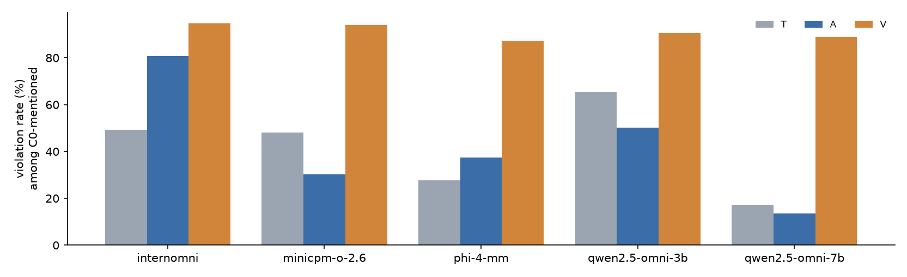
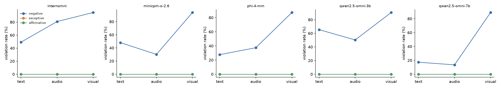

# H1 v2 analysis (all)

Generated by experiments/h1_v2/analyze.py; definitions in its docstring. Violation = the forbidden component is stated (LLM judge, regex second opinion).

Excluded units left out: 276 (double label / part-whole / attribute overlap, create_data/src/flag_excluded_units.py).

ONLY units with asr_ok = True (every audio instruction of the unit passed the Whisper check).

internomni: 52 units left out because of asr_ok = False

## internomni

Violation = any mention (STATE/META/DENY).

Primary negative samples (one per unit): 4338; C0 states the target in 3483 (80.3%).

Target stated without instruction (C0): 80.3%.

### Violation rate (%) among C0-mentioned, negative form

| branch | n | T | A | V |
|---|---|---|---|---|
| existence | 522 | 62.5 | 81.6 | 96.6 |
| existence_closed | 606 | 57.6 | 72.9 | 99.8 |
| count | 741 | 58.3 | 67.6 | 91.8 |
| attribute | 1146 | 43.5 | 89.8 | 94.2 |
| relation | 468 | 23.1 | 89.3 | 92.1 |
| ALL | 3483 | 49.2 | 80.8 | 94.7 |

### Paired comparisons (C0-mentioned, negative form)

| pair | violation A | violation B | A-B (pp) | 95% CI (image bootstrap) | only A violates | only B violates | McNemar p |
|---|---|---|---|---|---|---|---|
| T vs A | 49.2 | 80.8 | -31.6 | [-33.7, -29.7] | 249 | 1351 | 4.01e-183 |
| T vs V | 49.2 | 94.7 | -45.5 | [-47.3, -43.7] | 67 | 1652 | 0 |
| A vs V | 80.8 | 94.7 | -13.9 | [-15.3, -12.4] | 123 | 606 | 1.72e-77 |

### Template N3 ("Never refer to ..."): paired comparisons with / without it

| pair | subset | n | A-B (pp) | 95% CI (image bootstrap) |
|---|---|---|---|---|
| T vs A | all | 3483 | -31.6 | [-33.7, -29.7] |
| T vs A | without N3 | 2984 | -32.9 | [-35.1, -30.6] |
| T vs A | N3 only | 499 | -24.2 | [-28.5, -19.9] |
| T vs V | all | 3483 | -45.5 | [-47.3, -43.7] |
| T vs V | without N3 | 2984 | -48.6 | [-50.5, -46.6] |
| T vs V | N3 only | 499 | -27.3 | [-31.5, -22.9] |
| A vs V | all | 3483 | -13.9 | [-15.3, -12.5] |
| A vs V | without N3 | 2984 | -15.7 | [-17.3, -14.1] |
| A vs V | N3 only | 499 | -3.0 | [-5.7, -0.4] |

### Violation by kind (% of C0-mentioned; the kinds add up to the violation), negative form

STATE = says the forbidden fact · META = names it to exclude it · DENY = says it is absent / false · WRONG = gives a different value.

| condition | violation | STATE | META | DENY | WRONG | leak (= STATE) |
|---|---|---|---|---|---|---|
| T | 49.2 | 46.6 | 0.2 | 2.4 | 0.0 | 46.5 |
| A | 80.8 | 79.6 | 0.4 | 0.9 | 0.0 | 79.2 |
| V | 94.7 | 93.3 | 0.4 | 1.1 | 0.0 | 92.1 |

By branch (STATE / META / DENY / WRONG, %):

| branch | n | T | A | V |
|---|---|---|---|---|
| existence | 522 | 59.4 / 0.0 / 3.1 / 0.0 | 77.4 / 0.0 / 4.2 / 0.0 | 94.8 / 0.0 / 1.7 / 0.0 |
| existence_closed | 606 | 46.4 / 0.3 / 10.9 / 0.0 | 71.3 / 0.2 / 1.5 / 0.0 | 95.7 / 0.0 / 4.1 / 0.0 |
| count | 741 | 57.6 / 0.4 / 0.3 / 0.0 | 67.1 / 0.4 / 0.1 / 0.0 | 91.0 / 0.4 / 0.4 / 0.0 |
| attribute | 1146 | 43.5 / 0.1 / 0.0 / 0.0 | 89.0 / 0.8 / 0.0 / 0.0 | 93.3 / 0.9 / 0.0 / 0.0 |
| relation | 468 | 22.6 / 0.4 / 0.0 / 0.0 | 89.3 / 0.0 / 0.0 / 0.0 | 91.9 / 0.2 / 0.0 / 0.0 |

Paired differences by kind (A-B, pp, 95% CI image bootstrap):

| pair | STATE | META | DENY | WRONG | leak |
|---|---|---|---|---|---|
| T vs A | -33.0 [-35.0, -31.0] | -0.1 [-0.4, +0.1] | +1.5 [+1.0, +2.1] | +0.0 [+0.0, +0.0] | -32.7 [-34.9, -30.8] |
| T vs V | -46.7 [-48.4, -45.0] | -0.2 [-0.4, +0.1] | +1.3 [+0.8, +1.9] | +0.0 [+0.0, +0.0] | -45.6 [-47.5, -43.8] |
| A vs V | -13.7 [-15.1, -12.2] | -0.0 [-0.3, +0.3] | -0.1 [-0.6, +0.3] | +0.0 [+0.0, +0.0] | -12.9 [-14.4, -11.4] |

Flagged for a human check: thinking judge gave no JSON 14; ambiguous bare-number counts 166.

### Required recall (over-suppression), C0-mentioned primary samples

| branch | C0 | T | A | V |
|---|---|---|---|---|
| existence | 70.8 | 73.1 | 31.8 | 72.3 |
| existence_closed | 87.8 | 96.5 | 33.7 | 91.7 |
| count | 36.2 | 36.6 | 10.1 | 39.1 |
| attribute | 83.5 | 82.4 | 30.2 | 82.4 |
| relation | 75.4 | 79.5 | 19.1 | 78.5 |
| ALL | 71.2 | 73.3 | 25.3 | 72.7 |

### Violation rate (%) by split (contamination check)

| split (contamination check) | n | T | A | V |
|---|---|---|---|---|
| train | 1871 | 52.9 | 79.9 | 94.5 |
| val | 1612 | 44.9 | 81.9 | 94.9 |

### Violation rate (%) by source

| source | n | T | A | V |
|---|---|---|---|---|
| CLEVR | 1142 | 48.9 | 82.2 | 96.1 |
| COCO | 1457 | 63.8 | 77.1 | 95.8 |
| GQA | 468 | 23.1 | 89.3 | 92.1 |
| VAW | 416 | 28.1 | 80.5 | 89.9 |

### Violation rate (%) by template (every sample, sweep copies included)

| template (every sample, sweep copies included) | n | T | A | V |
|---|---|---|---|---|
| N1 | 459 | 36.4 | 78.6 | 94.3 |
| N2 | 528 | 58.9 | 95.3 | 94.7 |
| N3 | 499 | 67.9 | 92.2 | 95.2 |
| N4 | 516 | 40.5 | 89.3 | 94.8 |
| N5 | 469 | 36.2 | 61.2 | 94.0 |
| N6 | 498 | 51.0 | 85.1 | 95.6 |
| N7 | 514 | 51.4 | 62.3 | 94.4 |

### Violation rate (%) by voice

| voice | n | A |
|---|---|---|
| female | 1888 | 83.8 |
| male | 1595 | 77.3 |

### Violation rate (%) by asr_ok

| asr_ok | n | A |
|---|---|---|
| True | 3483 | 80.8 |

### Violation rate (%) by occludes_subject

| occludes_subject | n | V |
|---|---|---|
| False | 3353 | 94.8 |
| True | 130 | 93.1 |

### H4: forms (C0-mentioned units that have the form)

| form | channel | n | violation % | F = 1 - violation |
|---|---|---|---|---|
| negative | text | 3483 | 49.2 | 50.8 |
| negative | audio | 3483 | 80.8 | 19.2 |
| negative | visual | 3483 | 94.7 | 5.3 |

Delta_m = F_aff,m - F_neg,m (and the exceptive analogue), same units; 95% image-bootstrap CI.

| contrast | text | audio | visual | audio - text | visual - text |
|---|---|---|---|---|---|

minicpm-o-2.6: 52 units left out because of asr_ok = False

## minicpm-o-2.6

Violation = any mention (STATE/META/DENY).

Primary negative samples (one per unit): 4338; C0 states the target in 3441 (79.3%).

Target stated without instruction (C0): 79.3%.

### Violation rate (%) among C0-mentioned, negative form

| branch | n | T | A | V |
|---|---|---|---|---|
| existence | 548 | 42.0 | 42.0 | 97.4 |
| existence_closed | 608 | 85.9 | 60.7 | 99.2 |
| count | 854 | 56.8 | 27.3 | 98.0 |
| attribute | 950 | 28.5 | 16.4 | 87.2 |
| relation | 481 | 30.4 | 10.2 | 89.4 |
| ALL | 3441 | 48.1 | 30.1 | 93.9 |

### Paired comparisons (C0-mentioned, negative form)

| pair | violation A | violation B | A-B (pp) | 95% CI (image bootstrap) | only A violates | only B violates | McNemar p |
|---|---|---|---|---|---|---|---|
| T vs A | 48.1 | 30.1 | +17.9 | [+16.2, +19.7] | 848 | 231 | 2.85e-83 |
| T vs V | 48.1 | 93.9 | -45.9 | [-47.6, -44.1] | 52 | 1630 | 0 |
| A vs V | 30.1 | 93.9 | -63.8 | [-65.4, -62.1] | 26 | 2221 | 0 |

### Template N3 ("Never refer to ..."): paired comparisons with / without it

| pair | subset | n | A-B (pp) | 95% CI (image bootstrap) |
|---|---|---|---|---|
| T vs A | all | 3441 | +17.9 | [+16.0, +19.6] |
| T vs A | without N3 | 2958 | +18.6 | [+16.6, +20.6] |
| T vs A | N3 only | 483 | +14.1 | [+9.6, +18.5] |
| T vs V | all | 3441 | -45.9 | [-47.6, -44.1] |
| T vs V | without N3 | 2958 | -49.3 | [-51.2, -47.4] |
| T vs V | N3 only | 483 | -24.6 | [-29.0, -20.2] |
| A vs V | all | 3441 | -63.8 | [-65.5, -62.1] |
| A vs V | without N3 | 2958 | -67.9 | [-69.8, -66.1] |
| A vs V | N3 only | 483 | -38.7 | [-43.4, -34.2] |

### Violation by kind (% of C0-mentioned; the kinds add up to the violation), negative form

STATE = says the forbidden fact · META = names it to exclude it · DENY = says it is absent / false · WRONG = gives a different value.

| condition | violation | STATE | META | DENY | WRONG | leak (= STATE) |
|---|---|---|---|---|---|---|
| T | 48.1 | 38.5 | 2.3 | 7.2 | 0.1 | 38.4 |
| A | 30.1 | 20.4 | 4.2 | 5.5 | 0.0 | 20.3 |
| V | 93.9 | 91.1 | 1.1 | 1.6 | 0.1 | 90.5 |

By branch (STATE / META / DENY / WRONG, %):

| branch | n | T | A | V |
|---|---|---|---|---|
| existence | 548 | 38.9 / 1.1 / 2.0 / 0.0 | 32.8 / 4.2 / 4.9 / 0.0 | 96.9 / 0.0 / 0.5 / 0.0 |
| existence_closed | 608 | 47.2 / 4.4 / 34.2 / 0.0 | 22.7 / 13.0 / 25.0 / 0.0 | 90.8 / 0.0 / 8.4 / 0.0 |
| count | 854 | 52.7 / 0.5 / 3.3 / 0.4 | 24.2 / 1.8 / 1.2 / 0.1 | 97.3 / 0.0 / 0.1 / 0.6 |
| attribute | 950 | 24.3 / 4.2 / 0.0 / 0.0 | 13.7 / 2.7 / 0.0 / 0.0 | 83.4 / 3.8 / 0.0 / 0.0 |
| relation | 481 | 29.9 / 0.4 / 0.0 / 0.0 | 9.6 / 0.4 / 0.2 / 0.0 | 89.0 / 0.4 / 0.0 / 0.0 |

Paired differences by kind (A-B, pp, 95% CI image bootstrap):

| pair | STATE | META | DENY | WRONG | leak |
|---|---|---|---|---|---|
| T vs A | +18.1 [+16.5, +19.9] | -1.9 [-2.7, -1.2] | +1.7 [+0.7, +2.6] | +0.1 [+0.0, +0.1] | +18.1 [+16.4, +19.8] |
| T vs V | -52.6 [-54.2, -50.8] | +1.2 [+0.7, +1.7] | +5.6 [+4.7, +6.5] | -0.1 [-0.2, +0.1] | -52.1 [-54.0, -50.3] |
| A vs V | -70.7 [-72.3, -69.1] | +3.1 [+2.4, +3.9] | +3.9 [+3.1, +4.7] | -0.1 [-0.2, -0.0] | -70.2 [-71.9, -68.6] |

Flagged for a human check: thinking judge gave no JSON 42; ambiguous bare-number counts 0.

### Required recall (over-suppression), C0-mentioned primary samples

| branch | C0 | T | A | V |
|---|---|---|---|---|
| existence | 78.7 | 82.5 | 81.1 | 75.6 |
| existence_closed | 94.3 | 97.8 | 95.1 | 93.7 |
| count | 94.5 | 92.5 | 90.5 | 93.2 |
| attribute | 60.4 | 71.6 | 74.0 | 60.4 |
| relation | 78.7 | 81.7 | 81.8 | 76.9 |
| ALL | 80.3 | 84.6 | 84.1 | 79.1 |

### Violation rate (%) by split (contamination check)

| split (contamination check) | n | T | A | V |
|---|---|---|---|---|
| train | 1949 | 55.7 | 37.1 | 95.4 |
| val | 1492 | 38.1 | 21.0 | 92.0 |

### Violation rate (%) by source

| source | n | T | A | V |
|---|---|---|---|---|
| CLEVR | 989 | 36.5 | 18.8 | 93.6 |
| COCO | 1506 | 66.6 | 46.9 | 98.1 |
| GQA | 481 | 30.4 | 10.2 | 89.4 |
| VAW | 465 | 31.0 | 20.4 | 85.8 |

### Violation rate (%) by template (every sample, sweep copies included)

| template (every sample, sweep copies included) | n | T | A | V |
|---|---|---|---|---|
| N1 | 454 | 45.2 | 23.8 | 93.2 |
| N2 | 528 | 46.0 | 31.6 | 96.8 |
| N3 | 483 | 70.2 | 56.1 | 94.8 |
| N4 | 503 | 43.1 | 28.8 | 96.0 |
| N5 | 459 | 34.2 | 14.2 | 90.6 |
| N6 | 491 | 45.6 | 28.1 | 93.1 |
| N7 | 523 | 51.4 | 27.3 | 92.5 |

### Violation rate (%) by voice

| voice | n | A |
|---|---|---|
| female | 1847 | 30.3 |
| male | 1594 | 30.0 |

### Violation rate (%) by asr_ok

| asr_ok | n | A |
|---|---|---|
| True | 3441 | 30.1 |

### Violation rate (%) by occludes_subject

| occludes_subject | n | V |
|---|---|---|
| False | 3309 | 94.0 |
| True | 132 | 92.4 |

### H4: forms (C0-mentioned units that have the form)

| form | channel | n | violation % | F = 1 - violation |
|---|---|---|---|---|
| negative | text | 3441 | 48.1 | 51.9 |
| negative | audio | 3441 | 30.1 | 69.9 |
| negative | visual | 3441 | 93.9 | 6.1 |

Delta_m = F_aff,m - F_neg,m (and the exceptive analogue), same units; 95% image-bootstrap CI.

| contrast | text | audio | visual | audio - text | visual - text |
|---|---|---|---|---|---|

phi-4-mm: 52 units left out because of asr_ok = False

## phi-4-mm

Violation = any mention (STATE/META/DENY).

Primary negative samples (one per unit): 4338; C0 states the target in 3478 (80.2%).

Target stated without instruction (C0): 80.2%.

### Violation rate (%) among C0-mentioned, negative form

| branch | n | T | A | V |
|---|---|---|---|---|
| existence | 546 | 7.9 | 53.8 | 96.9 |
| existence_closed | 608 | 10.7 | 55.6 | 99.8 |
| count | 703 | 42.2 | 39.5 | 86.5 |
| attribute | 1142 | 34.3 | 20.8 | 78.4 |
| relation | 479 | 34.2 | 31.9 | 82.3 |
| ALL | 3478 | 27.6 | 37.4 | 87.2 |

### Paired comparisons (C0-mentioned, negative form)

| pair | violation A | violation B | A-B (pp) | 95% CI (image bootstrap) | only A violates | only B violates | McNemar p |
|---|---|---|---|---|---|---|---|
| T vs A | 27.6 | 37.4 | -9.8 | [-11.9, -7.7] | 449 | 789 | 3.14e-22 |
| T vs V | 27.6 | 87.2 | -59.6 | [-61.5, -57.7] | 141 | 2213 | 0 |
| A vs V | 37.4 | 87.2 | -49.8 | [-51.7, -47.8] | 90 | 1822 | 0 |

### Template N3 ("Never refer to ..."): paired comparisons with / without it

| pair | subset | n | A-B (pp) | 95% CI (image bootstrap) |
|---|---|---|---|---|
| T vs A | all | 3478 | -9.8 | [-12.0, -7.7] |
| T vs A | without N3 | 2976 | -8.7 | [-11.1, -6.6] |
| T vs A | N3 only | 502 | -15.9 | [-21.9, -10.1] |
| T vs V | all | 3478 | -59.6 | [-61.4, -57.7] |
| T vs V | without N3 | 2976 | -59.6 | [-61.5, -57.5] |
| T vs V | N3 only | 502 | -59.4 | [-63.9, -54.6] |
| A vs V | all | 3478 | -49.8 | [-51.7, -47.9] |
| A vs V | without N3 | 2976 | -50.9 | [-52.9, -48.8] |
| A vs V | N3 only | 502 | -43.4 | [-48.4, -38.3] |

### Violation by kind (% of C0-mentioned; the kinds add up to the violation), negative form

STATE = says the forbidden fact · META = names it to exclude it · DENY = says it is absent / false · WRONG = gives a different value.

| condition | violation | STATE | META | DENY | WRONG | leak (= STATE) |
|---|---|---|---|---|---|---|
| T | 27.6 | 27.3 | 0.2 | 0.1 | 0.0 | 27.3 |
| A | 37.4 | 36.0 | 0.1 | 1.3 | 0.0 | 35.3 |
| V | 87.2 | 85.6 | 1.1 | 0.6 | 0.0 | 83.7 |

By branch (STATE / META / DENY / WRONG, %):

| branch | n | T | A | V |
|---|---|---|---|---|
| existence | 546 | 7.1 / 0.0 / 0.7 / 0.0 | 51.3 / 0.2 / 2.4 / 0.0 | 96.2 / 0.0 / 0.7 / 0.0 |
| existence_closed | 608 | 10.5 / 0.2 / 0.0 / 0.0 | 50.5 / 0.2 / 4.9 / 0.0 | 97.5 / 0.0 / 2.3 / 0.0 |
| count | 703 | 42.2 / 0.0 / 0.0 / 0.0 | 39.4 / 0.0 / 0.1 / 0.0 | 83.6 / 2.6 / 0.3 / 0.0 |
| attribute | 1142 | 34.2 / 0.1 / 0.0 / 0.0 | 20.8 / 0.1 / 0.0 / 0.0 | 77.1 / 1.2 / 0.0 / 0.0 |
| relation | 479 | 33.4 / 0.8 / 0.0 / 0.0 | 31.7 / 0.2 / 0.0 / 0.0 | 81.2 / 1.0 / 0.0 / 0.0 |

Paired differences by kind (A-B, pp, 95% CI image bootstrap):

| pair | STATE | META | DENY | WRONG | leak |
|---|---|---|---|---|---|
| T vs A | -8.7 [-10.8, -6.6] | +0.1 [-0.1, +0.2] | -1.2 [-1.5, -0.8] | +0.0 [+0.0, +0.0] | -8.0 [-10.0, -5.9] |
| T vs V | -58.2 [-60.1, -56.2] | -0.9 [-1.2, -0.6] | -0.5 [-0.7, -0.2] | +0.0 [+0.0, +0.0] | -56.4 [-58.2, -54.4] |
| A vs V | -49.5 [-51.6, -47.8] | -0.9 [-1.3, -0.6] | +0.7 [+0.3, +1.1] | +0.0 [+0.0, +0.0] | -48.3 [-50.3, -46.3] |

Flagged for a human check: thinking judge gave no JSON 33; ambiguous bare-number counts 262.

### Required recall (over-suppression), C0-mentioned primary samples

| branch | C0 | T | A | V |
|---|---|---|---|---|
| existence | 78.3 | 63.9 | 76.5 | 79.0 |
| existence_closed | 98.1 | 95.0 | 91.6 | 97.6 |
| count | 74.7 | 5.3 | 16.4 | 64.7 |
| attribute | 78.0 | 79.1 | 80.3 | 76.8 |
| relation | 75.3 | 73.4 | 75.4 | 74.6 |
| ALL | 80.5 | 63.8 | 68.1 | 78.0 |

### Violation rate (%) by split (contamination check)

| split (contamination check) | n | T | A | V |
|---|---|---|---|---|
| train | 1889 | 23.6 | 49.2 | 91.9 |
| val | 1589 | 32.4 | 23.4 | 81.6 |

### Violation rate (%) by source

| source | n | T | A | V |
|---|---|---|---|---|
| CLEVR | 1094 | 31.9 | 16.7 | 81.2 |
| COCO | 1447 | 19.5 | 56.2 | 95.4 |
| GQA | 479 | 34.2 | 31.9 | 82.3 |
| VAW | 458 | 36.2 | 33.2 | 81.0 |

### Violation rate (%) by template (every sample, sweep copies included)

| template (every sample, sweep copies included) | n | T | A | V |
|---|---|---|---|---|
| N1 | 459 | 26.6 | 35.9 | 83.0 |
| N2 | 521 | 20.0 | 41.8 | 91.4 |
| N3 | 502 | 31.7 | 47.6 | 91.0 |
| N4 | 506 | 17.0 | 39.7 | 89.9 |
| N5 | 466 | 35.2 | 24.7 | 73.8 |
| N6 | 502 | 40.2 | 43.4 | 88.2 |
| N7 | 522 | 23.8 | 27.8 | 91.4 |

### Violation rate (%) by voice

| voice | n | A |
|---|---|---|
| female | 1888 | 37.3 |
| male | 1590 | 37.5 |

### Violation rate (%) by asr_ok

| asr_ok | n | A |
|---|---|---|
| True | 3478 | 37.4 |

### Violation rate (%) by occludes_subject

| occludes_subject | n | V |
|---|---|---|
| False | 3344 | 87.1 |
| True | 134 | 88.8 |

### H4: forms (C0-mentioned units that have the form)

| form | channel | n | violation % | F = 1 - violation |
|---|---|---|---|---|
| negative | text | 3478 | 27.6 | 72.4 |
| negative | audio | 3478 | 37.4 | 62.6 |
| negative | visual | 3478 | 87.2 | 12.8 |

Delta_m = F_aff,m - F_neg,m (and the exceptive analogue), same units; 95% image-bootstrap CI.

| contrast | text | audio | visual | audio - text | visual - text |
|---|---|---|---|---|---|

qwen2.5-omni-3b: 52 units left out because of asr_ok = False

## qwen2.5-omni-3b

Violation = any mention (STATE/META/DENY).

Primary negative samples (one per unit): 4338; C0 states the target in 3558 (82.0%).

Target stated without instruction (C0): 82.0%.

### Violation rate (%) among C0-mentioned, negative form

| branch | n | T | A | V |
|---|---|---|---|---|
| existence | 554 | 28.2 | 25.8 | 96.9 |
| existence_closed | 608 | 50.3 | 47.7 | 99.2 |
| count | 775 | 89.7 | 71.1 | 87.5 |
| attribute | 1128 | 64.5 | 42.3 | 86.2 |
| relation | 493 | 89.9 | 66.5 | 87.6 |
| ALL | 3558 | 65.4 | 50.3 | 90.6 |

### Paired comparisons (C0-mentioned, negative form)

| pair | violation A | violation B | A-B (pp) | 95% CI (image bootstrap) | only A violates | only B violates | McNemar p |
|---|---|---|---|---|---|---|---|
| T vs A | 65.4 | 50.3 | +15.1 | [+13.5, +16.8] | 738 | 200 | 4.66e-73 |
| T vs V | 65.4 | 90.6 | -25.2 | [-27.0, -23.4] | 193 | 1088 | 1.16e-151 |
| A vs V | 50.3 | 90.6 | -40.3 | [-42.1, -38.4] | 143 | 1576 | 1.96e-305 |

### Template N3 ("Never refer to ..."): paired comparisons with / without it

| pair | subset | n | A-B (pp) | 95% CI (image bootstrap) |
|---|---|---|---|---|
| T vs A | all | 3558 | +15.1 | [+13.5, +16.7] |
| T vs A | without N3 | 3050 | +16.8 | [+15.1, +18.5] |
| T vs A | N3 only | 508 | +4.9 | [+1.2, +8.8] |
| T vs V | all | 3558 | -25.2 | [-26.9, -23.4] |
| T vs V | without N3 | 3050 | -26.1 | [-28.1, -24.2] |
| T vs V | N3 only | 508 | -19.3 | [-23.9, -14.6] |
| A vs V | all | 3558 | -40.3 | [-42.1, -38.4] |
| A vs V | without N3 | 3050 | -43.0 | [-44.9, -41.0] |
| A vs V | N3 only | 508 | -24.2 | [-28.6, -19.6] |

### Violation by kind (% of C0-mentioned; the kinds add up to the violation), negative form

STATE = says the forbidden fact · META = names it to exclude it · DENY = says it is absent / false · WRONG = gives a different value.

| condition | violation | STATE | META | DENY | WRONG | leak (= STATE) |
|---|---|---|---|---|---|---|
| T | 65.4 | 57.8 | 2.7 | 4.9 | 0.0 | 57.4 |
| A | 50.3 | 43.0 | 2.2 | 5.1 | 0.0 | 42.6 |
| V | 90.6 | 82.3 | 6.1 | 2.1 | 0.0 | 81.2 |

By branch (STATE / META / DENY / WRONG, %):

| branch | n | T | A | V |
|---|---|---|---|---|
| existence | 554 | 25.1 / 2.2 / 0.9 / 0.0 | 24.7 / 0.9 / 0.2 / 0.0 | 92.8 / 3.6 / 0.5 / 0.0 |
| existence_closed | 608 | 25.7 / 1.5 / 23.2 / 0.0 | 17.6 / 1.6 / 28.5 / 0.0 | 86.8 / 0.3 / 12.0 / 0.0 |
| count | 775 | 85.5 / 0.6 / 3.5 / 0.0 | 69.9 / 0.3 / 0.9 / 0.0 | 86.8 / 0.6 / 0.0 / 0.0 |
| attribute | 1128 | 58.9 / 5.6 / 0.0 / 0.0 | 37.9 / 4.3 / 0.0 / 0.0 | 70.0 / 16.1 / 0.0 / 0.0 |
| relation | 493 | 88.4 / 1.4 / 0.0 / 0.0 | 64.1 / 2.2 / 0.2 / 0.0 | 86.0 / 1.6 / 0.0 / 0.0 |

Paired differences by kind (A-B, pp, 95% CI image bootstrap):

| pair | STATE | META | DENY | WRONG | leak |
|---|---|---|---|---|---|
| T vs A | +14.8 [+13.4, +16.3] | +0.5 [-0.1, +1.2] | -0.3 [-1.0, +0.5] | +0.0 [+0.0, +0.0] | +14.8 [+13.4, +16.3] |
| T vs V | -24.5 [-26.5, -22.6] | -3.4 [-4.4, -2.5] | +2.7 [+1.9, +3.5] | +0.0 [+0.0, +0.0] | -23.7 [-25.7, -21.7] |
| A vs V | -39.3 [-41.2, -37.4] | -3.9 [-4.8, -3.1] | +3.0 [+2.2, +3.7] | +0.0 [+0.0, +0.0] | -38.6 [-40.6, -36.7] |

Flagged for a human check: thinking judge gave no JSON 144; ambiguous bare-number counts 0.

### Required recall (over-suppression), C0-mentioned primary samples

| branch | C0 | T | A | V |
|---|---|---|---|---|
| existence | 83.0 | 80.8 | 80.9 | 73.5 |
| existence_closed | 90.0 | 97.1 | 97.1 | 87.7 |
| count | 85.2 | 86.5 | 88.6 | 85.5 |
| attribute | 72.9 | 71.4 | 72.5 | 72.1 |
| relation | 82.1 | 80.1 | 80.7 | 75.6 |
| ALL | 81.4 | 81.8 | 82.7 | 78.4 |

### Violation rate (%) by split (contamination check)

| split (contamination check) | n | T | A | V |
|---|---|---|---|---|
| train | 1919 | 58.5 | 47.4 | 92.7 |
| val | 1639 | 73.5 | 53.6 | 88.1 |

### Violation rate (%) by source

| source | n | T | A | V |
|---|---|---|---|---|
| CLEVR | 1132 | 76.6 | 54.2 | 89.1 |
| COCO | 1475 | 48.7 | 40.4 | 95.2 |
| GQA | 493 | 89.9 | 66.5 | 87.6 |
| VAW | 458 | 65.1 | 55.0 | 82.3 |

### Violation rate (%) by template (every sample, sweep copies included)

| template (every sample, sweep copies included) | n | T | A | V |
|---|---|---|---|---|
| N1 | 462 | 65.8 | 41.3 | 92.0 |
| N2 | 537 | 74.9 | 54.2 | 90.5 |
| N3 | 508 | 72.4 | 67.5 | 91.7 |
| N4 | 512 | 61.1 | 42.6 | 91.2 |
| N5 | 475 | 64.4 | 52.2 | 89.3 |
| N6 | 525 | 64.0 | 53.0 | 88.8 |
| N7 | 539 | 55.3 | 40.8 | 90.5 |

### Violation rate (%) by voice

| voice | n | A |
|---|---|---|
| female | 1928 | 48.1 |
| male | 1630 | 52.8 |

### Violation rate (%) by asr_ok

| asr_ok | n | A |
|---|---|---|
| True | 3558 | 50.3 |

### Violation rate (%) by occludes_subject

| occludes_subject | n | V |
|---|---|---|
| False | 3426 | 90.4 |
| True | 132 | 94.7 |

### H4: forms (C0-mentioned units that have the form)

| form | channel | n | violation % | F = 1 - violation |
|---|---|---|---|---|
| negative | text | 3558 | 65.4 | 34.6 |
| negative | audio | 3558 | 50.3 | 49.7 |
| negative | visual | 3558 | 90.6 | 9.4 |

Delta_m = F_aff,m - F_neg,m (and the exceptive analogue), same units; 95% image-bootstrap CI.

| contrast | text | audio | visual | audio - text | visual - text |
|---|---|---|---|---|---|

qwen2.5-omni-7b: 52 units left out because of asr_ok = False

## qwen2.5-omni-7b

Violation = any mention (STATE/META/DENY).

Primary negative samples (one per unit): 4338; C0 states the target in 3535 (81.5%).

Target stated without instruction (C0): 81.5%.

### Violation rate (%) among C0-mentioned, negative form

| branch | n | T | A | V |
|---|---|---|---|---|
| existence | 562 | 13.9 | 11.6 | 88.6 |
| existence_closed | 586 | 35.2 | 30.5 | 95.4 |
| count | 879 | 16.2 | 8.8 | 93.7 |
| attribute | 1001 | 13.4 | 11.3 | 83.0 |
| relation | 507 | 9.9 | 8.3 | 85.4 |
| ALL | 3535 | 17.3 | 13.5 | 89.0 |

### Paired comparisons (C0-mentioned, negative form)

| pair | violation A | violation B | A-B (pp) | 95% CI (image bootstrap) | only A violates | only B violates | McNemar p |
|---|---|---|---|---|---|---|---|
| T vs A | 17.3 | 13.5 | +3.8 | [+2.6, +5.0] | 298 | 164 | 4.65e-10 |
| T vs V | 17.3 | 89.0 | -71.7 | [-73.2, -70.2] | 29 | 2564 | 0 |
| A vs V | 13.5 | 89.0 | -75.5 | [-77.1, -74.0] | 25 | 2694 | 0 |

### Template N3 ("Never refer to ..."): paired comparisons with / without it

| pair | subset | n | A-B (pp) | 95% CI (image bootstrap) |
|---|---|---|---|---|
| T vs A | all | 3535 | +3.8 | [+2.6, +5.0] |
| T vs A | without N3 | 3028 | +3.7 | [+2.4, +4.9] |
| T vs A | N3 only | 507 | +4.5 | [+0.8, +8.5] |
| T vs V | all | 3535 | -71.7 | [-73.2, -70.2] |
| T vs V | without N3 | 3028 | -73.2 | [-74.7, -71.5] |
| T vs V | N3 only | 507 | -63.1 | [-67.5, -58.9] |
| A vs V | all | 3535 | -75.5 | [-77.0, -74.0] |
| A vs V | without N3 | 3028 | -76.8 | [-78.3, -75.2] |
| A vs V | N3 only | 507 | -67.7 | [-71.7, -63.1] |

### Violation by kind (% of C0-mentioned; the kinds add up to the violation), negative form

STATE = says the forbidden fact · META = names it to exclude it · DENY = says it is absent / false · WRONG = gives a different value.

| condition | violation | STATE | META | DENY | WRONG | leak (= STATE) |
|---|---|---|---|---|---|---|
| T | 17.3 | 10.7 | 2.2 | 4.4 | 0.0 | 10.5 |
| A | 13.5 | 7.8 | 2.5 | 3.2 | 0.0 | 7.6 |
| V | 89.0 | 80.4 | 6.2 | 2.4 | 0.0 | 79.0 |

By branch (STATE / META / DENY / WRONG, %):

| branch | n | T | A | V |
|---|---|---|---|---|
| existence | 562 | 11.7 / 1.6 / 0.5 / 0.0 | 7.5 / 3.4 / 0.7 / 0.0 | 87.2 / 1.2 / 0.2 / 0.0 |
| existence_closed | 586 | 8.0 / 1.9 / 25.3 / 0.0 | 8.9 / 3.4 / 18.3 / 0.0 | 81.7 / 1.2 / 12.5 / 0.0 |
| count | 879 | 13.0 / 2.8 / 0.3 / 0.0 | 5.6 / 2.8 / 0.3 / 0.0 | 84.5 / 8.2 / 1.0 / 0.0 |
| attribute | 1001 | 10.8 / 2.6 / 0.0 / 0.0 | 9.8 / 1.5 / 0.0 / 0.0 | 71.0 / 11.9 / 0.1 / 0.0 |
| relation | 507 | 8.3 / 1.4 / 0.2 / 0.0 | 6.5 / 1.8 / 0.0 / 0.0 | 82.6 / 2.6 / 0.2 / 0.0 |

Paired differences by kind (A-B, pp, 95% CI image bootstrap):

| pair | STATE | META | DENY | WRONG | leak |
|---|---|---|---|---|---|
| T vs A | +2.9 [+2.0, +3.8] | -0.3 [-0.9, +0.3] | +1.2 [+0.5, +1.8] | +0.0 [+0.0, +0.0] | +2.9 [+1.9, +3.9] |
| T vs V | -69.7 [-71.3, -68.1] | -4.0 [-4.8, -3.0] | +2.0 [+1.2, +2.7] | +0.0 [+0.0, +0.0] | -68.5 [-70.3, -66.9] |
| A vs V | -72.6 [-74.2, -71.1] | -3.7 [-4.7, -2.7] | +0.8 [+0.1, +1.5] | +0.0 [+0.0, +0.0] | -71.4 [-73.0, -69.8] |

Flagged for a human check: thinking judge gave no JSON 113; ambiguous bare-number counts 0.

### Required recall (over-suppression), C0-mentioned primary samples

| branch | C0 | T | A | V |
|---|---|---|---|---|
| existence | 83.4 | 82.6 | 81.5 | 80.4 |
| existence_closed | 88.8 | 98.5 | 99.2 | 92.2 |
| count | 94.9 | 93.1 | 92.3 | 89.5 |
| attribute | 60.8 | 69.8 | 68.8 | 63.3 |
| relation | 81.2 | 81.8 | 82.9 | 78.9 |
| ALL | 80.4 | 84.1 | 83.8 | 79.5 |

### Violation rate (%) by split (contamination check)

| split (contamination check) | n | T | A | V |
|---|---|---|---|---|
| train | 1976 | 18.2 | 15.9 | 89.7 |
| val | 1559 | 16.1 | 10.4 | 88.0 |

### Violation rate (%) by source

| source | n | T | A | V |
|---|---|---|---|---|
| CLEVR | 1036 | 12.8 | 6.0 | 88.7 |
| COCO | 1513 | 20.8 | 17.7 | 91.9 |
| GQA | 507 | 9.9 | 8.3 | 85.4 |
| VAW | 479 | 23.4 | 21.7 | 84.1 |

### Violation rate (%) by template (every sample, sweep copies included)

| template (every sample, sweep copies included) | n | T | A | V |
|---|---|---|---|---|
| N1 | 462 | 13.9 | 11.0 | 89.4 |
| N2 | 541 | 18.1 | 14.2 | 91.7 |
| N3 | 507 | 29.0 | 24.5 | 92.1 |
| N4 | 517 | 14.1 | 13.7 | 92.5 |
| N5 | 473 | 10.1 | 4.7 | 75.7 |
| N6 | 510 | 19.6 | 13.7 | 88.6 |
| N7 | 525 | 15.2 | 11.6 | 91.6 |

### Violation rate (%) by voice

| voice | n | A |
|---|---|---|
| female | 1911 | 12.6 |
| male | 1624 | 14.5 |

### Violation rate (%) by asr_ok

| asr_ok | n | A |
|---|---|---|
| True | 3535 | 13.5 |

### Violation rate (%) by occludes_subject

| occludes_subject | n | V |
|---|---|---|
| False | 3400 | 88.9 |
| True | 135 | 91.9 |

### H4: forms (C0-mentioned units that have the form)

| form | channel | n | violation % | F = 1 - violation |
|---|---|---|---|---|
| negative | text | 3535 | 17.3 | 82.7 |
| negative | audio | 3535 | 13.5 | 86.5 |
| negative | visual | 3535 | 89.0 | 11.0 |

Delta_m = F_aff,m - F_neg,m (and the exceptive analogue), same units; 95% image-bootstrap CI.

| contrast | text | audio | visual | audio - text | visual - text |
|---|---|---|---|---|---|

