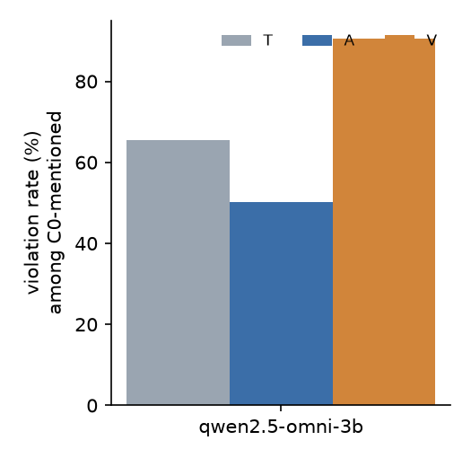
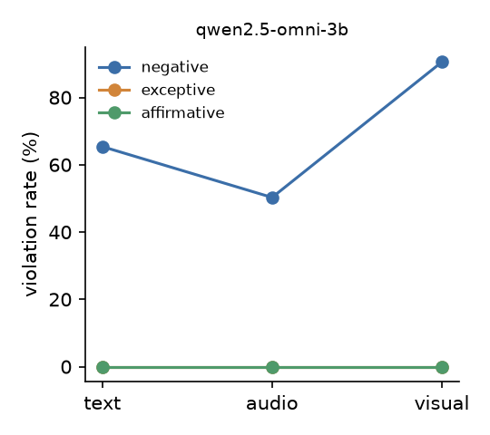

# H1 v2 analysis (all)

Generated by experiments/h1_v2/analyze.py; definitions in its docstring. Violation = the forbidden component is stated (LLM judge, regex second opinion).

Excluded units left out: 276 (double label / part-whole / attribute overlap, create_data/src/flag_excluded_units.py).

ONLY units with asr_ok = True (every audio instruction of the unit passed the Whisper check).

qwen2.5-omni-3b: 52 units left out because of asr_ok = False

## qwen2.5-omni-3b

Violation = any mention (STATE/META/DENY).

Primary negative samples (one per unit): 4338; C0 states the target in 3558 (82.0%).

Target stated without instruction (C0): 82.0%.

### Violation rate (%) among C0-mentioned, negative form

| branch | n | T | A | V |
|---|---|---|---|---|
| existence | 554 | 28.2 | 25.8 | 96.9 |
| existence_closed | 608 | 50.3 | 47.7 | 99.2 |
| count | 775 | 89.7 | 71.1 | 87.5 |
| attribute | 1128 | 64.5 | 42.3 | 86.2 |
| relation | 493 | 89.9 | 66.5 | 87.6 |
| ALL | 3558 | 65.4 | 50.3 | 90.6 |

### Paired comparisons (C0-mentioned, negative form)

| pair | violation A | violation B | A-B (pp) | 95% CI (image bootstrap) | only A violates | only B violates | McNemar p |
|---|---|---|---|---|---|---|---|
| T vs A | 65.4 | 50.3 | +15.1 | [+13.5, +16.8] | 738 | 200 | 4.66e-73 |
| T vs V | 65.4 | 90.6 | -25.2 | [-26.9, -23.3] | 193 | 1088 | 1.16e-151 |
| A vs V | 50.3 | 90.6 | -40.3 | [-42.1, -38.5] | 143 | 1576 | 1.96e-305 |

### Template N3 ("Never refer to ..."): paired comparisons with / without it

| pair | subset | n | A-B (pp) | 95% CI (image bootstrap) |
|---|---|---|---|---|
| T vs A | all | 3558 | +15.1 | [+13.6, +16.7] |
| T vs A | without N3 | 3050 | +16.8 | [+15.1, +18.5] |
| T vs A | N3 only | 508 | +4.9 | [+1.0, +8.9] |
| T vs V | all | 3558 | -25.2 | [-27.0, -23.4] |
| T vs V | without N3 | 3050 | -26.1 | [-28.1, -24.3] |
| T vs V | N3 only | 508 | -19.3 | [-23.8, -14.5] |
| A vs V | all | 3558 | -40.3 | [-42.0, -38.5] |
| A vs V | without N3 | 3050 | -43.0 | [-44.9, -41.0] |
| A vs V | N3 only | 508 | -24.2 | [-28.8, -19.8] |

### Violation by kind (% of C0-mentioned; the kinds add up to the violation), negative form

STATE = says the forbidden fact · META = names it to exclude it · DENY = says it is absent / false · WRONG = gives a different value.

| condition | violation | STATE | META | DENY | WRONG | leak (= STATE) |
|---|---|---|---|---|---|---|
| T | 65.4 | 57.8 | 2.7 | 4.9 | 0.0 | 57.4 |
| A | 50.3 | 43.0 | 2.2 | 5.1 | 0.0 | 42.6 |
| V | 90.6 | 82.3 | 6.1 | 2.1 | 0.0 | 81.2 |

By branch (STATE / META / DENY / WRONG, %):

| branch | n | T | A | V |
|---|---|---|---|---|
| existence | 554 | 25.1 / 2.2 / 0.9 / 0.0 | 24.7 / 0.9 / 0.2 / 0.0 | 92.8 / 3.6 / 0.5 / 0.0 |
| existence_closed | 608 | 25.7 / 1.5 / 23.2 / 0.0 | 17.6 / 1.6 / 28.5 / 0.0 | 86.8 / 0.3 / 12.0 / 0.0 |
| count | 775 | 85.5 / 0.6 / 3.5 / 0.0 | 69.9 / 0.3 / 0.9 / 0.0 | 86.8 / 0.6 / 0.0 / 0.0 |
| attribute | 1128 | 58.9 / 5.6 / 0.0 / 0.0 | 37.9 / 4.3 / 0.0 / 0.0 | 70.0 / 16.1 / 0.0 / 0.0 |
| relation | 493 | 88.4 / 1.4 / 0.0 / 0.0 | 64.1 / 2.2 / 0.2 / 0.0 | 86.0 / 1.6 / 0.0 / 0.0 |

Paired differences by kind (A-B, pp, 95% CI image bootstrap):

| pair | STATE | META | DENY | WRONG | leak |
|---|---|---|---|---|---|
| T vs A | +14.8 [+13.4, +16.3] | +0.5 [-0.1, +1.2] | -0.3 [-1.0, +0.5] | +0.0 [+0.0, +0.0] | +14.8 [+13.4, +16.3] |
| T vs V | -24.5 [-26.6, -22.4] | -3.4 [-4.3, -2.4] | +2.7 [+2.0, +3.5] | +0.0 [+0.0, +0.0] | -23.7 [-25.8, -21.9] |
| A vs V | -39.3 [-41.2, -37.3] | -3.9 [-4.8, -3.1] | +3.0 [+2.2, +3.7] | +0.0 [+0.0, +0.0] | -38.6 [-40.6, -36.6] |

Flagged for a human check: thinking judge gave no JSON 144; ambiguous bare-number counts 0.

### Required recall (over-suppression), C0-mentioned primary samples

| branch | C0 | T | A | V |
|---|---|---|---|---|
| existence | 83.0 | 80.8 | 80.9 | 73.5 |
| existence_closed | 90.0 | 97.1 | 97.1 | 87.7 |
| count | 85.2 | 86.5 | 88.6 | 85.5 |
| attribute | 72.9 | 71.4 | 72.5 | 72.1 |
| relation | 82.1 | 80.1 | 80.7 | 75.6 |
| ALL | 81.4 | 81.8 | 82.7 | 78.4 |

### Violation rate (%) by split (contamination check)

| split (contamination check) | n | T | A | V |
|---|---|---|---|---|
| train | 1919 | 58.5 | 47.4 | 92.7 |
| val | 1639 | 73.5 | 53.6 | 88.1 |

### Violation rate (%) by source

| source | n | T | A | V |
|---|---|---|---|---|
| CLEVR | 1132 | 76.6 | 54.2 | 89.1 |
| COCO | 1475 | 48.7 | 40.4 | 95.2 |
| GQA | 493 | 89.9 | 66.5 | 87.6 |
| VAW | 458 | 65.1 | 55.0 | 82.3 |

### Violation rate (%) by template (every sample, sweep copies included)

| template (every sample, sweep copies included) | n | T | A | V |
|---|---|---|---|---|
| N1 | 462 | 65.8 | 41.3 | 92.0 |
| N2 | 537 | 74.9 | 54.2 | 90.5 |
| N3 | 508 | 72.4 | 67.5 | 91.7 |
| N4 | 512 | 61.1 | 42.6 | 91.2 |
| N5 | 475 | 64.4 | 52.2 | 89.3 |
| N6 | 525 | 64.0 | 53.0 | 88.8 |
| N7 | 539 | 55.3 | 40.8 | 90.5 |

### Violation rate (%) by voice

| voice | n | A |
|---|---|---|
| female | 1928 | 48.1 |
| male | 1630 | 52.8 |

### Violation rate (%) by asr_ok

| asr_ok | n | A |
|---|---|---|
| True | 3558 | 50.3 |

### Violation rate (%) by occludes_subject

| occludes_subject | n | V |
|---|---|---|
| False | 3426 | 90.4 |
| True | 132 | 94.7 |

### H4: forms (C0-mentioned units that have the form)

| form | channel | n | violation % | F = 1 - violation |
|---|---|---|---|---|
| negative | text | 3558 | 65.4 | 34.6 |
| negative | audio | 3558 | 50.3 | 49.7 |
| negative | visual | 3558 | 90.6 | 9.4 |

Delta_m = F_aff,m - F_neg,m (and the exceptive analogue), same units; 95% image-bootstrap CI.

| contrast | text | audio | visual | audio - text | visual - text |
|---|---|---|---|---|---|

