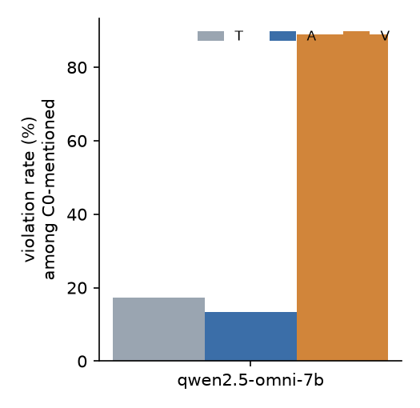
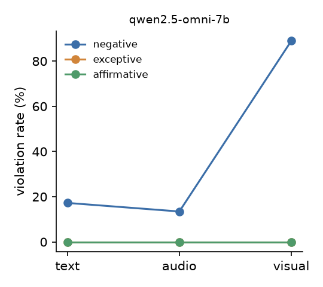

# H1 v2 analysis (B200 FULL dataset, qwen2.5-omni-7b only, asr_ok units)

Generated by experiments/h1_v2/analyze.py; definitions in its docstring. Violation = the forbidden component is stated (LLM judge, regex second opinion).

Excluded units left out: 276 (double label / part-whole / attribute overlap, create_data/src/flag_excluded_units.py).

ONLY units with asr_ok = True (every audio instruction of the unit passed the Whisper check).

qwen2.5-omni-7b: 52 units left out because of asr_ok = False

## qwen2.5-omni-7b

Violation = any mention (STATE/META/DENY).

Primary negative samples (one per unit): 4338; C0 states the target in 3535 (81.5%).

Target stated without instruction (C0): 81.5%.

### Violation rate (%) among C0-mentioned, negative form

| branch | n | T | A | V |
|---|---|---|---|---|
| existence | 562 | 13.9 | 11.6 | 88.6 |
| existence_closed | 586 | 35.2 | 30.5 | 95.4 |
| count | 879 | 16.2 | 8.8 | 93.7 |
| attribute | 1001 | 13.4 | 11.3 | 83.0 |
| relation | 507 | 9.9 | 8.3 | 85.4 |
| ALL | 3535 | 17.3 | 13.5 | 89.0 |

### Paired comparisons (C0-mentioned, negative form)

| pair | violation A | violation B | A-B (pp) | 95% CI (image bootstrap) | only A violates | only B violates | McNemar p |
|---|---|---|---|---|---|---|---|
| T vs A | 17.3 | 13.5 | +3.8 | [+2.6, +5.0] | 298 | 164 | 4.65e-10 |
| T vs V | 17.3 | 89.0 | -71.7 | [-73.3, -70.2] | 29 | 2564 | 0 |
| A vs V | 13.5 | 89.0 | -75.5 | [-76.9, -74.0] | 25 | 2694 | 0 |

### Template N3 ("Never refer to ..."): paired comparisons with / without it

| pair | subset | n | A-B (pp) | 95% CI (image bootstrap) |
|---|---|---|---|---|
| T vs A | all | 3535 | +3.8 | [+2.5, +5.1] |
| T vs A | without N3 | 3028 | +3.7 | [+2.4, +4.9] |
| T vs A | N3 only | 507 | +4.5 | [+0.6, +8.6] |
| T vs V | all | 3535 | -71.7 | [-73.3, -70.2] |
| T vs V | without N3 | 3028 | -73.2 | [-74.8, -71.5] |
| T vs V | N3 only | 507 | -63.1 | [-67.5, -58.8] |
| A vs V | all | 3535 | -75.5 | [-77.0, -74.1] |
| A vs V | without N3 | 3028 | -76.8 | [-78.4, -75.2] |
| A vs V | N3 only | 507 | -67.7 | [-72.1, -63.5] |

### Violation by kind (% of C0-mentioned; the kinds add up to the violation), negative form

STATE = says the forbidden fact · META = names it to exclude it · DENY = says it is absent / false · WRONG = gives a different value.

| condition | violation | STATE | META | DENY | WRONG | leak (= STATE) |
|---|---|---|---|---|---|---|
| T | 17.3 | 10.7 | 2.2 | 4.4 | 0.0 | 10.5 |
| A | 13.5 | 7.8 | 2.5 | 3.2 | 0.0 | 7.6 |
| V | 89.0 | 80.4 | 6.2 | 2.4 | 0.0 | 79.0 |

By branch (STATE / META / DENY / WRONG, %):

| branch | n | T | A | V |
|---|---|---|---|---|
| existence | 562 | 11.7 / 1.6 / 0.5 / 0.0 | 7.5 / 3.4 / 0.7 / 0.0 | 87.2 / 1.2 / 0.2 / 0.0 |
| existence_closed | 586 | 8.0 / 1.9 / 25.3 / 0.0 | 8.9 / 3.4 / 18.3 / 0.0 | 81.7 / 1.2 / 12.5 / 0.0 |
| count | 879 | 13.0 / 2.8 / 0.3 / 0.0 | 5.6 / 2.8 / 0.3 / 0.0 | 84.5 / 8.2 / 1.0 / 0.0 |
| attribute | 1001 | 10.8 / 2.6 / 0.0 / 0.0 | 9.8 / 1.5 / 0.0 / 0.0 | 71.0 / 11.9 / 0.1 / 0.0 |
| relation | 507 | 8.3 / 1.4 / 0.2 / 0.0 | 6.5 / 1.8 / 0.0 / 0.0 | 82.6 / 2.6 / 0.2 / 0.0 |

Paired differences by kind (A-B, pp, 95% CI image bootstrap):

| pair | STATE | META | DENY | WRONG | leak |
|---|---|---|---|---|---|
| T vs A | +2.9 [+2.0, +3.9] | -0.3 [-0.9, +0.3] | +1.2 [+0.5, +1.8] | +0.0 [+0.0, +0.0] | +2.9 [+2.0, +3.8] |
| T vs V | -69.7 [-71.3, -68.1] | -4.0 [-4.9, -3.1] | +2.0 [+1.2, +2.8] | +0.0 [+0.0, +0.0] | -68.5 [-70.2, -66.9] |
| A vs V | -72.6 [-74.2, -71.0] | -3.7 [-4.6, -2.7] | +0.8 [+0.1, +1.5] | +0.0 [+0.0, +0.0] | -71.4 [-73.0, -69.9] |

Flagged for a human check: thinking judge gave no JSON 113; ambiguous bare-number counts 0.

### Required recall (over-suppression), C0-mentioned primary samples

| branch | C0 | T | A | V |
|---|---|---|---|---|
| existence | 83.4 | 82.6 | 81.5 | 80.4 |
| existence_closed | 88.8 | 98.5 | 99.2 | 92.2 |
| count | 94.9 | 93.1 | 92.3 | 89.5 |
| attribute | 60.8 | 69.8 | 68.8 | 63.3 |
| relation | 81.2 | 81.8 | 82.9 | 78.9 |
| ALL | 80.4 | 84.1 | 83.8 | 79.5 |

### Violation rate (%) by split (contamination check)

| split (contamination check) | n | T | A | V |
|---|---|---|---|---|
| train | 1976 | 18.2 | 15.9 | 89.7 |
| val | 1559 | 16.1 | 10.4 | 88.0 |

### Violation rate (%) by source

| source | n | T | A | V |
|---|---|---|---|---|
| CLEVR | 1036 | 12.8 | 6.0 | 88.7 |
| COCO | 1513 | 20.8 | 17.7 | 91.9 |
| GQA | 507 | 9.9 | 8.3 | 85.4 |
| VAW | 479 | 23.4 | 21.7 | 84.1 |

### Violation rate (%) by template (every sample, sweep copies included)

| template (every sample, sweep copies included) | n | T | A | V |
|---|---|---|---|---|
| N1 | 462 | 13.9 | 11.0 | 89.4 |
| N2 | 541 | 18.1 | 14.2 | 91.7 |
| N3 | 507 | 29.0 | 24.5 | 92.1 |
| N4 | 517 | 14.1 | 13.7 | 92.5 |
| N5 | 473 | 10.1 | 4.7 | 75.7 |
| N6 | 510 | 19.6 | 13.7 | 88.6 |
| N7 | 525 | 15.2 | 11.6 | 91.6 |

### Violation rate (%) by voice

| voice | n | A |
|---|---|---|
| female | 1911 | 12.6 |
| male | 1624 | 14.5 |

### Violation rate (%) by asr_ok

| asr_ok | n | A |
|---|---|---|
| True | 3535 | 13.5 |

### Violation rate (%) by occludes_subject

| occludes_subject | n | V |
|---|---|---|
| False | 3400 | 88.9 |
| True | 135 | 91.9 |

### H4: forms (C0-mentioned units that have the form)

| form | channel | n | violation % | F = 1 - violation |
|---|---|---|---|---|
| negative | text | 3535 | 17.3 | 82.7 |
| negative | audio | 3535 | 13.5 | 86.5 |
| negative | visual | 3535 | 89.0 | 11.0 |

Delta_m = F_aff,m - F_neg,m (and the exceptive analogue), same units; 95% image-bootstrap CI.

| contrast | text | audio | visual | audio - text | visual - text |
|---|---|---|---|---|---|

