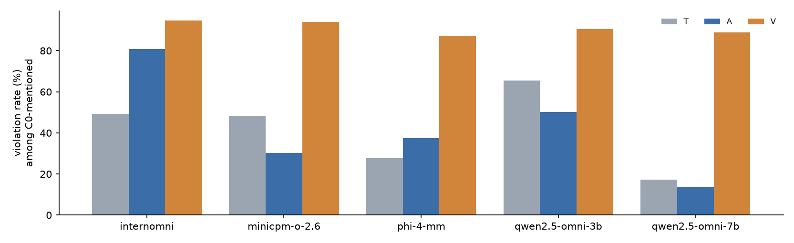
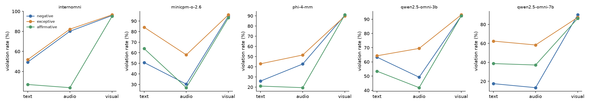

**Study in one paragraph.** Omni-models (image + audio + text in) receive a prohibition such as "Do not mention the
dog." through three channels: typed as its own text block (**T**), spoken (**A**), or written in a box inside the
image (**V**). The question is always typed. **Violation** = the answer still names the forbidden component,
counted only on questions where the same model names it with no instruction (**C0**). Five models: Qwen2.5-Omni-7B,
Qwen2.5-Omni-3B, MiniCPM-o 2.6, Phi-4-multimodal, InternOmni. Full set = 4,338 questions over 2,627 images (asr_ok
units). Pilot = a fixed balanced list of 1,000 of these questions (200 per branch). 95% CIs are bootstrapped over
images, and paired tests are exact McNemar.

**Caveats for every block.** (1) The LLM judge (Qwen3-8B) has **no human check on B200 answers yet**. The only
check is 49 answers on server 1: 93.9% agreement, κ 0.83. (2) Everything except H1 uses the **1,000-question
pilot**, so no per-branch or split claims are made from it. (3) Compare channels **within** a model only.

# H1: does the channel matter?

**Tests:** whether the same prohibition is obeyed equally when typed, spoken, or written in the image (full set).

**Results** (violation % among C0-mentioned questions; T − A paired, image-bootstrap 95% CI):

| model | n | T | A | V | T − A [95% CI] | recall C0 / T / A / V |
|---|---|---|---|---|---|---|
| Qwen2.5-Omni-7B | 3,535 | 17.3 | 13.5 | 89.0 | +3.8 [+2.6, +5.0] | 80.4 / 84.1 / 83.8 / 79.5 |
| Qwen2.5-Omni-3B | 3,558 | 65.4 | 50.3 | 90.6 | +15.1 [+13.5, +16.8] | 81.4 / 81.8 / 82.7 / 78.4 |
| MiniCPM-o 2.6 | 3,441 | 48.1 | 30.1 | 93.9 | +17.9 [+16.2, +19.7] | 80.3 / 84.6 / 84.1 / 79.1 |
| Phi-4-MM | 3,478 | 27.6 | 37.4 | 87.2 | −9.8 [−11.9, −7.7] | 80.5 / 63.8 / 68.1 / 78.0 |
| InternOmni | 3,483 | 49.2 | 80.8 | 94.7 | −31.6 [−33.7, −29.7] | 71.2 / 73.3 / 25.3 / 72.7 |

\small Source: experiments/h1_v2/full_analysis_5models_asrok.md; all-units check: full_analysis_5models_allunits.md;
judge-error sensitivity: analysis_all_asrok_rm.md. Recall = share of the allowed components still named.\normalsize

{width=72%}

**=> Findings**

- Typed and spoken prohibitions are obeyed at different rates in **every** model (all CIs exclude 0), but the
  **sign differs by model**. There is no general "weaker channel".
- Written prohibitions (V) are violated in 87–95% of cases in all five models.
- InternOmni's recall drops to 25% under the spoken prohibition: it seems to answer the spoken sentence as if it
  were the question, so its A violation is not a clean measure of ignoring a prohibition.
- Robust: T − A changes by ≤ 0.2 points on all units and by ≤ 0.3 points without judge-error rows. It keeps the
  same sign if "says X is absent" answers are not counted.

# Controls for V: empty box (C0_box) and reading (OCR_V), pilot

**Tests:** whether the written instruction can be read at all (copy task), and whether a box without text changes
the answer.

**Results:**

| model | OCR_V exact copy % (n=1,000) | C0 → C0_box target named % | V − C0_box (pp) [95% CI], C0-mentioned |
|---|---|---|---|
| Qwen2.5-Omni-7B | 99.8 | 84.4 → 83.9 (p=0.60) | −6.0 [−8.0, −4.0] |
| Qwen2.5-Omni-3B | 93.6 | 84.0 → 81.7 (p=0.007) | −2.1 [−3.9, −0.4] |
| MiniCPM-o 2.6 | 99.7 | 81.9 → 83.0 (p=0.13) | −3.2 [−4.9, −1.6] |
| Phi-4-MM | 98.1 | 81.2 → 80.2 (p=0.28) | −5.2 [−7.4, −3.1] |
| InternOmni | 99.0 | 82.6 → 82.6 (p=1) | −0.7 [−2.2, +0.8] |

\small Source: experiments/h1_v2/pilot1000_comp_ctrl_5models.md; V − C0_box re-derived from raw rows in
audit/number_audit.md (same points, CIs within 0.2).\normalsize

**=> Findings**

- Every model can read the written instruction (94–100% exact copies), and an empty box barely changes what is
  named.
- Writing the prohibition in the image lowers mention by only 0–6 points compared with the empty box, so the V
  failure is **not a reading failure**: the text is read but mostly not acted on as an instruction.

# H3-B: does the model understand the prohibition in each channel? (COMP v1 done; COMP v2 running)

**Tests:** whether the model can identify the forbidden item (3-option multiple choice, chance 33%), separately
from whether it obeys.

**Results.** *COMP v1* (question asked after an active instruction) is **not valid**: the models obey the
instruction while answering the MCQ, e.g. Qwen-7B T 21.2% and MiniCPM-o T 8.8%, both below chance
(analysis_comp_pilot1000.md). *COMP v2* (instruction quoted first, then asked about; pilot, 2 of 5 models done):

| model | understood % T / A / V [95% CI] | verbatim repeat exact % T / A / V | V violation if understood |
|---|---|---|---|
| Qwen2.5-Omni-7B | 100.0 / 99.9 [99.7, 100] / 100.0 | 99.3 / 97.1 / 99.8 | 90.4 [88.4, 92.4] (n=821) |
| Qwen2.5-Omni-3B | 99.7 [99.3, 100] / 99.8 [99.5, 100] / 100.0 | 92.2 / 95.6 / 93.6 | 92.8 [90.9, 94.5] (n=805) |
| MiniCPM-o, Phi-4, InternOmni | running | running | running |

\small Source: experiments/h1_v2/analysis_comp2_pilot1000.md (partial, rerun when job-comp2 ends, ETA ~1-3 h).
Known artefact: MiniCPM-o repeats a typed sentence in a loop, so its "exact" repeat score is too low (smoke test);
it will be reported with a separate prefix check.\normalsize

**=> Findings (Qwen models only so far)**

- Both Qwen models understand the prohibition in **all three channels** (≈100%), including V.
- They still violate the **written** prohibition in 90–93% of the questions where they understood it.
  Understanding is not the bottleneck for V. Wait for the other 3 models before generalising.

# H4: is the channel gap specific to negation? (pilot)

**Tests:** whether negation costs more in one channel than another, relative to a positive instruction
(affirmative "Mention only Y." or exceptive "Mention everything except X."). Δ_c = compliance(affirmative) −
compliance(negative) in channel c.

**Results** (points, 95% CI; n = 647–669 affirmative units, 801–833 exceptive units):

| model | Δ_T (aff) | Δ_A (aff) | Δ_A − Δ_T (aff) | Δ_A − Δ_T (exceptive) | Δ_V (aff) |
|---|---|---|---|---|---|
| Qwen2.5-Omni-7B | −19.6 | −23.2 | −3.6 [−8.2, +0.9] | −0.1 [−4.1, +4.2] | +4.3 |
| Qwen2.5-Omni-3B | +19.1 | +14.9 | −4.2 [−9.0, +0.6] *fragile* | −19.3 [−24.1, −14.7] | −1.1 |
| MiniCPM-o 2.6 | −8.9 | +2.9 | +11.9 [+6.6, +17.6] | +5.7 [+0.6, +10.9] *fragile* | +0.6 |
| Phi-4-MM | +9.3 | +21.2 | +11.9 [+7.0, +17.0] | +8.1 [+3.2, +13.1] | −1.9 |
| InternOmni | +19.8 | +56.1 | +36.3 [+30.9, +41.8] | +0.4 [−4.8, +5.5] | +0.5 |

\small Source: experiments/h1_v2/pilot1000_forms_5models_asrok.md; fragile = the CI crosses 0 without the judge-error
units (analysis_pilot1000_forms_asrok_rm.md).\normalsize

{width=72%}

**=> Findings**

- With the affirmative reference, the spoken penalty for negation is larger than the typed one in 3 models
  (MiniCPM-o, Phi-4, InternOmni). For both Qwen models the CI includes 0.
- The exceptive reference (names X, no "not") **shrinks or reverses** this: InternOmni +0.4 (its affirmative effect
  is confounded with "answering the spoken sentence"), Qwen-3B −19.3. Negation-specificity depends on the model.
- Instructions written in the image are ignored in **every** form (V violation 86–97%), so Δ_V says nothing about
  negation.
- Pilot only; the H4 full extension for the Qwen models is running (below).

# H2: question and prohibition through different channels (pilot)

**Tests:** whether the prohibition is obeyed equally whichever channel carries it, when the question comes through
another channel (6 layouts, q = question channel, i = instruction channel). *Note:* this is not the Idea document's
H2 (typed "Mention X" + spoken "Do not mention X"), which has not been run.

**Results** (violation %; direction effect = qT_iA − qA_iT, 95% CI; n = 800–832):

| model | qT_iA | qA_iT | qT_iA − qA_iT | instruction in image (qT_iV / qA_iV) | question in image (qV_iT / qV_iA) |
|---|---|---|---|---|---|
| Qwen2.5-Omni-7B | 13.2 | 17.5 | −4.3 [−7.0, −1.6] | 90.1 / 90.0 | 19.7 / 17.4 |
| Qwen2.5-Omni-3B | 49.2 | 67.8 | −18.6 [−22.1, −15.1] | 92.5 / 90.8 | 44.5 / 41.4 |
| MiniCPM-o 2.6 | 30.4 | 54.3 | −23.9 [−27.7, −20.3] | 94.9 / 95.3 | 54.8 / 38.7 |
| Phi-4-MM | 42.6 | 32.6 | +10.0 [+6.0, +13.9] | 90.8 / 88.6 | 30.6 / 43.0 |
| InternOmni | 80.1 | 42.9 | +37.2 [+32.9, +41.4] | 95.8 / 84.9 | 29.9 / 68.9 |

\small Source: experiments/h1_v2/analysis_h2_pilot1000_asrok.md.\normalsize

**=> Findings**

- Typed vs spoken: the direction matters in all 5 models, and the channel that does better is the one that did
  better in that model's H1 result.
- A prohibition written in the image is violated in 85–96% of cases whichever channel carries the question.

# H3-A: the same layouts without negation (pilot)

**Tests:** whether the "winning" channel is the same for a positive conflicting instruction ("Mention only Y.").
This separates general channel dominance from something about negation.

**Results** (direction effect qT_iA − qA_iT without negation, and the difference H2 − H3-A on the same units; open
existence has no affirmative form, n = 646–668):

| model | H3-A qT_iA − qA_iT | H2 − H3-A (T–A) | H2 − H3-A, think-error units removed | positive instr. with question in image (qV_iT / qV_iA) |
|---|---|---|---|---|
| Qwen2.5-Omni-7B | +2.7 [−1.0, +6.4] | −7.9 [−12.7, −3.3] | −8.6 [−13.9, −2.9] | 19.5 / 18.7 |
| Qwen2.5-Omni-3B | +1.4 [−1.8, +4.5] | −15.4 [−20.2, −10.4] | −17.6 [−23.3, −11.7] | 18.7 / 13.7 |
| MiniCPM-o 2.6 | −11.4 [−15.1, −7.7] | −13.9 [−19.5, −8.3] | −14.5 [−20.4, −8.7] | 19.0 / 20.1 |
| Phi-4-MM | +5.9 [+2.5, +9.1] | +5.9 [+0.2, +11.5] *borderline* | +6.6 [+0.4, +12.6] | 15.9 / 16.6 |
| InternOmni | +5.9 [+2.1, +9.7] | +32.5 [+26.9, +38.2] | +32.9 [+26.5, +38.8] | 8.8 / 10.3 |

\small Source: experiments/h1_v2/analysis_h2_pilot1000_asrok.md and analysis_h2_pilot1000_asrok_rm.md.\normalsize

**=> Findings**

- The typed-vs-spoken direction effect is **larger with negation than without in all 5 models** (H2 − H3-A CI
  excludes 0, also without judge-error units; Phi-4 is borderline). This is the most consistent negation-specific
  pattern so far, and its sign follows each model's H1 gap.
- InternOmni's effect is confounded with treating speech as the question (recall 10–27% under a spoken
  prohibition).
- With the question written in the image, positive instructions are followed well (9–20% violation), but
  prohibitions much less in 4 of 5 models (30–69%).

# Runs not finished yet

**NEU control (neutral instruction "Include the word W in your answer.", same channel/position/voice/box).**
*Tests* whether a channel is worse at following ANY instruction, or worse at negation specifically.
*Status:* generation running. MiniCPM-o 3,561/6,000, InternOmni 2,961/6,000, Phi-4 681/6,000 (slowest, ~8 h at
the current shared-GPU speed). The Qwen models are generated. The judge then scores one model at a time (~1.2 h
each). *Expected:* if NEU follow − NEG follow is about the same in T, A and V, the H1 gaps are about instruction
following in general. If it differs by channel, the gap is specific to negation. The 2×2 table {V, V + "The image
contains an instruction for you."} × {NEG, NEU} shows whether telling the model about the written instruction
helps.

**H3-C (instruction before the image).** *Tests* whether the instruction's position (before the image vs after the
question) changes obedience. *Status:* smoke test on 5 models (8–9 questions each) gave 100% violation for both
instruction-first conditions. The prompts were checked, and the models see the image but ignore the instruction.
200 questions are generated for the Qwen models; the other models follow, then scoring when the judge is free.
Caveat: "first" also puts the instruction before the question (T_pre would separate the two; not run). V skipped
(no instruction-card images). *Expected:* a large difference would mean prohibitions fade with distance or are
over-written by the later question, in every channel. A channel difference in that effect would point to how each
channel's tokens are attended.

**H4 full extension (Qwen-7B and -3B, all 4,390 units).** *Tests* the same Δ_A − Δ_T as H4 with ~4× the data, since
the pilot CIs for both Qwen models cross 0. *Status:* generation 2,784/16,827 (7B) and 2,224/16,791 (3B), ~4.5–5 h.
Then judge ~4 h per model. *Expected:* a CI that excludes 0 would support (or rule out) a negation-specific
spoken/typed difference for the Qwen models. A CI still around 0 would make "no negation-specific gap in Qwen" the
honest summary.

**H3-D (target size) and per-source split (CPU, done).** Large − small size tertile, violation under T: +9.8
[+6.5, +13.1] (Qwen-7B), +6.6 [+2.4, +10.7] (Qwen-3B), +5.6 [+0.9, +10.0] (MiniCPM-o), +4.3 [+0.4, +8.2] (Phi-4),
−2.6 [−7.4, +2.1] (InternOmni). Larger targets are violated more in 4 models. This is observational and confounded
with branch: the size effect is clearest within attribute. B1 keeps only objects ≥ 3% of the image. Split vs
source: CLEVR is val-only and COCO is mostly train, so **no train-vs-val claim** can be made.
\small Sources: experiments/h1_v2/h3d_area_b200.md, split_by_source_b200.md, dataset_stats_b200_full.md.\normalsize

**Biggest open issues:** human check of the judge on B200 answers; H2 as run differs from the Idea document's H2;
the method part (steering etc.) is off by Vy's decision.
