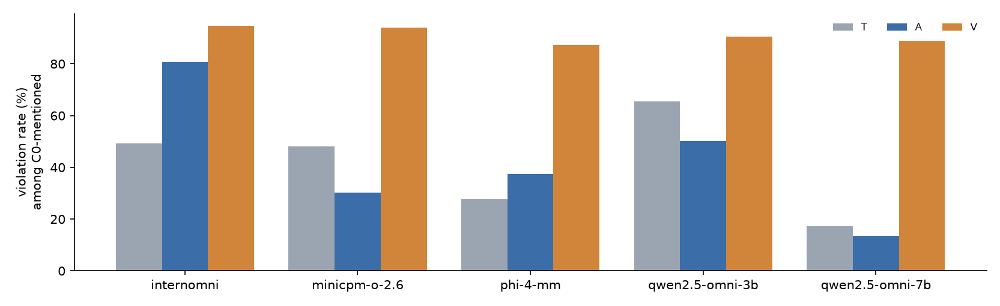
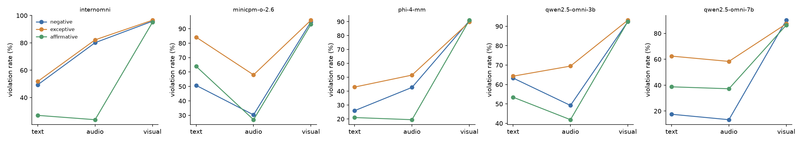

**Main question (about negation).** Do omni-models obey a negative instruction ("Do not mention the dog.") equally well
when it arrives as **text** (its own text block, **T**), **audio** (spoken, **A**) or **visual** (written in a box inside
the image, **V**)? What has to be shown is an **interaction**: a channel difference is "negation-specific" only if it does
**not** appear (or is clearly smaller) with a control instruction in the same channel: an **affirmative** instruction
("Mention only Y."), an **exceptive** instruction ("Mention everything except X.", names X but has no "not"), or a
**neutral NEU** instruction ("Include the word W in your answer."). If a channel is bad for *every* instruction, that is a
channel effect, not a negation effect.

**Setup.** Violation rate = share of answers that still mention the forbidden component, counted only on questions where
the same model mentions that component without any instruction (**C0**). Five models: Qwen2.5-Omni-7B, Qwen2.5-Omni-3B,
MiniCPM-o 2.6, Phi-4-multimodal, InternOmni. Full set = 4,338 questions on 2,627 images (asr_ok). Pilot = a fixed list of
1,000 questions (200 per branch). 95% CI = bootstrap over images; paired test = exact McNemar. Every number comes from the
result file named under each table (folder experiments/h1_v2/).

**General caveats.** (1) The LLM judge (Qwen3-8B) **has not been checked by a human on B200 answers** (server 1: 49 answers,
93.9% agreement, κ 0.83). (2) Everything except H1 and H3-D ran on the **pilot**: no per-branch or per-split claims.
(3) Channels are compared **within a model** only.

# Overview table

Last column: **yes** = negation-specific (a control shows the difference is smaller or absent without negation);
**no** = not negation-specific (the control fails the same way); **unknown** = no control yet, or running.

| H | What it tests | Result in one line | Negation-specific? |
|---|---|---|---|
| H1 (full) | Same negative instruction via T / A / V | T ≠ A in all 5 models, direction depends on the model; V violated 87–95% | T vs A: **yes** in Qwen per NEU, **unknown** in the other 3 models (see H4, H3-A, NEU). V: **no** (H4, NEU) |
| Controls (pilot) | Can models read text in the image? Does an empty box matter? | Exact copy 94–100%; empty box changes almost nothing; instruction in image lowers target mention only 0–6 points | **no** (about reading, not negation) |
| H3-B v2 (pilot) | Do models *understand* the negative instruction per channel? | All 5 understand what is forbidden ≥ 95% in T/V, ≥ 97% in A (except InternOmni 75.5%); when understood still violate V 90–96%, T/A 13–80% | **unknown** (no affirmative comprehension control yet) |
| H4 (pilot) | A − T gap for negation vs affirmative / exceptive | Vs affirmative: larger gap with negation in MiniCPM-o, Phi-4, InternOmni; Qwen: CI includes 0. Vs exceptive: smaller / flips. V at ceiling in every form | A − T: **yes** in 3 models (vs affirmative), **unknown** for Qwen; V: **no** |
| H2 (pilot) | Swap question channel / instruction channel | Swap direction matters in all 5 models, same direction as H1 | **unknown** on its own (H3-A answers it) |
| H3-A (pilot) | Same layouts as H2 with an affirmative instruction | Direction effect larger with negation in all 5 models (Phi-4 borderline) | **yes** (most consistent negation-specific pattern so far) |
| H3-D (full, CPU) | Are larger targets violated more? | Yes in 4/5 models (T, A); InternOmni opposite; observational, branch-confounded | **unknown** (no affirmative size control) |
| NEU (pilot, 2/5 models) | Is a channel bad at *any* instruction, or only at negation? | Qwen: neutral instruction in the image ignored too (follow 7–10%); typed/spoken gap only with negation (D_A − D_T −7.3 / −20.5) | T vs A: **yes** in Qwen; V: **no**; other 3 models **unknown** |
| H3-C | Instruction before the image vs after the question | Results: running (smoke: 100% violation with instruction first) | **unknown** |
| H4 full (Qwen) | H4 with ~4x the data for Qwen | Results: running | **unknown** |

# H1: is the same negative instruction obeyed equally when typed, spoken, or written in the image? (full set)

**Results H1:** violation rate (%) on C0-mentioned questions. Column T − A is the paired difference with 95% CI.

| model | n | T | A | V | T − A [95% CI] | recall C0 / T / A / V |
|---|---|---|---|---|---|---|
| Qwen2.5-Omni-7B | 3,535 | 17.3 | 13.5 | 89.0 | +3.8 [+2.6, +5.0] | 80.4 / 84.1 / 83.8 / 79.5 |
| Qwen2.5-Omni-3B | 3,558 | 65.4 | 50.3 | 90.6 | +15.1 [+13.5, +16.8] | 81.4 / 81.8 / 82.7 / 78.4 |
| MiniCPM-o 2.6 | 3,441 | 48.1 | 30.1 | 93.9 | +17.9 [+16.2, +19.7] | 80.3 / 84.6 / 84.1 / 79.1 |
| Phi-4-MM | 3,478 | 27.6 | 37.4 | 87.2 | −9.8 [−11.9, −7.7] | 80.5 / 63.8 / 68.1 / 78.0 |
| InternOmni | 3,483 | 49.2 | 80.8 | 94.7 | −31.6 [−33.7, −29.7] | 71.2 / 73.3 / 25.3 / 72.7 |

\small Source: experiments/h1_v2/full_analysis_5models_asrok.md. All units: full_analysis_5models_allunits.md. Without
judge-error rows: analysis_all_asrok_rm.md. Recall = share of allowed components the model still states.\normalsize

{width=62%}

**=> Findings:**

- Typed and spoken negative instructions are obeyed differently in **all 5 models** (no CI contains 0), but the **direction
  depends on the model**: no channel is "weaker" in general. *Negation-specific: unknown*, because H1 has only negative
  instructions; the same gap could appear with any instruction (H4, H3-A, NEU test this). NEU (new, Qwen-7B/3B): the
  typed/spoken gap appears only for the negative instruction, so in Qwen it is *negation-specific*; no NEU yet for the other 3.
- The negative instruction written in the image (V) is violated 87–95% in all 5 models. *Negation-specific: no*: H4 shows
  that affirmative and exceptive instructions in the image are ignored about as often (86–97%).
- InternOmni's recall drops to 25% when the instruction is spoken: it seems to treat the speech as the question, so its A
  violation rate is not a clean measure of "ignoring the negation".
- Robust: T − A moves ≤ 0.2 points on all units, ≤ 0.3 points without judge-error rows.

**Negation takeaway:** negative instructions are obeyed differently when typed vs spoken in every model, but H1 alone cannot
say whether that gap is specific to negation; the image-channel failure is **not negation-specific**.

# Controls (C0_box / OCR_V): can models read the instruction written in the image, and does an empty box change the answer? (pilot)

**Results controls:**

| model | OCR_V exact copy % (n=1,000) | C0 → C0_box, % mentioning target | V − C0_box (points) [95% CI], on C0-mentioned |
|---|---|---|---|
| Qwen2.5-Omni-7B | 99.8 | 84.4 → 83.9 (p=0.60) | −6.0 [−8.0, −4.0] |
| Qwen2.5-Omni-3B | 93.6 | 84.0 → 81.7 (p=0.007) | −2.1 [−3.9, −0.4] |
| MiniCPM-o 2.6 | 99.7 | 81.9 → 83.0 (p=0.13) | −3.2 [−4.9, −1.6] |
| Phi-4-MM | 98.1 | 81.2 → 80.2 (p=0.28) | −5.2 [−7.4, −3.1] |
| InternOmni | 99.0 | 82.6 → 82.6 (p=1) | −0.7 [−2.2, +0.8] |

\small Source: experiments/h1_v2/pilot1000_comp_ctrl_5models.md; V − C0_box re-derived from raw rows in
audit/number_audit.md (point estimates match, CIs within 0.2).\normalsize

**=> Findings:**

- All models read the instruction in the image (exact copy 94–100%), and an empty box barely changes the answer.
- Compared with the empty box, writing the negative instruction in the image lowers target mention by only 0–6 points: the
  V failure is **not a reading failure**; the text is read but mostly not treated as an instruction. *Negation-specific: no*
  (this is about whether text-in-image counts as an instruction, and H4 shows non-negative instructions in the image are
  ignored too).

**Negation takeaway:** the image-channel failure comes neither from OCR nor from negation: models read the instruction but do
not treat image text as an instruction, negative or not.

# H3-B: do models understand the negative instruction in each channel, separately from obeying it? (pilot, all 5 models)

**Results H3-B:**

- **COMP v1 is invalid:** the question came after an instruction that was still in force, so models applied the
  instruction to the multiple-choice answer too (e.g. Qwen-7B T correct 21.2%, MiniCPM-o T 8.8%, below the 33% chance
  level; analysis_comp_pilot1000.md).
- **COMP v2** quotes the negative instruction first, then asks "what does this instruction forbid mentioning?" (3 options,
  chance 33%), n=1,000 per channel. "Repeat" = the answer starts with the instruction (REP_T, REP_A, OCR_V). Violation is
  on C0-mentioned questions where the model understood the instruction.

| model | understood % T / A / V | repeat % T / A / V | violation when understood % T / A / V (n) |
|---|---|---|---|
| Qwen2.5-Omni-7B | 100.0 / 99.9 / 100.0 | 99.3 / 97.4 / 99.8 | 17.3 / 13.3 / 90.4 (820–821) |
| Qwen2.5-Omni-3B | 99.7 / 99.8 / 100.0 | 94.2 / 95.9 / 93.6 | 63.2 / 49.2 / 92.8 (802–805) |
| MiniCPM-o 2.6 | 95.4 / 97.1 / 99.3 | 95.9 / 80.9 / 99.7 | 50.9 / 30.6 / 94.7 (764–796) |
| Phi-4-MM | 99.8 / 99.8 / 100.0 | 98.1 / 96.1 / 98.1 | 25.2 / 41.9 / 90.5 (781–783) |
| InternOmni | 97.7 / 75.5 / 100.0 | 98.1 / 65.1 / 99.1 | 49.4 / 79.8 / 96.0 (589–795) |

\small Source: experiments/h1_v2/analysis_comp2_pilot1000.md (95% CIs over images there; every "understood" CI is ≤ 5.2
points wide); "repeat" = comp2_startswith_pilot1000.md (prefix match, original scorer unchanged). The original "exact" scores
are the same except MiniCPM-o REP_T: 7.7% exact because it repeats the sentence in a loop, 95.9% by prefix.\normalsize

**=> Findings:**

- All 5 models **understand what is forbidden** in T and V (≥ 95%) and in A (≥ 97%), except InternOmni with the spoken
  instruction (75.5%; repeats the spoken sentence only 65.1%): part of InternOmni's A failure is hearing/understanding. But
  when it understood, InternOmni still violates A 79.8% (when not understood: 82.0%, n=206), so poor understanding does not
  explain most of it.
- Even when they understood, models still violate the negative instruction 13–80% in T/A and 90–96% in V; within each
  model the T vs A order is the same as in H1. So the T/A gap and the V failure lie in **obeying**, not in **understanding**
  the negative instruction.
- *Negation-specific: unknown*: COMP v2 asks only about the negative instruction; there is no matching affirmative
  comprehension question yet.

**Negation takeaway:** models understand *what* is forbidden in every channel (except InternOmni when listening);
non-compliance happens after comprehension. Whether comprehension is specific to negation is not yet known.

# H4: is the channel gap specific to negation, compared with a positive instruction? (pilot)

Delta_c = compliance(non-negative instruction) − compliance(negative instruction) in channel c, where the non-negative
instruction is affirmative "Mention only Y." or exceptive "Mention everything except X.". Delta_A − Delta_T ≠ 0 means the
A − T gap is **negation-specific**.

**Results H4:** points, with 95% CI. Units: affirmative 647–669, exceptive 801–833.

| model | Delta_T (aff) | Delta_A (aff) | Delta_A − Delta_T (aff) | Delta_A − Delta_T (exc) | Delta_V (aff) |
|---|---|---|---|---|---|
| Qwen2.5-Omni-7B | −19.6 | −23.2 | −3.6 [−8.2, +0.9] | −0.1 [−4.1, +4.2] | +4.3 |
| Qwen2.5-Omni-3B | +19.1 | +14.9 | −4.2 [−9.0, +0.6] *fragile* | −19.3 [−24.1, −14.7] | −1.1 |
| MiniCPM-o 2.6 | −8.9 | +2.9 | +11.9 [+6.6, +17.6] | +5.7 [+0.6, +10.9] *fragile* | +0.6 |
| Phi-4-MM | +9.3 | +21.2 | +11.9 [+7.0, +17.0] | +8.1 [+3.2, +13.1] | −1.9 |
| InternOmni | +19.8 | +56.1 | +36.3 [+30.9, +41.8] | +0.4 [−4.8, +5.5] | +0.5 |

\small Source: experiments/h1_v2/pilot1000_forms_5models_asrok.md. "Fragile" = CI crosses 0 when judge-error units are
removed (analysis_pilot1000_forms_asrok_rm.md).\normalsize

{width=62%}

**=> Findings:**

- **Vs affirmative**, spoken negation is penalised more than typed negation in MiniCPM-o, Phi-4 and InternOmni (CI excludes 0):
  *negation-specific: yes* for these 3 models (InternOmni confounded by treating the speech as the question). For both
  Qwen models the CI includes 0: *unknown* (H4 full is running).
- **Vs exceptive** (names X, no "not"), the gap shrinks or flips (InternOmni +0.4; Qwen-3B −19.3). So part of the
  affirmative gap may come from *naming the target* rather than from the word "not"; how much depends on the model.
- Qwen-7B obeys the affirmative instruction **worse** than the negative one in T (Delta_T −19.6): negation is not always harder.
- Instructions in the image are ignored in **every** form (V violation 86–97%, Delta_V −1.9 to +4.3): *negation-specific: no*.

**Negation takeaway:** in 3/5 models the spoken-vs-typed gap is larger for negation than for an affirmative instruction
(negation-specific); against the exceptive form it is weaker, so part of it may come from naming the target. Unknown for
Qwen. The image channel is not negation-specific.

# H2: when the question and the negative instruction come through different channels, is the instruction obeyed equally whichever channel it uses? (pilot)

Notation: q = question channel, i = instruction channel. Note: this is **not** the H2 of the Idea document (typed
"Mention X" + spoken "Do not mention X"); that version has not been run.

**Results H2:** violation rate (%). Direction effect = qT_iA − qA_iT, with 95% CI; n = 800–832.

| model | qT_iA | qA_iT | qT_iA − qA_iT | instruction in image (qT_iV / qA_iV) | question in image (qV_iT / qV_iA) |
|---|---|---|---|---|---|
| Qwen2.5-Omni-7B | 13.2 | 17.5 | −4.3 [−7.0, −1.6] | 90.1 / 90.0 | 19.7 / 17.4 |
| Qwen2.5-Omni-3B | 49.2 | 67.8 | −18.6 [−22.1, −15.1] | 92.5 / 90.8 | 44.5 / 41.4 |
| MiniCPM-o 2.6 | 30.4 | 54.3 | −23.9 [−27.7, −20.3] | 94.9 / 95.3 | 54.8 / 38.7 |
| Phi-4-MM | 42.6 | 32.6 | +10.0 [+6.0, +13.9] | 90.8 / 88.6 | 30.6 / 43.0 |
| InternOmni | 80.1 | 42.9 | +37.2 [+32.9, +41.4] | 95.8 / 84.9 | 29.9 / 68.9 |

\small Source: experiments/h1_v2/analysis_h2_pilot1000_asrok.md.\normalsize

**=> Findings:**

- Between typed and spoken, the swap direction matters in all 5 models; the better channel is the same as in that model's
  H1. *Negation-specific: unknown on its own*: H3-A (same layouts, affirmative instruction) is the control.
- The negative instruction written in the image is violated 85–96% whatever the question channel (*not negation-specific*,
  as in H1/H4).

**Negation takeaway:** the channel effect on the negative instruction survives moving the question to another channel; how
much of it belongs to negation is answered by H3-A (below).

# H3-A: the same layouts without negation ("Mention only Y."), which channel wins? (pilot)

Separates general modality dominance from the negation-specific effect. The open existence branch has no affirmative form
and is dropped, n = 646–668. H2 − H3-A ≠ 0 means the direction effect is **negation-specific**.

**Results H3-A:**

| model | H3-A qT_iA − qA_iT | H2 − H3-A (T–A) | H2 − H3-A, without judge-error units | affirmative with question in image (qV_iT / qV_iA) |
|---|---|---|---|---|
| Qwen2.5-Omni-7B | +2.7 [−1.0, +6.4] | −7.9 [−12.7, −3.3] | −8.6 [−13.9, −2.9] | 19.5 / 18.7 |
| Qwen2.5-Omni-3B | +1.4 [−1.8, +4.5] | −15.4 [−20.2, −10.4] | −17.6 [−23.3, −11.7] | 18.7 / 13.7 |
| MiniCPM-o 2.6 | −11.4 [−15.1, −7.7] | −13.9 [−19.5, −8.3] | −14.5 [−20.4, −8.7] | 19.0 / 20.1 |
| Phi-4-MM | +5.9 [+2.5, +9.1] | +5.9 [+0.2, +11.5] *borderline* | +6.6 [+0.4, +12.6] | 15.9 / 16.6 |
| InternOmni | +5.9 [+2.1, +9.7] | +32.5 [+26.9, +38.2] | +32.9 [+26.5, +38.8] | 8.8 / 10.3 |

\small Source: experiments/h1_v2/analysis_h2_pilot1000_asrok.md and analysis_h2_pilot1000_asrok_rm.md.\normalsize

**=> Findings:**

- The typed/spoken direction effect is **larger with negation than without it, in all 5 models** (H2 − H3-A CI excludes 0,
  also without judge-error units; Phi-4 borderline). *Negation-specific: yes.* This is the most consistent
  negation-specific pattern so far, and its direction follows each model's H1 gap.
- InternOmni is confounded by treating the speech as the question (recall 10–27% when the negative instruction is spoken).
- With the question in the image, the affirmative instruction is obeyed well (9–20% violation), while the negative one is
  obeyed much worse in 4/5 models (30–69% violation, H2 table; slightly different question sets since H3-A drops
  existence): *negation-specific: yes* (Qwen-7B about equal).

**Negation takeaway:** the clearest evidence that the typed/spoken gap belongs to **negation**: without negation the gap is
small or absent; with negation it is large, in all 5 models (pilot, judge not yet human-checked).

# H3-D: are larger targets violated more? Plus source × split table (full set, CPU only, done)

**Results H3-D:** violation in the large-target tertile minus the small-target tertile (points), with 95% CI.

| model | T | A | V |
|---|---|---|---|
| Qwen2.5-Omni-7B | +9.8 [+6.5, +13.1] | +7.2 [+4.4, +10.2] | +1.8 [−0.9, +4.6] |
| Qwen2.5-Omni-3B | +6.6 [+2.4, +10.7] | +13.3 [+9.1, +17.6] | −4.0 [−6.4, −1.7] |
| MiniCPM-o 2.6 | +5.6 [+0.9, +10.0] | +3.8 [−0.1, +7.8] | +0.1 [−2.1, +2.4] |
| Phi-4-MM | +4.3 [+0.4, +8.2] | +9.4 [+5.1, +13.7] | +1.0 [−2.0, +3.8] |
| InternOmni | −2.6 [−7.4, +2.1] | −6.6 [−9.7, −3.3] | −1.9 [−3.7, −0.0] |

\small Source: experiments/h1_v2/h3d_area_b200.md, split_by_source_b200.md, dataset_stats_b200_full.md.\normalsize

**=> Findings:**

- In 4/5 models, larger targets are violated more in T and A; InternOmni goes the other way.
- Observational and confounded with branch (clearest in the attribute branch); B1 keeps only objects covering ≥ 3% of the image.
- CLEVR is val only and COCO almost all train: **no train vs val claim**.
- *Negation-specific: unknown*: not yet checked whether affirmative instructions show the same size effect (can be computed
  on CPU from H4).

**Negation takeaway:** salient targets are harder to suppress, but it is not known whether this is about negation or about
image description in general.

# NEU control: are models bad at obeying ANY instruction in a channel, or only negation? (pilot, 2/5 models)

The neutral instruction is "Include the word W in your answer.", same channel, position, voice and box style as the negative
instruction. NEU follow = W appears in the answer (string match, no judge); NEG follow = 1 − violation (judge). On
C0-mentioned questions (Qwen-7B n=846, Qwen-3B n=842). Without any instruction W appears 0% of the time.

**Results NEU:** follow % and D = NEU − NEG (points) [95% CI].

| model | channel | NEG follow | NEU follow | D = NEU − NEG |
|---|---|---|---|---|
| Qwen2.5-Omni-7B | T | 82.4 | 84.9 | +2.5 [−0.9, +5.9] |
| | A | 86.5 | 81.7 | −4.8 [−8.4, −1.4] |
| | V | 10.0 | 9.5 | −0.6 [−3.2, +2.2] |
| Qwen2.5-Omni-3B | T | 36.9 | 85.5 | +48.6 [+44.7, +53.0] |
| | A | 50.7 | 78.7 | +28.0 [+23.6, +32.4] |
| | V | 7.8 | 6.5 | −1.3 [−3.8, +1.2] |

| model | D_A − D_T [95% CI] | A − T for NEG | A − T for NEU | cue in image: NEG / NEU (points) |
|---|---|---|---|---|
| Qwen2.5-Omni-7B | −7.3 [−11.2, −3.5] | +4.1 [+1.5, +6.6] | −3.2 [−6.3, −0.1] | +0.7 [−0.9, +2.5] / −1.8 [−3.5, −0.1] |
| Qwen2.5-Omni-3B | −20.5 [−25.1, −16.0] | +13.8 [+10.7, +17.1] | −6.8 [−9.7, −3.8] | +1.1 [−0.6, +2.7] / −1.2 [−2.9, +0.5] |
| MiniCPM-o, Phi-4, InternOmni | not yet (MiniCPM-o generation stopped on Vy's order; Phi-4, InternOmni generated, scoring waits for Vy's OK) | | | |

\small Source: experiments/h1_v2/analysis_neu_pilot1000.md. Caveat: NEG and NEU are scored differently (judge vs string
match); NEU follow varies by word (e.g. Qwen-7B NEU_T: "philosophy" 63%, "democracy" 98%).\normalsize

**=> Findings:**

- **Image channel:** the neutral instruction in the image is ignored just like the negative one (NEU_V follow 7–10%,
  D_V ≈ 0). The cue "The image contains an instruction for you." does not help (≤ 2 points). *Negation-specific: no*
  (confirmed a third time, after H4 and the controls).
- **Typed vs spoken:** for the negative instruction, Qwen follows the spoken one **better** than the typed one; for the
  neutral instruction it is the other way round (typed better). D_A − D_T differs from 0 in both Qwen models:
  *negation-specific: yes* (in Qwen, against the neutral control). This differs from H4 against the affirmative form,
  where the Qwen CIs include 0; H4 full (waiting for scoring) will say more.
- **Negation penalty:** Qwen-3B follows the negative instruction much worse than the neutral one (T +48.6, A +28.0);
  Qwen-7B hardly (T +2.5, CI includes 0).
- Only 2/5 models, pilot: no generalisation yet.

**Negation takeaway:** in both Qwen models the typed/spoken gap exists (or flips) only when the instruction is negative, so it
is negation-specific; the image channel fails for every instruction, so it is not negation-specific.

# H3-C: negative instruction BEFORE the image vs after the question

**Results: running.** Smoke on 5 models (8–9 questions each): with the instruction first, 100% violation in every model;
prompt checked (models still see the image). Qwen generated 200 questions; the other models generate later and are scored
when the judge is free. V skipped (no instruction-card images yet).

**Expected findings:**

- If the difference is large in every channel: the negative instruction fades with distance or is "overwritten" by the
  later question (position, not channel).
- If the difference varies by channel: a hint about how attention treats each channel's tokens.
- There is no affirmative-first control, so even with an effect *negation-specific: unknown*. "First" is also before the
  question; separating the two needs T_pre (not run).

**Negation takeaway:** unknown; this experiment asks about the position of the negative instruction, not negation vs a control.

# H4 full for Qwen-7B and Qwen-3B: same Delta_A − Delta_T as H4 with about 4x the data (pilot CIs crossed 0)

**Results: running.** (04:45 UTC) Generated 3,044/16,827 (7B) and 2,484/16,791 (3B), about 4.5–5 h left; then the judge, about
4 h per model.

**Expected findings:**

- If the CI of Delta_A − Delta_T excludes 0: the typed/spoken gap in Qwen is **negation-specific**, in the direction the CI shows.
- If the CI stays around 0: the honest conclusion is "in Qwen, the typed/spoken gap is not negation-specific (vs affirmative)".

**Negation takeaway:** decides the "unknown" cell for Qwen in H4.

# Main open problems

- The judge has not been human-checked on B200 answers.
- H2 as run differs from the H2 of the Idea document.
- The method part (steering, ...) is off by Vy's decision.
