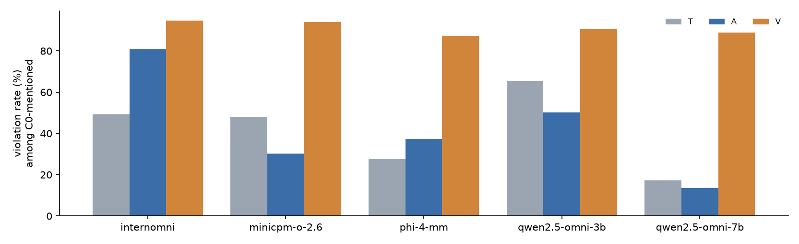
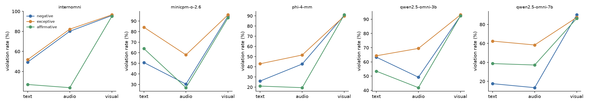

**Câu hỏi chính (về negation).** Một lệnh cấm ("Do not mention the dog.") có được omni-model tuân theo như nhau khi nó đi
qua **text** (khối text riêng, **T**), **audio** (giọng nói, **A**) hay **visual** (viết trong một ô trong ảnh, **V**) không?
Điều cần chứng minh là một **interaction**: một khác biệt giữa các kênh chỉ là "riêng cho negation" khi nó **không** xuất
hiện (hoặc nhỏ hơn rõ rệt) với một lệnh đối chứng cùng kênh: lệnh **affirmative** ("Mention only Y."), lệnh **exceptive**
("Mention everything except X.", nêu X nhưng không có chữ "not"), hoặc lệnh **neutral NEU** ("Include the word W in your
answer."). Nếu một kênh kém với *mọi* lệnh, đó là channel effect, không phải negation effect.

**Thiết lập.** Violation rate = tỉ lệ câu trả lời vẫn nhắc tới thành phần bị cấm, chỉ tính trên các câu mà chính mô hình
đó nhắc tới thành phần ấy khi không có lệnh (**C0**). Năm mô hình: Qwen2.5-Omni-7B, Qwen2.5-Omni-3B, MiniCPM-o 2.6,
Phi-4-multimodal, InternOmni. Full set = 4.338 câu hỏi trên 2.627 ảnh (asr_ok). Pilot = danh sách cố định 1.000 câu
(200 mỗi branch). CI 95% = bootstrap theo ảnh; kiểm định cặp = McNemar exact. Mọi số lấy từ file kết quả ghi ở cuối mỗi
bảng (thư mục experiments/h1_v2/).

**Lưu ý chung.** (1) LLM judge (Qwen3-8B) **chưa được người kiểm tra trên câu trả lời của B200** (server 1: 49 câu, đồng ý
93,9%, κ 0,83). (2) Mọi phần trừ H1 và H3-D chạy trên **pilot**: không kết luận theo branch hay split. (3) Chỉ so sánh các
kênh **trong cùng một mô hình**.

# Bảng tổng quan

Cột cuối: **có** = riêng cho negation (đã có đối chứng cho thấy khác biệt nhỏ hơn hoặc không có với lệnh không phủ định);
**không** = không riêng cho negation (đối chứng cũng thất bại như vậy); **chưa biết** = chưa có đối chứng hoặc đang chạy.

| H | Kiểm tra gì | Kết quả một dòng | Riêng cho negation? |
|---|---|---|---|
| H1 (full) | Cùng lệnh cấm qua T / A / V | T ≠ A ở cả 5 mô hình, chiều tùy mô hình; V bị vi phạm 87–95% | T vs A: **có** ở Qwen theo NEU, **chưa biết** ở 3 mô hình khác (xem H4, H3-A, NEU). V: **không** (H4, NEU) |
| Controls (pilot) | Mô hình có đọc được chữ trong ảnh? ô trống có ảnh hưởng? | Chép đúng 94–100%; ô trống gần như không đổi gì; lệnh trong ảnh chỉ giảm nhắc target 0–6 điểm | **không** (về đọc chữ, không về negation) |
| H3-B v2 (pilot) | Mô hình có *hiểu* lệnh cấm ở từng kênh? | Cả 5 hiểu cái bị cấm ≥ 95% ở T/V, ≥ 97% ở A (trừ InternOmni 75,5%); đã hiểu vẫn vi phạm V 90–96%, T/A 13–80% | **chưa biết** (chưa có đối chứng hiểu lệnh affirmative) |
| H4 (pilot) | Gap A − T với negation so với affirmative / exceptive | So với affirmative: gap lớn hơn với negation ở MiniCPM-o, Phi-4, InternOmni; Qwen: CI chứa 0. So với exceptive: nhỏ lại / đổi chiều. V ~ trần ở mọi dạng | A − T: **có** ở 3 mô hình (vs affirmative), **chưa biết** ở Qwen; V: **không** |
| H2 (pilot) | Hoán đổi kênh câu hỏi / kênh lệnh cấm | Chiều hoán đổi có ảnh hưởng ở cả 5 mô hình, cùng chiều với H1 | **chưa biết** khi đứng một mình (H3-A trả lời) |
| H3-A (pilot) | Cùng bố cục H2 nhưng lệnh affirmative | Hiệu ứng chiều lớn hơn khi có negation ở cả 5 mô hình (Phi-4 sát ngưỡng) | **có** (pattern riêng cho negation nhất quán nhất tới giờ) |
| H3-D (full + pilot, CPU) | Target lớn có dễ bị vi phạm hơn? | Có ở 4/5 mô hình (T, A); InternOmni ngược lại; trên pilot hiệu ứng này cũng có (hoặc lớn hơn) với lệnh affirmative / exceptive | **không** (pilot, CI rộng) |
| NEU (pilot, 2/5 mô hình) | Kênh kém với *mọi* lệnh, hay chỉ với negation? | Qwen: lệnh neutral trong ảnh cũng bị lờ (follow 7–10%); gap gõ/nói chỉ có với lệnh cấm (D_A − D_T −7,3 / −20,5) | T vs A: **có** ở Qwen; V: **không**; 3 mô hình khác **chưa biết** |
| H3-C | Lệnh đặt trước ảnh so với sau câu hỏi | Kết quả: đang chạy (smoke: 100% vi phạm khi lệnh đặt trước) | **chưa biết** |
| H4 full (Qwen) | H4 với ~4 lần dữ liệu cho Qwen | Kết quả: đang chạy | **chưa biết** |

# H1: cùng một lệnh cấm, khi được gõ, được nói, hay được viết trong ảnh, có được tuân theo như nhau không? (full set)

**Kết quả H1:** violation rate (%) trên các câu C0-mentioned. Cột T − A là hiệu theo cặp, kèm CI 95%.

| model | n | T | A | V | T − A [95% CI] | recall C0 / T / A / V |
|---|---|---|---|---|---|---|
| Qwen2.5-Omni-7B | 3.535 | 17,3 | 13,5 | 89,0 | +3,8 [+2,6, +5,0] | 80,4 / 84,1 / 83,8 / 79,5 |
| Qwen2.5-Omni-3B | 3.558 | 65,4 | 50,3 | 90,6 | +15,1 [+13,5, +16,8] | 81,4 / 81,8 / 82,7 / 78,4 |
| MiniCPM-o 2.6 | 3.441 | 48,1 | 30,1 | 93,9 | +17,9 [+16,2, +19,7] | 80,3 / 84,6 / 84,1 / 79,1 |
| Phi-4-MM | 3.478 | 27,6 | 37,4 | 87,2 | −9,8 [−11,9, −7,7] | 80,5 / 63,8 / 68,1 / 78,0 |
| InternOmni | 3.483 | 49,2 | 80,8 | 94,7 | −31,6 [−33,7, −29,7] | 71,2 / 73,3 / 25,3 / 72,7 |

\small Nguồn: experiments/h1_v2/full_analysis_5models_asrok.md. Kiểm tra trên mọi unit: full_analysis_5models_allunits.md.
Bỏ các dòng judge lỗi: analysis_all_asrok_rm.md. Recall = tỉ lệ thành phần được phép mà mô hình vẫn nêu.\normalsize

{width=62%}

**=> Rút ra findings là:**

- Lệnh cấm gõ và lệnh cấm nói được tuân theo khác nhau ở **cả 5 mô hình** (mọi CI không chứa 0), nhưng **chiều khác nhau
  theo mô hình**: không có kênh nào "yếu hơn" nói chung. *Riêng cho negation: chưa biết*, vì H1 chỉ có lệnh phủ định;
  cùng một gap có thể xuất hiện với bất kỳ lệnh nào (H4, H3-A, NEU kiểm tra điều này). NEU (mới, Qwen-7B/3B): gap gõ/nói
  chỉ có với lệnh cấm, nên ở Qwen nó *riêng cho negation*; 3 mô hình kia chưa có NEU.
- Lệnh cấm viết trong ảnh (V) bị vi phạm 87–95% ở cả 5 mô hình. *Riêng cho negation: không*: H4 cho thấy lệnh affirmative
  và exceptive trong ảnh cũng bị lờ ở mức gần như vậy (86–97%).
- Recall của InternOmni tụt còn 25% khi lệnh được nói: mô hình có vẻ coi câu nói là câu hỏi, nên violation rate A của nó
  không phản ánh sạch việc "lờ lệnh cấm".
- Vững: T − A lệch ≤ 0,2 điểm trên mọi unit, ≤ 0,3 điểm khi bỏ các dòng judge lỗi.

**Điểm chính về negation:** lệnh cấm được tuân theo khác nhau giữa gõ và nói ở mọi mô hình, nhưng H1 một mình không cho biết
gap đó có riêng cho negation hay không; còn thất bại ở kênh ảnh thì **không riêng cho negation**.

# Controls (C0_box / OCR_V): mô hình có đọc được lệnh viết trong ảnh không, và một ô trống có làm thay đổi câu trả lời không? (pilot)

**Kết quả controls:**

| model | OCR_V exact copy % (n=1.000) | C0 → C0_box, % nêu target | V − C0_box (điểm) [95% CI], trên C0-mentioned |
|---|---|---|---|
| Qwen2.5-Omni-7B | 99,8 | 84,4 → 83,9 (p=0,60) | −6,0 [−8,0, −4,0] |
| Qwen2.5-Omni-3B | 93,6 | 84,0 → 81,7 (p=0,007) | −2,1 [−3,9, −0,4] |
| MiniCPM-o 2.6 | 99,7 | 81,9 → 83,0 (p=0,13) | −3,2 [−4,9, −1,6] |
| Phi-4-MM | 98,1 | 81,2 → 80,2 (p=0,28) | −5,2 [−7,4, −3,1] |
| InternOmni | 99,0 | 82,6 → 82,6 (p=1) | −0,7 [−2,2, +0,8] |

\small Nguồn: experiments/h1_v2/pilot1000_comp_ctrl_5models.md; V − C0_box tính lại từ dữ liệu thô trong
audit/number_audit.md (điểm ước lượng trùng, CI lệch ≤ 0,2).\normalsize

**=> Rút ra findings là:**

- Mọi mô hình đọc được lệnh viết trong ảnh (chép đúng 94–100%), và ô trống hầu như không đổi câu trả lời.
- So với ô trống, viết lệnh cấm vào ảnh chỉ giảm việc nhắc target 0–6 điểm: lỗi ở V **không phải do không đọc được**; chữ
  được đọc nhưng phần lớn không được coi là lệnh. *Riêng cho negation: không* (đây là chuyện chữ-trong-ảnh-có-phải-lệnh,
  và H4 cho thấy lệnh không phủ định trong ảnh cũng bị lờ).

**Điểm chính về negation:** thất bại ở kênh ảnh không đến từ OCR, và cũng không đến từ negation: mô hình đọc được lệnh nhưng
không coi chữ trong ảnh là lệnh, dù lệnh có phủ định hay không.

# H3-B: mô hình có hiểu lệnh cấm ở từng kênh không, tách riêng khỏi việc có làm theo hay không? (pilot, đủ 5 mô hình)

**Kết quả H3-B:**

- **COMP v1 không hợp lệ:** câu hỏi đặt sau một lệnh còn hiệu lực, nên mô hình áp lệnh vào luôn câu trả lời trắc nghiệm
  (vd. Qwen-7B ở T đúng 21,2%, MiniCPM-o ở T đúng 8,8%, dưới mức ngẫu nhiên 33%; analysis_comp_pilot1000.md).
- **COMP v2** trích dẫn lệnh cấm trước rồi hỏi "lệnh này cấm nhắc tới cái gì?" (3 lựa chọn, ngẫu nhiên 33%), n=1.000 mỗi kênh.
  "Lặp lại" = câu trả lời bắt đầu bằng đúng câu lệnh (REP_T, REP_A, OCR_V). Violation tính trên các câu C0-mentioned mà mô
  hình đã hiểu lệnh.

| model | hiểu lệnh cấm % T / A / V | lặp lại % T / A / V | violation khi đã hiểu % T / A / V (n) |
|---|---|---|---|
| Qwen2.5-Omni-7B | 100,0 / 99,9 / 100,0 | 99,3 / 97,4 / 99,8 | 17,3 / 13,3 / 90,4 (820–821) |
| Qwen2.5-Omni-3B | 99,7 / 99,8 / 100,0 | 94,2 / 95,9 / 93,6 | 63,2 / 49,2 / 92,8 (802–805) |
| MiniCPM-o 2.6 | 95,4 / 97,1 / 99,3 | 95,9 / 80,9 / 99,7 | 50,9 / 30,6 / 94,7 (764–796) |
| Phi-4-MM | 99,8 / 99,8 / 100,0 | 98,1 / 96,1 / 98,1 | 25,2 / 41,9 / 90,5 (781–783) |
| InternOmni | 97,7 / 75,5 / 100,0 | 98,1 / 65,1 / 99,1 | 49,4 / 79,8 / 96,0 (589–795) |

\small Nguồn: experiments/h1_v2/analysis_comp2_pilot1000.md (CI 95% theo ảnh ở đó; mọi CI của "hiểu lệnh" rộng ≤ 5,2 điểm);
"lặp lại" = comp2_startswith_pilot1000.md (khớp phần đầu câu, scorer gốc không đổi). Điểm "exact" gốc giống hệt trừ MiniCPM-o
REP_T: 7,7% exact vì mô hình lặp câu thành vòng, 95,9% khi xét phần đầu câu.\normalsize

**=> Rút ra findings là:**

- Cả 5 mô hình **hiểu cái gì bị cấm** ở T và V (≥ 95%) và ở A (≥ 97%), trừ InternOmni khi lệnh được nói (75,5%; chỉ lặp lại
  đúng câu nói 65,1%): một phần lỗi A của InternOmni là nghe/hiểu. Nhưng khi đã hiểu, InternOmni vẫn vi phạm A 79,8%
  (khi không hiểu: 82,0%, n=206), nên hiểu kém không giải thích được phần lớn.
- Khi đã hiểu, mô hình vẫn vi phạm lệnh cấm 13–80% ở T/A và 90–96% ở V; thứ tự T vs A trong từng mô hình giống H1. Vậy
  gap T/A và thất bại ở V nằm ở bước **làm theo**, không ở bước **hiểu** lệnh cấm.
- *Riêng cho negation: chưa biết*: COMP v2 chỉ hỏi về lệnh cấm, chưa có câu hỏi hiểu lệnh affirmative tương ứng.

**Điểm chính về negation:** mô hình hiểu được *cái gì* bị cấm ở mọi kênh (trừ InternOmni khi nghe); việc không tuân theo xảy
ra sau bước hiểu. Bước hiểu này có riêng cho negation không thì chưa biết.

# H4: khoảng cách giữa các kênh có riêng cho phủ định không, khi so với một lệnh tích cực? (pilot)

Delta_c = compliance(lệnh không phủ định) − compliance(lệnh phủ định) ở kênh c, với lệnh không phủ định là affirmative
"Mention only Y." hoặc exceptive "Mention everything except X.". Delta_A − Delta_T ≠ 0 nghĩa là gap A − T **riêng cho negation**.

**Kết quả H4:** điểm, kèm CI 95%. Số unit: affirmative 647–669, exceptive 801–833.

| model | Delta_T (aff) | Delta_A (aff) | Delta_A − Delta_T (aff) | Delta_A − Delta_T (exc) | Delta_V (aff) |
|---|---|---|---|---|---|
| Qwen2.5-Omni-7B | −19,6 | −23,2 | −3,6 [−8,2, +0,9] | −0,1 [−4,1, +4,2] | +4,3 |
| Qwen2.5-Omni-3B | +19,1 | +14,9 | −4,2 [−9,0, +0,6] *fragile* | −19,3 [−24,1, −14,7] | −1,1 |
| MiniCPM-o 2.6 | −8,9 | +2,9 | +11,9 [+6,6, +17,6] | +5,7 [+0,6, +10,9] *fragile* | +0,6 |
| Phi-4-MM | +9,3 | +21,2 | +11,9 [+7,0, +17,0] | +8,1 [+3,2, +13,1] | −1,9 |
| InternOmni | +19,8 | +56,1 | +36,3 [+30,9, +41,8] | +0,4 [−4,8, +5,5] | +0,5 |

\small Nguồn: experiments/h1_v2/pilot1000_forms_5models_asrok.md. "Fragile" = CI vượt qua 0 khi bỏ các unit judge lỗi
(analysis_pilot1000_forms_asrok_rm.md).\normalsize

{width=62%}

**=> Rút ra findings là:**

- **So với affirmative**, negation qua giọng nói bị phạt nặng hơn qua text ở MiniCPM-o, Phi-4, InternOmni (CI không chứa 0):
  *riêng cho negation: có* ở 3 mô hình này (InternOmni bị nhiễu vì coi câu nói là câu hỏi). Ở hai mô hình Qwen CI chứa 0:
  *chưa biết* (H4 full đang chạy).
- **So với exceptive** (nêu X nhưng không có "not"), gap này nhỏ lại hoặc đổi chiều (InternOmni +0,4; Qwen-3B −19,3). Vậy
  một phần gap của affirmative có thể do *việc nêu tên target* chứ không phải do chữ "not"; mức độ khác nhau theo mô hình.
- Qwen-7B tuân theo lệnh affirmative **kém hơn** lệnh phủ định ở T (Delta_T −19,6): negation không phải lúc nào cũng khó hơn.
- Lệnh trong ảnh bị lờ ở **mọi** dạng lệnh (V violation 86–97%, Delta_V từ −1,9 đến +4,3): *riêng cho negation: không*.

**Điểm chính về negation:** ở 3/5 mô hình, gap giữa nói và gõ lớn hơn khi lệnh là phủ định so với affirmative (riêng cho
negation); với exceptive thì yếu hơn, nên một phần có thể đến từ việc nêu tên target. Ở Qwen chưa biết. Kênh ảnh không riêng
cho negation.

# H2: khi câu hỏi và lệnh cấm đi qua hai kênh khác nhau, lệnh cấm có được tuân theo như nhau bất kể nó đi kênh nào không? (pilot)

Ký hiệu: q = kênh của câu hỏi, i = kênh của lệnh cấm. Lưu ý: đây **không phải** H2 trong tài liệu Idea (gõ "Mention X" +
nói "Do not mention X"); phiên bản đó chưa chạy.

**Kết quả H2:** violation rate (%). Hiệu ứng chiều = qT_iA − qA_iT, kèm CI 95%; n = 800–832.

| model | qT_iA | qA_iT | qT_iA − qA_iT | lệnh trong ảnh (qT_iV / qA_iV) | câu hỏi trong ảnh (qV_iT / qV_iA) |
|---|---|---|---|---|---|
| Qwen2.5-Omni-7B | 13,2 | 17,5 | −4,3 [−7,0, −1,6] | 90,1 / 90,0 | 19,7 / 17,4 |
| Qwen2.5-Omni-3B | 49,2 | 67,8 | −18,6 [−22,1, −15,1] | 92,5 / 90,8 | 44,5 / 41,4 |
| MiniCPM-o 2.6 | 30,4 | 54,3 | −23,9 [−27,7, −20,3] | 94,9 / 95,3 | 54,8 / 38,7 |
| Phi-4-MM | 42,6 | 32,6 | +10,0 [+6,0, +13,9] | 90,8 / 88,6 | 30,6 / 43,0 |
| InternOmni | 80,1 | 42,9 | +37,2 [+32,9, +41,4] | 95,8 / 84,9 | 29,9 / 68,9 |

\small Nguồn: experiments/h1_v2/analysis_h2_pilot1000_asrok.md.\normalsize

**=> Rút ra findings là:**

- Giữa gõ và nói, chiều hoán đổi có ảnh hưởng ở cả 5 mô hình; kênh làm tốt hơn trùng với kênh tốt hơn trong H1 của chính
  mô hình đó. *Riêng cho negation: chưa biết khi đứng một mình*: H3-A (cùng bố cục, lệnh affirmative) là đối chứng.
- Lệnh cấm viết trong ảnh bị vi phạm 85–96% dù câu hỏi đi kênh nào (*không riêng cho negation*, như H1/H4).

**Điểm chính về negation:** hiệu ứng kênh của lệnh cấm vẫn còn khi câu hỏi đổi kênh; phần nào của nó là của negation thì
H3-A trả lời (bên dưới).

# H3-A: cùng các bố cục đó nhưng không có phủ định ("Mention only Y."), kênh nào thắng? (pilot)

Tách modality dominance nói chung khỏi hiệu ứng riêng của negation. Branch open existence không có dạng affirmative nên bị
bỏ, n = 646–668. H2 − H3-A ≠ 0 nghĩa là hiệu ứng chiều **riêng cho negation**.

**Kết quả H3-A:**

| model | H3-A qT_iA − qA_iT | H2 − H3-A (T–A) | H2 − H3-A, bỏ unit judge lỗi | affirmative khi câu hỏi trong ảnh (qV_iT / qV_iA) |
|---|---|---|---|---|
| Qwen2.5-Omni-7B | +2,7 [−1,0, +6,4] | −7,9 [−12,7, −3,3] | −8,6 [−13,9, −2,9] | 19,5 / 18,7 |
| Qwen2.5-Omni-3B | +1,4 [−1,8, +4,5] | −15,4 [−20,2, −10,4] | −17,6 [−23,3, −11,7] | 18,7 / 13,7 |
| MiniCPM-o 2.6 | −11,4 [−15,1, −7,7] | −13,9 [−19,5, −8,3] | −14,5 [−20,4, −8,7] | 19,0 / 20,1 |
| Phi-4-MM | +5,9 [+2,5, +9,1] | +5,9 [+0,2, +11,5] *sát ngưỡng* | +6,6 [+0,4, +12,6] | 15,9 / 16,6 |
| InternOmni | +5,9 [+2,1, +9,7] | +32,5 [+26,9, +38,2] | +32,9 [+26,5, +38,8] | 8,8 / 10,3 |

\small Nguồn: experiments/h1_v2/analysis_h2_pilot1000_asrok.md và analysis_h2_pilot1000_asrok_rm.md.\normalsize

**=> Rút ra findings là:**

- Hiệu ứng chiều gõ/nói **lớn hơn khi có negation so với khi không có, ở cả 5 mô hình** (CI của H2 − H3-A không chứa 0,
  kể cả khi bỏ unit judge lỗi; Phi-4 sát ngưỡng). *Riêng cho negation: có.* Đây là pattern riêng cho negation nhất quán
  nhất tới giờ, và chiều của nó theo đúng gap H1 của từng mô hình.
- InternOmni bị nhiễu vì coi câu nói là câu hỏi (recall 10–27% khi lệnh cấm được nói).
- Khi câu hỏi nằm trong ảnh, lệnh affirmative được tuân theo tốt (vi phạm 9–20%), còn lệnh cấm kém hơn nhiều ở 4/5 mô hình
  (vi phạm 30–69%, bảng H2; tập câu hơi khác vì H3-A bỏ existence): *riêng cho negation: có* (Qwen-7B thì gần như nhau).

**Điểm chính về negation:** đây là bằng chứng rõ nhất rằng gap gõ/nói là của **negation**: không có negation thì gap nhỏ
hoặc không có; có negation thì gap lớn, ở cả 5 mô hình (pilot, judge chưa được người kiểm tra).

# H3-D: target càng lớn thì càng dễ bị vi phạm? Kèm bảng nguồn × split (full set, chỉ CPU, đã xong)

**Kết quả H3-D:** violation ở tertile target lớn trừ tertile target nhỏ (điểm), kèm CI 95%.

| model | T | A | V |
|---|---|---|---|
| Qwen2.5-Omni-7B | +9,8 [+6,5, +13,1] | +7,2 [+4,4, +10,2] | +1,8 [−0,9, +4,6] |
| Qwen2.5-Omni-3B | +6,6 [+2,4, +10,7] | +13,3 [+9,1, +17,6] | −4,0 [−6,4, −1,7] |
| MiniCPM-o 2.6 | +5,6 [+0,9, +10,0] | +3,8 [−0,1, +7,8] | +0,1 [−2,1, +2,4] |
| Phi-4-MM | +4,3 [+0,4, +8,2] | +9,4 [+5,1, +13,7] | +1,0 [−2,0, +3,8] |
| InternOmni | −2,6 [−7,4, +2,1] | −6,6 [−9,7, −3,3] | −1,9 [−3,7, −0,0] |

\small Nguồn: experiments/h1_v2/h3d_area_b200.md, split_by_source_b200.md, dataset_stats_b200_full.md.\normalsize

**Kiểm tra thêm (pilot, CPU, mới 2026-11-28):** hiệu ứng kích thước có riêng cho negation không? Interaction = (lớn − nhỏ)
dưới lệnh cấm trừ (lớn − nhỏ) dưới lệnh affirmative / exceptive, cùng các unit, điểm [95% CI]; n = 535–550 (aff), 695–708 (exc),
mỗi tertile ~180–235 unit. V: mọi interaction gần 0.

| model | T: neg − aff | A: neg − aff | T: neg − exc | A: neg − exc |
|---|---|---|---|---|
| Qwen2.5-Omni-7B | −1,5 [−13,6, +10,6] | −11,4 [−22,6, −0,6] | −2,5 [−12,3, +7,3] | −11,9 [−21,3, −2,1] |
| Qwen2.5-Omni-3B | +1,7 [−12,4, +15,0] | +14,0 [+0,5, +27,4] | +2,6 [−7,1, +11,8] | +3,5 [−7,3, +13,6] |
| MiniCPM-o 2.6 | −1,1 [−13,2, +11,5] | −1,1 [−13,1, +10,4] | −0,1 [−10,6, +10,2] | −3,6 [−13,7, +6,9] |
| Phi-4-MM | −9,9 [−20,8, +1,2] | +8,7 [−2,7, +20,7] | −0,8 [−10,8, +9,2] | −3,4 [−14,2, +7,5] |
| InternOmni | −13,4 [−24,8, −1,5] | −16,0 [−28,1, −4,6] | −18,9 [−28,8, −9,3] | −14,2 [−22,7, −5,0] |

\small Nguồn: experiments/h1_v2/h3d_forms_pilot1000.md (h3d_forms_b200.py; cùng trường violation như analyze.py).\normalsize

**=> Rút ra findings là:**

- Ở 4/5 mô hình (full set), target lớn bị vi phạm nhiều hơn ở T và A; InternOmni ngược lại.
- Chỉ là quan sát và lẫn với branch (rõ nhất trong branch attribute); B1 chỉ giữ vật chiếm ≥ 3% ảnh.
- CLEVR chỉ có val, COCO gần như toàn train: **không kết luận train vs val**.
- Trên pilot, hiệu ứng kích thước **không lớn hơn dưới lệnh cấm** so với lệnh affirmative / exceptive: phần lớn CI của
  interaction chứa 0; Qwen-7B (A) và InternOmni (T, A) còn có hiệu ứng kích thước **nhỏ hơn** dưới lệnh cấm; chỉ Qwen-3B A so
  với affirmative lớn hơn (+14,0, sát ngưỡng, không lặp lại so với exceptive). *Riêng cho negation: không* (pilot, CI rộng).

**Điểm chính về negation:** target nổi bật khó bị "nén" hơn, nhưng điều này đúng với mọi dạng lệnh (affirmative, exceptive),
nên **không riêng cho negation** (pilot, CI rộng).

# NEU control: mô hình kém ở việc làm theo BẤT KỲ lệnh nào trong một kênh, hay chỉ kém ở negation? (pilot, 2/5 mô hình)

Lệnh neutral là "Include the word W in your answer.", cùng kênh, cùng vị trí, cùng giọng, cùng kiểu ô với lệnh cấm. NEU follow
= W có trong câu trả lời (so chuỗi, không cần judge); NEG follow = 1 − violation (judge). Trên các câu C0-mentioned
(Qwen-7B n=846, Qwen-3B n=842). Khi không có lệnh, W xuất hiện 0%.

**Kết quả NEU:** follow % và D = NEU − NEG (điểm) [95% CI].

| model | kênh | NEG follow | NEU follow | D = NEU − NEG |
|---|---|---|---|---|
| Qwen2.5-Omni-7B | T | 82,4 | 84,9 | +2,5 [−0,9, +5,9] |
| | A | 86,5 | 81,7 | −4,8 [−8,4, −1,4] |
| | V | 10,0 | 9,5 | −0,6 [−3,2, +2,2] |
| Qwen2.5-Omni-3B | T | 36,9 | 85,5 | +48,6 [+44,7, +53,0] |
| | A | 50,7 | 78,7 | +28,0 [+23,6, +32,4] |
| | V | 7,8 | 6,5 | −1,3 [−3,8, +1,2] |

| model | D_A − D_T [95% CI] | A − T với NEG | A − T với NEU | cue trong ảnh: NEG / NEU (điểm) |
|---|---|---|---|---|
| Qwen2.5-Omni-7B | −7,3 [−11,2, −3,5] | +4,1 [+1,5, +6,6] | −3,2 [−6,3, −0,1] | +0,7 [−0,9, +2,5] / −1,8 [−3,5, −0,1] |
| Qwen2.5-Omni-3B | −20,5 [−25,1, −16,0] | +13,8 [+10,7, +17,1] | −6,8 [−9,7, −3,8] | +1,1 [−0,6, +2,7] / −1,2 [−2,9, +0,5] |
| MiniCPM-o, Phi-4, InternOmni | chưa có (MiniCPM-o sinh bị dừng theo lệnh Vy; Phi-4, InternOmni sinh xong, chờ Vy OK để chấm) | | | |

\small Nguồn: experiments/h1_v2/analysis_neu_pilot1000.md. Lưu ý: NEG và NEU được chấm bằng hai cách khác nhau (judge vs so
chuỗi); tỉ lệ follow NEU khác nhau theo từ (vd. Qwen-7B NEU_T: "philosophy" 63%, "democracy" 98%).\normalsize

**=> Rút ra findings là:**

- **Kênh ảnh:** lệnh neutral trong ảnh cũng bị lờ y như lệnh cấm (NEU_V follow 7–10%, D_V ≈ 0). Câu báo trước "The image
  contains an instruction for you." không giúp (≤ 2 điểm). *Riêng cho negation: không* (xác nhận lần ba, sau H4 và controls).
- **Gõ vs nói:** với lệnh cấm, ở Qwen lệnh nói được theo **tốt hơn** lệnh gõ; với lệnh neutral thì ngược lại (gõ tốt hơn).
  D_A − D_T khác 0 ở cả hai Qwen: *riêng cho negation: có* (ở Qwen, so với neutral). Điều này khác H4 so với affirmative,
  nơi CI của Qwen chứa 0; H4 full đang chờ chấm sẽ cho biết thêm.
- **Negation penalty:** Qwen-3B theo lệnh cấm kém hơn lệnh neutral rất nhiều (T +48,6, A +28,0); Qwen-7B gần như không
  (T +2,5, CI chứa 0).
- Chỉ 2/5 mô hình, pilot: chưa khái quát.

**Điểm chính về negation:** ở hai mô hình Qwen, khoảng cách gõ/nói chỉ có (hoặc đổi chiều) khi lệnh là phủ định, nên nó riêng
cho negation; còn kênh ảnh thì thất bại với mọi lệnh, không riêng cho negation.

# H3-C: lệnh cấm đặt TRƯỚC ảnh so với đặt sau câu hỏi

**Kết quả: Đang chạy.** Smoke trên 5 mô hình (8–9 câu mỗi mô hình): khi lệnh đặt trước, vi phạm 100% ở mọi mô hình; prompt
đã kiểm tra (mô hình vẫn thấy ảnh). Qwen đã sinh xong 200 câu; các mô hình khác sinh sau, chấm khi judge rảnh. V bị bỏ qua
(chưa có ảnh thẻ lệnh).

**Findings mong đợi:**

- Nếu khác biệt lớn ở mọi kênh: lệnh cấm phai theo khoảng cách hoặc bị câu hỏi phía sau "ghi đè" (vị trí, không phải kênh).
- Nếu khác biệt này khác nhau giữa các kênh: dấu hiệu về cách attention xử lý token của từng kênh.
- Chưa có đối chứng affirmative đặt trước, nên kể cả khi có hiệu ứng thì *riêng cho negation: chưa biết*. "First" cũng là
  trước câu hỏi; muốn tách cần T_pre (chưa chạy).

**Điểm chính về negation:** chưa biết; thí nghiệm này hỏi về vị trí của lệnh cấm, không phải về negation so với đối chứng.

# H4 full cho Qwen-7B và Qwen-3B: cùng Delta_A − Delta_T như H4, nhiều dữ liệu hơn khoảng 4 lần (pilot cho CI vượt 0)

**Kết quả: Đang chạy.** (04:45 UTC) Đã sinh 3.044/16.827 câu (7B) và 2.484/16.791 câu (3B), còn khoảng 4,5–5 giờ; sau đó judge
khoảng 4 giờ mỗi mô hình.

**Findings mong đợi:**

- Nếu CI của Delta_A − Delta_T không chứa 0: gap gõ/nói ở Qwen **riêng cho negation**, theo chiều CI cho thấy.
- Nếu CI vẫn quanh 0: kết luận trung thực là "ở Qwen, gap gõ/nói không riêng cho negation (so với affirmative)".

**Điểm chính về negation:** quyết định ô "chưa biết" của Qwen trong H4.

# Vấn đề lớn còn mở

- Chưa có người kiểm tra judge trên câu trả lời của B200.
- H2 đã chạy khác với H2 trong tài liệu Idea.
- Phần method (steering, …) đang tắt theo quyết định của Vy.
